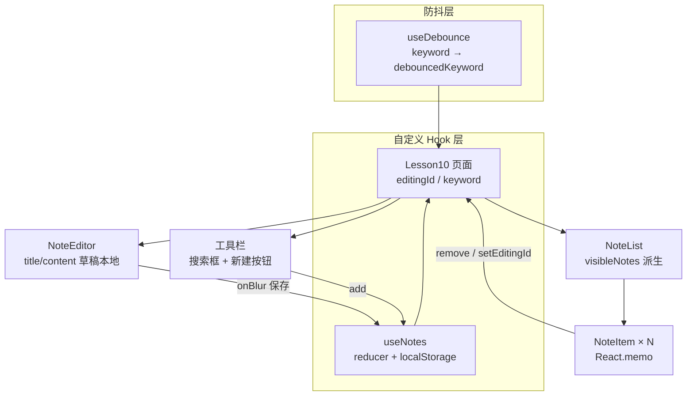
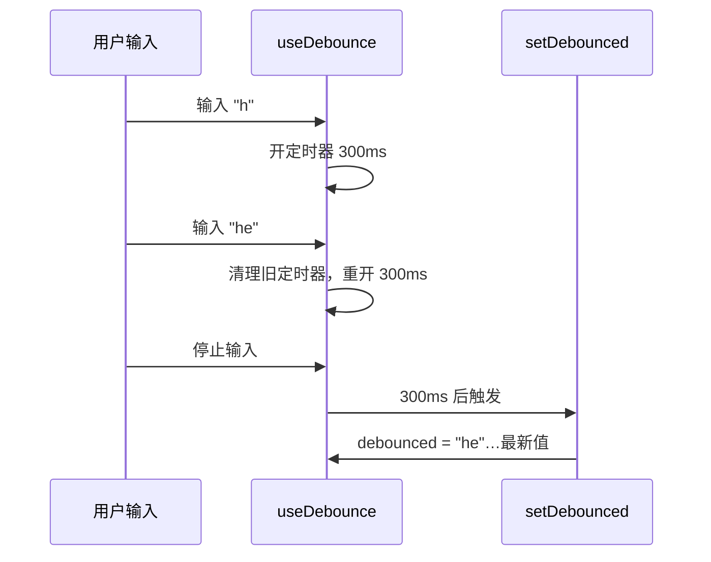

# 第 10 课 · 综合实战：学习笔记应用

## 学习目标

完成本课后，你应该能够：

1. 把一个"模糊的功能需求"拆成组件树和状态清单，决定每个状态放在哪一层；
2. 用 useReducer 管理一组同构数据（新增/修改/删除），写出符合不可变规则的 reducer；
3. 把 reducer + localStorage 打包成一个自定义 hook，让组件一行代码获得"持久化状态"；
4. 用 useEffect 的清理函数实现防抖，理解"定时器清理"这一通用模式；
5. 在真实页面里综合运用前九课：路由、props、受控表单、状态提升、React.memo。

## 核心概念

### 状态放在哪：自上而下的判断法

> **一句话记住：** 谁用谁改决定 state 放哪：单组件留本地，多组件提到公共父组件，算出来的不进 state。

拿到需求先列状态，再问三个问题：

- 谁渲染它？（只一个组件 → 留在本地）
- 谁修改它？谁依赖它？（多个兄弟组件共享 → 提升到最近公共父组件）
- 它是"算出来的"吗？（是 → 别进 state，渲染时直接算）

本应用的状态清单：

| 状态 | 放哪 | 理由 |
|---|---|---|
| 笔记集合 `notes` | 自定义 hook `useNotes`（内部 useReducer） | 多组件共享 + 需要持久化 |
| 正在编辑的 id `editingId` | `Lesson10` 页面级 | NoteList 高亮、NoteEditor 编辑、新建按钮都要用 |
| 输入框草稿 `title/content` | `NoteEditor` 本地 | 只有编辑器关心 |
| 搜索词 `keyword` | `Lesson10` 页面级 | 过滤在页面算，列表只收结果 |
| 防抖词 `debouncedKeyword` | `useDebounce` 返回值 | 派生 + 延迟生效，封装成 hook |
| 过滤后的列表 `visibleNotes` | 渲染时计算 | 派生数据不进 state |
| 字数统计 | 渲染时计算 | 同上 |

**图：学习笔记应用的组件树与数据流**



### reducer：把"怎么改"集中管理

> **一句话记住：** 一组数据的增删改方式固定时，全部收进 reducer，写法不可变。

一组数据的增删改方式固定为几种时，useReducer 比 useState 更清晰——所有"怎么改"集中在一处，组件只发意图。

```js
// 不可变三连：新增用展开、修改用 map、删除用 filter
case ADD_NOTE:   return [action.note, ...notes]
case UPDATE_NOTE: return notes.map(n => n.id === action.id ? { ...n, ...patch } : n)
case REMOVE_NOTE: return notes.filter(n => n.id !== action.id)
```

### 自定义 hook：一段可复用的状态逻辑

> **一句话记住：** 自定义 hook 是逻辑打包机：组件拿走"意图"（add/update/remove），不用知道机制。

组件经常需要一段"状态 + 副作用"的组合逻辑，又不想在每个组件里抄一遍。自定义 hook（名字以 `use` 开头的函数，内部调用其他 hook）就是干这个的：

```js
function useNotes() {
  const [notes, dispatch] = useReducer(notesReducer, undefined, loadInitial)
  useEffect(() => { localStorage.setItem(KEY, JSON.stringify(notes)) }, [notes])
  return { notes, add, update, remove }
}
```

**组件不需要知道 action 的结构——hook 暴露的是"意图"（add/update/remove），不是"机制"（dispatch）。**

### 防抖：定时器清理的典型应用

> **一句话记住：** 值一变就 clearTimeout 上一个定时器，停够 300ms 才真正生效。

搜索框每敲一个键就过滤一次太浪费——我们希望"停止输入后一段时间才行动"。防抖（debounce：每次新输入都重置计时器）正是靠第 2 课的清理函数实现的：

```js
function useDebounce(value, delay) {
  const [debounced, setDebounced] = useState(value)
  useEffect(() => {
    const timer = setTimeout(() => setDebounced(value), delay)
    return () => clearTimeout(timer) // 值一变，取消上一个还没触发的定时器
  }, [value, delay])
  return debounced
}
```

连续输入时前一个定时器总被清理，只有停止输入满 300ms 才真正更新——第 2 课"清理函数"的直接复用。

**图：防抖的时序——每次输入取消上一次定时器**



## 代码导读

### `src/components/lesson10/notesReducer.js` —— 状态转移的"规则手册"

- 三条 action type 用大写常量导出，组件/hook 不手写字符串；
- 每个 case 都是纯函数式、不可变更新：新增用展开放到最前、修改用 map 只替换目标项、删除用 filter；
- `default` 分支抛错：拼错 type 时能立刻暴露，而不是静默无效。

### `src/components/lesson10/useNotes.js` —— reducer + 持久化的打包

- `useReducer(notesReducer, undefined, loadInitial)`：第三个参数是**惰性初始化函数**，只在首次挂载调用一次，读 localStorage（IO）不进渲染体；
- 读取发生在初始化，写入发生在 effect（依赖 `[notes]`）——**"加载不是 effect、保存才是"这个方向别搞反**；
- 返回值是 `add/update/remove` 三个意图明确的方法，`Date.now()` 当 id 的细节被封装在里面。

### `src/components/lesson10/NoteList.jsx` —— 列表 + memo

- 列表项单独抽成 `NoteItem` 组件并包 `React.memo`：父组件因输入搜索词频繁重渲染时，props 不变的项直接跳过；
- memo 生效的前提是回调引用稳定——本页传的是 `setEditingId`（稳定）和包含 page 级状态提升后稳定的回调；
- 空态提示写在列表里，但"为什么空"（本来没数据 / 搜索无结果）由父组件区分。

### `src/components/lesson10/NoteEditor.jsx` —— 受控表单 + 失焦保存

- 标题、内容都是受控组件，草稿留本地；切换编辑对象时父组件用 `key={editingNote.id}` 强制重建组件，state 自然重置，不需要 useEffect 同步 props；
- **保存时机选择了"失焦保存"而非独立保存按钮**：笔记应用的心智模型是"随时在写"，失焦落盘最不容易丢内容，也天然覆盖"点别的笔记 → 先保存再切换"的场景；代价是可能多余 dispatch，所以 onBlur 里做了"内容没变就不派发"的短路；
- 字数统计是派生数据，渲染时直接 `(title + content).length`，不进 state。

### `src/pages/Lesson10.jsx` —— 编排层

- 页面级持有 `editingId` 和 `keyword`；过滤用防抖后的 `debouncedKeyword`，输入框体验（立即回显）和计算成本（300ms 才过滤）分离；
- `editingNote` 从**全量** notes 里找，不是从过滤后的列表找——搜索时编辑中的项可能被过滤掉，但不能因此丢编辑态；
- `useDebounce` 就写在本页文件里，按本课要求自包含、不跨课引用。

### 路由与布局（父代理集成，此处仅说明）

- 本页组件 `Lesson10` 由 `main.jsx` 的路由表挂在 `/lesson/10`，导航入口由 `Home.jsx` 目录提供——这正是第 3 课的路由实践。

## 动手试一试

1. **给编辑器加"未保存改动"提示**：在 NoteEditor 里比较草稿和 `note` 的存档值， dirty 时在编辑器标题旁显示一个小圆点。提示：这又是一个派生数据，别建 state。
2. **把防抖改成"可取消的搜索"**：搜索框旁边加一个 × 按钮，点击立即清空 keyword 并且列表马上恢复全量。提示：清空后 `useDebounce` 的下一次 effect 会跑，想想 300ms 延迟能不能也绕过。
3. **加"按更新时间排序"**：给笔记加 `updatedAt` 字段，每次 update 顺手改它，列表按它倒序。提示：排序放 reducer 还是渲染时 `.sort()`？注意 `.sort()` 会改原数组，想想怎么排序才不可变。

## 易错点

1. **effect 里读 localStorage 来"加载"**：现象是数据闪烁或被初始值覆盖。原因：读存储应该是惰性初始化（`useReducer`/`useState` 的函数参数），写成 effect 会先渲染默认值再"补"数据，方向反了。
2. **传内联箭头函数给 memo 组件**：现象是 memo 完全不生效，输入搜索词时全部列表项重渲染。原因：每次渲染都创建新函数引用，props 浅比较必然不等。回调要么是稳定的 setState，要么用 `useCallback` 包。
3. **reducer 里 push / 直接改字段**：现象是数据" sometimes 变了 sometimes 没变"、React.memo 失灵、StrictMode 下结果重复。原因：Mutation 让 React 拿到的还是同一个引用，可能跳过重渲染；StrictMode 双调用会把副作用做两遍。
4. **编辑态从过滤后的列表里找**：现象是搜索期间正在编辑的笔记编辑器消失。原因：`visibleNotes.find(...)` 找不到被过滤掉的项；要从全量 notes 里找。
5. **防抖后忘记清理定时器**：现象是路由切走后控制台警告更新已卸载组件，或输入停了值才"迟到"更新。原因：没在清理函数里 `clearTimeout`，卸载后定时器仍然触发 setState。
6. **用 note.title 之类不稳定的东西当 key**（如标题、下标）：现象是编辑/删除/过滤组合操作时列表串行。原因：key 必须是稳定唯一的 id，标题会变、下标会移位。

## 自测题

1. 为什么"从 localStorage 加载"不写在 useEffect 里，而"写入 localStorage"要写？如果把两个方向都写成 effect 会出什么问题？
2. `useDebounce` 里如果忘记 `return () => clearTimeout(timer)`，连续快速输入"hello"（5 个键）会触发几次 `setDebounced`？结果是什么？
3. NoteEditor 里切换笔记时，草稿 state 是怎么被重置的？为什么不用 `useEffect(() => setTitle(note.title), [note.id])`？
4. 如果把 NoteList 的回调改成 `onDelete={(id) => remove(id)}` 内联写在 JSX 里，`React.memo` 会发生什么？怎么修复？
5. 删除"正在编辑的笔记"时，页面做了两件事（remove + setEditingId(null)）。如果只做第一件，会看到什么？

### 参考答案

1. 加载是"初始值"问题，属于渲染前的输入，用惰性初始化函数在首帧就拿到正确数据；写成 effect 会先渲染默认/空数据，再触发二次渲染，出现闪烁，且依赖写错可能反复读存储。写入是"数据变了就同步到外部世界"的副作用，effect 依赖 `[notes]` 正合适。两个都写成 effect 的话，读的那个还容易把刚写入的数据又读回来形成无意义循环。
2. 仍然 5 次（每个 setTimeout 都照常触发，只是各延迟 300ms 且顺序执行），debounced 值一路从 'h' → 'he' → … → 'hello' 逐字更新，防抖完全失效，只是慢 300ms。
3. 父组件给 `<NoteEditor key={editingNote.id}>`，id 变化时 React 卸载旧组件、挂载新组件，useState 用新 note 重新初始化。用 effect 同步 props 是第 2 课说的反模式：多一轮渲染、多一份要维护的"同步逻辑"，而且首个 effect 前的一帧里显示的还是旧笔记的草稿。
4. 每次渲染 `onDelete` 都是新函数引用，`NoteItem` 的 props 浅比较失败，memo 对它失效，列表项全部重渲染。修复：包 `useCallback`（依赖 remove/setEditingId），或像本课一样把删除逻辑放页面里以稳定引用传入。
5. 不会白屏：`editingNote` 会变成 null（find 找不到），编辑器区域退回"未选中"空态提示——这正是"找不到时兜底"起的作用。但 `editingId` 还残留着已删除笔记的 id，状态不干净；清掉它（setEditingId(null)）让两处状态一致，才是干净的做法。

## 知识点回扣表

| 功能 | 对应课次 | 对应概念 | 本项目代码位置 |
|---|---|---|---|
| 页面本身挂在 `/lesson/10` | 第 3 课 | react-router 路由表、页面导航 | `main.jsx`（集成）、`src/pages/Lesson10.jsx` |
| 工具栏 / 列表 / 编辑器拆成独立组件 | 第 1、5 课 | 组件拆分、props 传递与回调 | `NoteList.jsx`、`NoteEditor.jsx` |
| 标题 + 内容输入框、新建与搜索输入 | 第 1、4 课 | 事件处理、受控表单 | `NoteEditor.jsx`、`Lesson10.jsx` 工具栏 |
| 刷新页面数据不丢 | 第 2、4 课 | useEffect + localStorage 持久化 | `useNotes.js` 的写 effect |
| `editingId` 由 NoteList/NoteEditor/新建按钮共享 | 第 5 课 | 状态提升到最近公共父组件 | `Lesson10.jsx` 的 `editingId` |
| 笔记的新增 / 修改 / 删除 | 第 7 课 | useReducer、纯函数、不可变更新 | `notesReducer.js` |
| `useNotes` 一行获得持久化笔记集合 | 第 8 课 | 自定义 hook、惰性初始化 | `useNotes.js` |
| 搜索过滤 300ms 延迟生效 | 第 2 课（清理函数）| 防抖：setTimeout + clearTimeout | `Lesson10.jsx` 的 `useDebounce` |
| 输入搜索词时列表项不全量重渲染 | 第 9 课 | React.memo + 稳定 props | `NoteList.jsx` 的 `NoteItem` |
| 空列表 / 搜索无结果 / 未选中笔记的提示 | 第 1 课 | 条件渲染、空态设计 | `NoteList.jsx`、`Lesson10.jsx` |
| 字数统计随输入实时变化 | 第 2 课 | 派生数据不进 state | `NoteEditor.jsx` 的 `charCount` |

## 下一课预告

十课旅程到这就完整了：从第一个组件到一个真正的应用。接下来可以自己动手，把这套笔记应用加上多标签、拖拽排序，或者接一个真实的后端 API——你已经有全部的砖块了。
