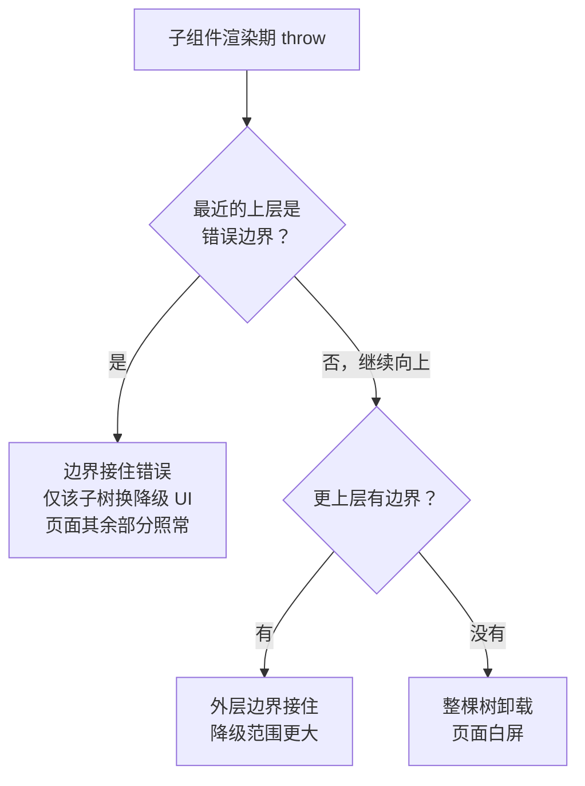
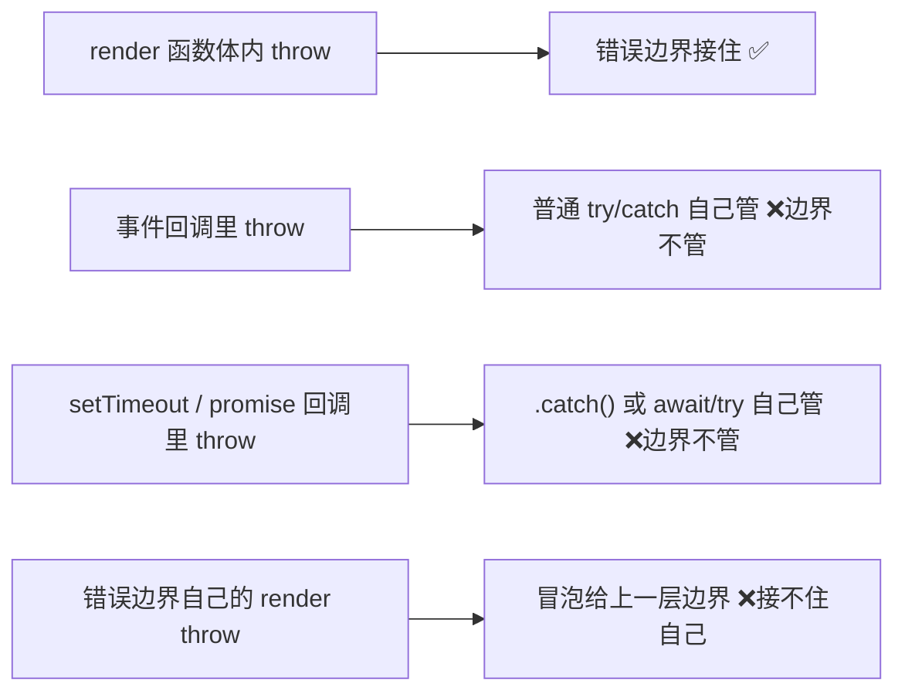

# 第 13 课 · 错误边界（Error Boundary）

## 学习目标

完成本课后，你应该能够：

1. 说清楚"一个组件渲染崩溃，默认会白掉整棵树"的原因，以及错误边界为什么是"子树的 try/catch"；
2. 手写一个 class 版 `ErrorBoundary`，分清 `getDerivedStateFromError`（切 UI）和 `componentDidCatch`（打日志）的分工；
3. 知道错误边界的捕获范围：只接**渲染期**错误，事件回调、异步 promise、它自己的 render 都接不住；
4. 用"重置"（fallback 内按钮 / `resetKeys`）让崩溃的子树恢复，理解"恢复 = 重挂整棵子树，state 归零"；
5. 建立"边界划在哪，崩的范围就到哪"的直觉，并养成在最外层放兜底边界的习惯。

本课对应的示例代码：

- `src/components/lesson13/ErrorBoundary.jsx` —— 错误边界本体（class 组件 + resetKeys）
- `src/components/lesson13/BuggyCounter.jsx` —— 人造故障源：渲染期 throw 的计数器
- 页面入口在 `src/pages/Lesson13.jsx`（三层演示：无边界 / 有边界 / 嵌套边界）
- 页面专属样式在 `src/pages/lesson13.css`

## 核心概念

### 为什么一个组件崩了，整页都白

> **一句话记住：** 渲染是一个组件崩、整棵树卸——没有边界接住，用户看到的就是白屏。

React 渲染是一棵树从上到下"算 JSX"。渲染过程中某个组件 `throw` 时，这一轮渲染整体失败。

React 无法"跳过"出错的组件继续画它旁边的内容。于是**把整棵树卸载**，页面上什么都不剩。用户看到的就是白屏，控制台只剩一条红色报错。

这不是 bug，是设计：React 不知道你想怎么"部分失败"，所以把决定权交给一个专门的机制——错误边界。

### 错误边界：子树的 try/catch

> **一句话记住：** 错误边界是包在子树外面的 try/catch——里面渲染崩了，只降级这一小块，别处照常。

错误边界是一个 class 组件，实现了下面两个生命周期之一（或两者都实现）：

```jsx
class ErrorBoundary extends Component {
  state = { hasError: false, error: null }

  // 渲染期调用：接住子树的错误，返回值并入 state → 切换降级 UI
  static getDerivedStateFromError(error) {
    return { hasError: true, error }
  }

  // 提交期调用：副作用位置 → 打日志、上报监控
  componentDidCatch(error, info) {
    console.error(error, info.componentStack)
  }

  render() {
    if (this.state.hasError) return <p>这片区域出错了</p>
    return this.props.children
  }
}
```

它的用法像一个包住子树的 `try/catch`：

```jsx
<ErrorBoundary fallback={<p>炸了</p>}>
  <BuggyCounter />
</ErrorBoundary>
```

子树在渲染期抛错时，React 逆着组件树向上找**最近的**错误边界。它包住的那一小片被替换成降级 UI，边界外的东西完全不受影响。

**图：渲染期错误的冒泡与捕获**



### class 的最后一座堡垒

> **一句话记住：** 错误边界是 Hooks 时代最后必须写 class 的场景——切 UI 归 getDerivedStateFromError，打日志归 componentDidCatch。

React 19 + Hooks 时代，几乎一切都能用函数组件表达。错误边界是仅剩的"必须写 class"的常见场景：`getDerivedStateFromError` / `componentDidCatch` 没有对应的 Hooks 等价物。

写它时记住两个钩子的分工铁律：

| 钩子 | 调用时机 | 该做什么 | 不该做什么 |
|---|---|---|---|
| `static getDerivedStateFromError` | 渲染期 | 返回新的 state，切换降级 UI | 做副作用（打日志、发请求） |
| `componentDidCatch` | 提交期 | 打日志、上报 | `setState` 来切 UI（切 UI 是上一个钩子的事） |

这个分工和第 2 课的"渲染要纯、副作用进 useEffect"是同一条原则在 class 世界的投影。

### 捕获范围：边界不是万能 try/catch

> **一句话记住：** 边界只接渲染期错误——事件回调、异步 promise、它自己，都不归它管。

为什么要专门划清范围？因为很多人把边界当成万能保险，出了任何错都指望它接住——结果调试时发现"边界毫无反应"。**只接渲染期错误**，以下三种都接不住（现象：抛了错，边界毫无反应，甚至整页照常白掉）：

1. **事件回调**：`onClick` 里 `throw`，与渲染无关，用普通 `try/catch` 自己管；
2. **异步回调 / promise**：`setTimeout`、`fetch().then()` 里抛的错发生在渲染之外，边界接不到，要 `.catch()` 或 `try/await` 处理（第 2 课的请求错误就是这么管的）；
3. **错误边界自己**：边界自身的 `render` 抛错，它接不住自己，错误会冒泡给上一层边界。所以错误要尽量不在边界组件里发生。

另外它也不处理服务端渲染的错误，也不接 React 内部错误之外的语法错误（如事件处理器里的 `undefined.foo`）。

由此得出工程铁律：**错误该在根上修，边界只是兜底**。后端可能返回 `null` 就先判空，数组可能不是数组就先 `Array.isArray`。边界不是用来掩盖这些的，它只是"我漏防的那一下，别白掉整页"的保险丝。

**图：哪些错误归边界管，哪些要自己管**



### 恢复：重置 = 重挂子树

> **一句话记住：** 重置不是修复错误，是把崩掉的子树整个卸下来重新挂一遍——state 归零，如同刚打开页面。

错误被接住后，出错的子树被整体卸载，fallback 顶替。想让用户继续用，有两条路：

- **fallback 里给重置入口**：边界把 `reset` 函数通过 fallback 传出去，点按钮清掉 `hasError`，children 重新挂载（state 全部归零，如同刚打开页面）。
- **`resetKeys`**：外部传入一组值，边界在 `componentDidUpdate` 里检测它变化就自动重置。适合"切换了数据源 / 换了 tab，旧错误不该再显示"的场景。

本课 `ErrorBoundary.jsx` 两种都实现了：`fallback` 支持传函数 `({ error, reset }) => ...`，`resetKeys` 在 `componentDidUpdate` 里比对。

### 崩的范围 = 边界划定的范围

> **一句话记住：** 错误总是被最近的边界接住——边界划在哪，崩的范围就到哪。

边界可以嵌套。错误总是被**距离最近的**边界接住；内层边界接住后，外层完全无感。

反过来，内层不存在（或内层自己也在渲染期炸了），错误继续冒泡到外层。这个性质决定了放置策略：

- **细粒度**：每个独立功能区（一张卡片、一个面板）包一层，坏一块只降级一块；
- **兜底**：应用最外层再包一层，保证任何漏网的渲染期错误也不会白掉整页。

## 代码导读

### `src/components/lesson13/ErrorBoundary.jsx` —— 边界本体

- `constructor` 里初始化 `{ hasError, error }`；`hasError` 是"是否降级"的开关。
- `static getDerivedStateFromError(error)`：返回 `{ hasError: true, error }`，只负责切 UI。
- `componentDidCatch`：只负责 `console.error`，并把 `info.componentStack`（出错组件的调用栈）一并打出来——排查"哪个组件炸了"的第一工具。真实项目里这里是上报监控的位置。
- `fallback` 双形态：传 React 节点 → 直接渲染；传函数 → 以 `({ error, reset })` 调用，让降级 UI 能拿到错误信息和重置函数。
- `reset`：手动重置，清掉 `hasError` 和 `error`（**两个都要清**，只清 `hasError` 会让 fallback 读到旧错误）。重置后 children 重新挂载，BuggyCounter 的 count 回到 0。
- `componentDidUpdate` 里的 `resetKeys` 比对：长度或任一元素（`Object.is`）变化且当前处于降级态 → 自动重置。注意只在 `hasError` 时比对，避免无谓的渲染开销。

### `src/components/lesson13/BuggyCounter.jsx` —— 人造故障源

- `count` 超过 3 时，在 **render 函数体内** `throw new Error(...)`——注意 throw 写在渲染过程中，这是错误边界能接住它的前提；如果 throw 写在 onClick 里，边界不会理你（见"捕获范围"）。
- "归零"按钮只在没炸时有用——炸了以后这棵子树已经被卸载，重挂后 count 自然回到 0。恢复靠边界的"重置本区域"。

### `src/pages/Lesson13.jsx` —— 三层演示

- **最外层兜底边界**：`<ErrorBoundary fallback={FullPageCrash}>` 包住整个页面。它是安全网，也是 ① 区演示的"观众席"。
- **① 区（无边界）**：BuggyCounter 与兜底边界之间没有任何中间边界。引爆后错误冒泡到兜底边界，整页演示区（三个区 + 心跳计时）全部被 fallback 替换——这是"全页崩"的受控版。页面里的注释和 fallback 文案都明确告诉你：真实项目没有这个兜底边界时，效果是**彻底白屏**。
- **② 区（有边界）**：边界只包这一张卡片的内部。引爆后只有这张卡片变成 fallback，页面顶部的"心跳计时"一秒都没停——直观证明"只卸载边界包住的子树"。
- **③ 区（嵌套边界）**：外层边界包住整组，内层边界包单个格子，另有开关控制内层是否渲染。开着引爆：内层接住，外层无感；关掉引爆：错误直接冒泡，外层接盘、整组降级。外层还挂了 `resetKeys={[innerGuard]}`，切换开关即自动恢复，演示第二种重置方式。
- **`Heartbeat` 组件**：每秒 +1 的计时器，放在所有演示区旁边。崩溃波及多大，看它停没停就知道。
- **复习区卡片**：把"✅ 能接 / ❌ 不接"清单直接放在页面上。

### `src/pages/lesson13.css`

`crash-screen`（伪装全页白屏的兜底降级页）与 `fallback-card`（虚线橙框的降级卡片）。复用 App.css 的 `.card / .row / .big-number / .hint`，课程专属样式不进公共文件。

## 动手试一试

1. **给边界加"错误上报"**：在 `componentDidCatch` 里把错误信息存进一个模块级数组，页面角落放一个"故障记录"小面板展示条数。提示：上报是副作用，正好体会 componentDidCatch 与 getDerivedStateFromError 的分工；注意面板自身最好也处在边界保护之外或之内，想想放哪更稳。
2. **做一个"异步错误"对照区**：写一个按钮，onClick 里 `setTimeout(() => { throw new Error('异步炸了') }, 1000)`，观察边界是否有任何反应；再给按钮套上 `try/catch` 和 `Promise.reject` 的处理，体会"渲染期错误归边界，异步错误归自己"。
3. **把兜底边界搬进路由层**：把 `<ErrorBoundary>` 包到路由出口外面（可以在动手练习里另建文件，不影响本课文件），再引爆 ① 区，观察降级范围的变化。提示：边界包得越靠外，降级范围越大——权衡"隔离粒度"和"导航栏是否还活着"。

## 易错点

1. **以为边界能接事件回调 / 异步错误**：现象是 onClick 或 setTimeout 里抛错，页面行为和没边界一样（甚至整页白掉）。原因：边界只接**渲染期**错误；异步错误要自己 `try/catch` / `.catch()`。
2. **两个钩子写反**：在 `getDerivedStateFromError` 里发请求上报（副作用进了渲染期），或在 `componentDidCatch` 里 setState 切降级 UI。前者会在 StrictMode 下执行多次，后者没必要——切 UI 是 `getDerivedStateFromError` 的职责。
3. **重置时只清 `hasError` 不清 `error`**：现象是恢复后某个位置闪现上一次的错误信息。原因：`error` 还留在 state 里被 fallback 或日志读到。
4. **边界包得太粗**：把整个页面（含导航、侧边栏）包进一个边界，一处小卡片崩溃 → 整页降级，用户连"回家"的导航都没了。对策：细粒度分区包一层 + 最外层兜底一层。
5. **以为重置能"修好"错误**：点"重置本区域"后 count 归零看似恢复了，再点满 4 次照样炸。原因：边界只是把故障隔离、把子树重挂，**错误本身要在根上修**（本课是故意 throw，真实项目是判空/校验）。

## 自测题

1. 组件渲染时 `throw`，React 默认会做什么？为什么不能"跳过"这个组件继续渲染它旁边的兄弟节点？
2. `getDerivedStateFromError` 和 `componentDidCatch` 的调用时机和职责分别是什么？为什么上报日志要放在后者？
3. 以下错误哪些会被错误边界接住：① render 里 `undefined.map()`；② onClick 里 `throw`；③ `fetch().then()` 回调里 `throw`；④ 错误边界自己的 render 里 `throw`。
4. 点击"重置本区域"后，BuggyCounter 的 count 是多少？为什么？`resetKeys` 和 fallback 里的 reset 按钮各适合什么场景？
5. 为什么说"错误该在根上修，边界只是兜底"？如果后端接口可能返回 `null`，正确做法是什么？

### 参考答案

1. 整轮渲染失败，React 把整棵树卸载，用户看到白屏（控制台有报错）。因为渲染是一棵树的整体计算，React 无法得知"部分失败"应该长什么样，所以把决定权交给错误边界：没人接，就整树卸载。
2. `getDerivedStateFromError` 在渲染期调用，返回值并入 state，负责切换降级 UI；`componentDidCatch` 在提交期调用，负责打日志/上报。上报是副作用，放渲染期钩子会在 StrictMode 下执行多次且违反"渲染要纯"的原则；而 class 的渲染期钩子不允许副作用，所以归 `componentDidCatch`。
3. 只有 ① 会被接住。② 事件回调、③ 异步回调都发生在渲染之外，要用 `try/catch` / `.catch()` 自己处理；④ 边界接不住自己，错误会冒泡给上一层边界。
4. count 是 0。因为接住错误时子树被整体卸载，重置只是重新挂载 children，state 全部归零，如同刚打开页面。fallback 内的 reset 适合"用户自己点一下重试"；`resetKeys` 适合"外部状态变了（换了数据源/tab），旧错误自动失效"的场景。
5. 边界只隔离故障、不修复故障：重置后同样的坏数据再来一次照样崩。接口可能返回 `null` 就在数据使用处判空/校验（`users?.map ?? []`），让错误根本不发生；边界兜的是"没防住的那一下"，保证不白掉整页。

## 下一课预告

第 14 课：代码分割与懒加载——让首屏只下载当前页面需要的代码。
