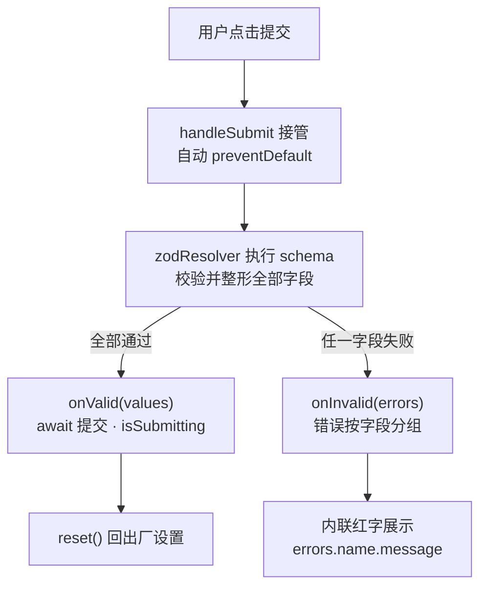
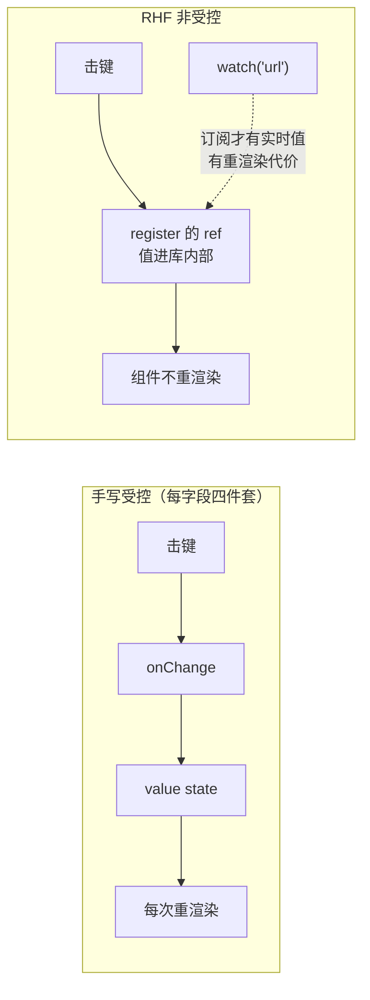

# 第 17 课 · react-hook-form + zod 表单方案

## 学习目标

完成本课后，你应该能够：

1. 说清楚受控表单的"样板"到底从哪来：每个字段一套 value + onChange + error state，字段一多就线性爆炸；
2. 会用 `useForm` + `{...register('字段')}` 收集表单值，理解"非受控注册"的原理（ref 收集、提交时一次性读值、输入不重渲染）；
3. 会把全部校验规则集中写进一个 zod schema（中文错误消息写在规则旁边），用 `zodResolver` 接进 RHF，说出"规则只有一处"带来的好处；
4. 掌握 `handleSubmit(onValid, onInvalid)` 双回调分流、每个字段错误的内联展示、`isSubmitting` 提交态；
5. 会用 `defaultValues` 与 `reset()`（无参/带参）管理表单的出厂设置与重置，会用 `watch` 做一个字段的实时预览，并知道它的重渲染代价。

本课对应的示例代码：

- `src/components/lesson17/schema.js` —— zod schema：全部规则 + 中文消息集中一处，`zodResolver` 接线
- `src/components/lesson17/ControlledFormEcho.jsx` —— 第 1 课 TodoList 风格的纯手写受控表单（4 字段全展开的对照版）
- `src/components/lesson17/ResourceForm.jsx` —— RHF + zod 的标准姿势：register / handleSubmit / watch / reset / isSubmitting
- 页面入口在 `src/pages/Lesson17.jsx`（同一张表单、两套写法，上下对照）

## 核心概念

### 样板从哪来：受控表单的"每字段四件套"

> **一句话记住：** 受控表单每个字段要配 value、onChange、error、清错四件套——字段翻倍，样板也翻倍。

为什么先看受控写法？因为不亲手体验一次"样板爆炸"，你不知道 RHF 到底替你省了什么。第 1 课的 TodoList 只有一个输入框，手写毫无压力：一个 `draft` state、一个 `onChange`、提交时 `trim` 一下判空。

但把这套写法放大到本课的 4 个字段（见 `ControlledFormEcho.jsx`），清单就变成了：

- 4 个**值 state**（`name / url / category / note`）；
- 4 个**错误 state**（`nameError / urlError / ...`，和值靠命名约定配对）;
- 4 份 **onChange**（每份还要顺手清掉自己字段的旧错误）；
- 一个**手写 validate()**：逐字段 if/else，规则、消息全在里面，还要记得"没错时清旧错误"；
- 提交时 `preventDefault`、成功后逐字段手动清空。

规则、中文消息、展示位置三样东西散落在组件各处，全靠人肉对齐。字段翻倍，这份清单也翻倍——这就是"样板爆炸"。

### RHF 的答案：register 收集，submit 时一次性校验

> **一句话记住：** register 是"非受控注册"——输入框自己管自己，RHF 只在提交时一次性伸手拿值。

react-hook-form 的核心思路和受控组件相反：**输入框自己管自己，RHF 只在需要的时刻伸手拿值**。

```jsx
const { register, handleSubmit } = useForm({ resolver: zodResolver(schema) })
<input {...register('name')} />
```

`register('name')` 返回 `{ name, onChange, onBlur, ref }`，展开到 `<input>` 上之后：

- `ref` 是 RHF 摸到真实 DOM 的唯一通道——**铁律：必须 `{...register('name')}` 展开**，少展开一个字段就收不到它的值；
- 输入过程中组件**不重渲染**（值存在 RHF 内部，不进 state）——这正是它比受控写法"轻"的原因；
- 代价也随之而来：想在某处实时看到值，就得用 `watch` 主动订阅（见下文）。

校验时机默认是**提交时**（`mode: 'onSubmit'`）。用户打字打到一半不会被打扰，点提交才一次性校验全部字段。

### zod schema：规则集中一处，zodResolver 接线

> **一句话记住：** 规则和中文错误消息写进一份纯 JS 的 schema——只有一处真相，组件里零校验代码。

手写版的规则散在 validate() 里；库版把全部规则搬进 `schema.js`，规则和它的中文错误消息写在同一行：

```js
name: z.string().trim().min(1, '名称必填').min(2, '名称至少 2 个字符').max(20, '名称最多 20 个字符'),
url: z.url({ message: '请输入合法的 URL（记得带上 https://）' }),
category: z.enum(['高优先级', '工具', '教程', '文章'], { message: '请选择一个分类' }),
note: z.string().max(50, '备注最多 50 字').optional(),
```

三个值得注意的细节：

- **链式规则按书写顺序执行**：`.trim()` 在前，长度检查的就是去空格后的长度；两条 `min` 先"必填"后"长度"，空表单看到的是"名称必填"而不是莫名其妙的长度报错；
- **schema 是纯 JS**：不依赖 React，单元测试、TypeScript 类型推导、将来的后端校验都能 import 同一份规则；
- **schema 还负责整形**：提交时 `onValid` 拿到的 `values.name` 已经是 `trim` 过的版本——"校验"和"清洗"是一件事。

`zodResolver(schema)` 是两个库之间的接线盒。RHF 在提交时把整份表单值交给它，拿到 `{ values, errors }` 后决定走 `onValid` 还是 `onInvalid`。

### handleSubmit 的双回调分流

> **一句话记住：** 通过 schema 走 onValid，任一字段失败走 onInvalid——组件里一行判断都不剩。

为什么需要分流？手写版提交后要先 validate()、再 if 判断有没有错、再手动走两条路。`handleSubmit` 把这套判断收编成两个回调：

```jsx
<form onSubmit={handleSubmit(onValid, onInvalid)}>
```

- `onValid(values)`：**只有全部字段通过 schema 才会被调**，参数是解析整形后的数据；它可以是 async 函数，await 期间 RHF 自动把 `formState.isSubmitting` 置为 true（本课用它做了"提交中…"按钮禁用）；
- `onInvalid(errors)`：**任一字段失败就整体走这里**，参数是按字段分好组的 errors 对象。

对比手写版"提交 → validate() → if 判断有没有错"的三步，库把"通过与否"直接分流到两个回调，组件里一行判断都不剩。`handleSubmit` 内部自己会 `preventDefault`，也不用再手写。

**图：提交时一次校验的双回调分流**



每个字段的错误内联展示只剩三行固定句式：

```jsx
{errors.name && <p className="lesson17-error">{errors.name.message}</p>}
```

消息本身来自 schema，组件只负责"有错就展示"。

### defaultValues 与 reset：表单的"出厂设置"

> **一句话记住：** defaultValues 定出厂设置，reset 一句话整表复位——不用逐字段手动 setXxx('')。

表单需要两个"回到起点"的动作：初始化的默认值、提交成功后的清空。`useForm({ defaultValues })` 定下表单的初始值（本课的 `EMPTY_DEFAULTS` 全空）；`reset()` 有两种用法：

- **`reset()` 无参**：回到 `defaultValues`，同时清空 errors、复位 isSubmitting——本课在提交成功后调用它；
- **`reset(对象)` 带参**：把表单带到给定值——本课的"填充示例"按钮用 `reset(SAMPLE)` 一键填好整张表。

手写版里"成功后清空"是 4 行 `setName('') ...`。字段再多两倍，就是 12 行，而且漏一行就漏一个字段。

### watch：把一个字段拉回受控世界（预览 + 代价）

> **一句话记住：** watch 是"实时看到输入"的唯一途径，但每次击键都重渲染——只 watch 真正要展示的字段。

`const previewUrl = watch('url')` 订阅 url 字段的实时值。这是 RHF 里"实时看到输入"的唯一途径，也因此**每次击键都会重渲染组件**——watch 一个字段是小代价，watch 整张表单（`watch()` 无参）就等于放弃了非受控的性能优势。原则：**只 watch 真正要展示的字段**。

另外注意语义差别：`watch` 拿到的是输入框此刻的**原文**，没经过 schema 校验——本课的预览链接把半截网址也照样渲染（点了打不开没关系），**预览要宽容，提交才严格**。

### 与手写方案对比

> **一句话记住：** 库收编了收集、校验、分组、分流、重置五件体力活；代价是多一层抽象——小表单手写依然合理。

| | 第 1/5 课手写受控 | 本课 RHF + zod |
|---|---|---|
| 字段值 | 每字段一个 useState，输入即重渲染 | register 非受控收集，输入不重渲染 |
| 校验规则 | validate() 里逐字段 if/else，规则散落 | schema.js 集中声明，规则与消息同源 |
| 错误管理 | 每字段一个 error state + 手动清旧错 | errors 对象自动分组，reset 自动清空 |
| 提交流程 | preventDefault + if 判断 + 手动分流 | handleSubmit(onValid, onInvalid) 双回调 |
| 重置/默认值 | 逐字段手动 set，漏一个错一个 | defaultValues + reset() 一句话 |
| 代码量（4 字段） | 约 100 行组件 + 全部规则在组件里 | 约 60 行组件 + 30 行纯 JS schema |

**库解决了什么**：把"收集、校验、错误分组、提交分流、重置"这五件每个表单都要重做一遍的体力活收编成声明式配置；规则从组件里搬进纯 JS 的 schema，获得了可测试、可共享（类型推导、后端）的额外红利。

**代价是什么**：多一层抽象。具体贵在三处：

- register 的 ref 机制、formState 的 Proxy 订阅、resolver 接口——出了问题要翻库文档，而不是盯着自己的代码；
- 两个库的依赖体积；
- "输入不重渲染"这个特性本身，要求你理解 watch 的取舍，否则会在"为什么界面上这个值不更新"上栽跟头。

**字段只有一两个、规则一眼看完时，手写受控依然是合理选择——别为了用库而用库。**

**图：两套方案的数据通路对比**



## 代码导读

### `src/components/lesson17/schema.js` —— 全部规则的一份合同

- `resourceSchema`：4 个字段。`name` 两条 min 演示"顺序即语义"（先必填后长度）；`url` 用 zod v4 的顶层格式校验 `z.url({ message })`；`category` 枚举拒绝空串，逼用户真正选择；`note` 用 `.optional()` 声明可空；
- `CATEGORY_OPTIONS` 直接从 `resourceSchema.shape.category.options` 里"抽"出来——下拉选项和校验枚举永远同源，不会出现"能选但过不了校验"的漂移；
- `EMPTY_DEFAULTS` 是表单的出厂设置；`resourceResolver = zodResolver(resourceSchema)` 是接进 RHF 的接线盒，导出后组件里一行校验都不用写。

### `src/components/lesson17/ControlledFormEcho.jsx` —— 样板的现场感

- 故意一个库都不用：9 个 useState（4 值 + 4 错误 + 1 结果）、一个四段式 if/else 的 `validate()`、每份 onChange 里塞一句"顺手清错误"、成功后 4 行手动清空；
- `isParseableUrl()` 手搓 URL 校验（try/catch 包 `new URL`）——库版里这就是 `z.url()` 一行；
- 校验规则和错误消息写在一起，但和 JSX 里的展示位置隔着十万八千里——这就是"规则散落"的现场感；
- 底部的 `.hint` 把这份清单念了一遍，方便和 ResourceForm 逐项对照。

### `src/components/lesson17/ResourceForm.jsx` —— 库方案的标准姿势

- `useForm` 只解构需要的四样：`register` / `handleSubmit` / `watch` / `reset`，以及 `formState` 里的 `errors` 和 `isSubmitting`。formState 是个 Proxy：读到哪个属性就订阅哪个属性，**别一把梭展开整个 formState**；
- `resolver: resourceResolver` + `defaultValues: EMPTY_DEFAULTS`，组件里零校验代码；
- 四个字段统一 `{...register(字段)}` + 内联错误三行句式；select 的选项来自 `CATEGORY_OPTIONS`（schema 同源）；
- `watch('url')` 做实时预览盒：有值就渲染成可点链接，没值给提示；
- `handleSubmit(onValid, onInvalid)`：onValid 里 `await fakeNetwork()` 模拟 600ms 网络往返，让 `isSubmitting` 有戏可演（按钮禁用 + "提交中…"），然后展示 values、`reset()` 回出厂设置；onInvalid 把出错字段名拼成一句话展示——这就是第二个参数的存在感；
- 两个辅助按钮显式 `type="button"`：form 里的 button 不写 type 默认是 submit，点了会把表单顺手提交一遍。

### `src/pages/Lesson17.jsx` —— 对照实验的实验台

- 页面零逻辑，只负责编排：先手写版、后库版、再一张"两套方案怎么选"的选型卡片；
- 和第 11 课同一设计思路：**页面负责编排，能力下沉到组件/模块**。

## 动手试一试

1. **给 schema 加一条 refine 联合校验**：备注里写了"急"字时，分类必须选"高优先级"。提示：跨字段的规则要挂在**对象级**而不是字段级——`resourceSchema.refine((data) => ..., { message: '备注里有"急"，分类必须选"高优先级"', path: ['category'] })`。想想为什么 path 给 `'category'`（错误红字应该出现在哪个字段下面）；再想想 refine 写在 `.optional()` 链上和写在对象上有什么区别。
2. **把第 10 课的笔记编辑器改写成 RHF 版**：`src/components/lesson10/NoteEditor.jsx` 的 title/content 两个受控输入框是天然的练习材料。提示：保存时机是失焦（onBlur）——可以给输入框挂 `onBlur={handleSubmit(save)}`；"实时字数统计"怎么办？只有两条路：watch（有重渲染代价）或保持受控。做完对比一下：RHF 版省了哪些代码，又引入了什么新决策。
3. **体验校验时机 mode**：给 `useForm` 加 `mode: 'onBlur'` 或 `mode: 'onChange'`，感受错误红字出现的时机变化；再想想"提交前不打扰、提交后立刻跟进"（`reValidateMode`）默认行为为什么对大多数表单最友好。

## 易错点

1. **register 忘了展开**：现象是提交"成功"但数据里少一块，或某个字段永远是 `undefined`。原因：`register('name')` 只是个返回对象的调用，不展开（`{...}`）就没有 onChange 和 ref 落到 DOM 上，RHF 既听不到输入也摸不到输入框。
2. **form 里的辅助按钮没写 `type="button"`**：现象是点"重置/填充示例"，表单被顺手提交了一遍。原因：HTML 规定 form 里 button 的默认 type 是 `submit`。凡是 form 内不负责提交的按钮，一律显式 `type="button"`。
3. **到处用 watch**：现象是打字每敲一键整个组件重渲染，字段多的大表单明显变卡。原因：watch 会订阅字段值变化，把非受控字段"拉回"受控世界。原则：只 watch 真正要展示的字段；`watch()` 无参订阅全表单是大忌。
4. **校验规则双写**：现象是明明 input 上写了 `maxLength={20}`，提交却报另一套错；或 schema 改了、register 的 rules 忘改，两个地方互相打架。原因：规则存在两处必然漂移。原则：规则只写 schema.js 一处，register 一律裸 `{...register(字段)}`。
5. **以为错误会随输入实时消失/出现**：现象是打字改正了内容，红字却不动；或者期待"输入时就开始报错"却毫无反应。原因：默认校验时机是提交时（`mode: 'onSubmit'`），提交前 errors 不更新。想改时机用 `mode`/`reValidateMode`（见动手试一试 3），但要意识到代价——输入即校验会一边打字一边报红。

## 自测题

1. `{...register('name')}` 展开到 `<input>` 上的到底是什么？为什么 RHF 输入时组件不重渲染，而第 1 课的受控写法每敲一键都重渲染？
2. `handleSubmit(onValid, onInvalid)` 两个回调各在什么时候被调用？`errors.name.message` 里那句中文是哪一步、由谁产生的？
3. 为什么把校验规则写进 zod schema，而不是写在 register 的 rules 参数里？至少说出两条好处和一条代价。
4. `reset()` 和 `reset(SAMPLE)` 分别把表单带到哪里？errors 会不会残留？

### 参考答案

1. 展开的是 `{ name, onChange, onBlur, ref }`：name 便于读值，onChange/onBlur 让 RHF 知道字段何时被动过，ref 是 RHF 摸到真实 DOM、提交时读值的通道。RHF 的值存在库内部（不在 React state 里），输入只改库内部的数据、不触发 setState，所以不重渲染；受控写法的 value 来自 useState，输入必须 setState 才能更新输入框，所以每键一渲染。
2. 全部字段通过 schema 时调 onValid（参数是解析整形后的 values）；任一字段失败时整体调 onInvalid（参数是按字段分组的 errors）。中文消息是**提交那一刻** zod 执行 schema 校验产生的：规则和消息都声明在 schema.js 里，zodResolver 把失败结果翻译成 RHF 的 errors 结构，组件里只负责展示。
3. 好处一：单一事实来源——规则、消息、整形（trim）集中一处，不会和 JSX/register 里的第二份规则漂移；好处二：schema 是纯 JS，单元测试、TypeScript 类型推导、后端校验都能复用同一份；好处三：组件变纯编排，读表单先读合同再读 UI。代价：多两个依赖和一层抽象（resolver 接口、ref 机制），小表单上纯属杀鸡用牛刀，排查问题要翻库文档。
4. `reset()` 无参：回到 `defaultValues`（本课的 `EMPTY_DEFAULTS`），errors 清空、isSubmitting 复位；`reset(SAMPLE)`：把表单带到给定对象 `SAMPLE` 的值，同样清空 errors。都不会残留——reset 是"整张表单的状态复位"，这也是手写版逐字段 setXxx('') 永远做不到的干净。

## 下一课预告

第 18 课：表单是"一张页面里的状态"，整张应用的状态怎么办——用 zustand 管理全局状态，并和第 6 课的 Context 方案做一次正面对比。
