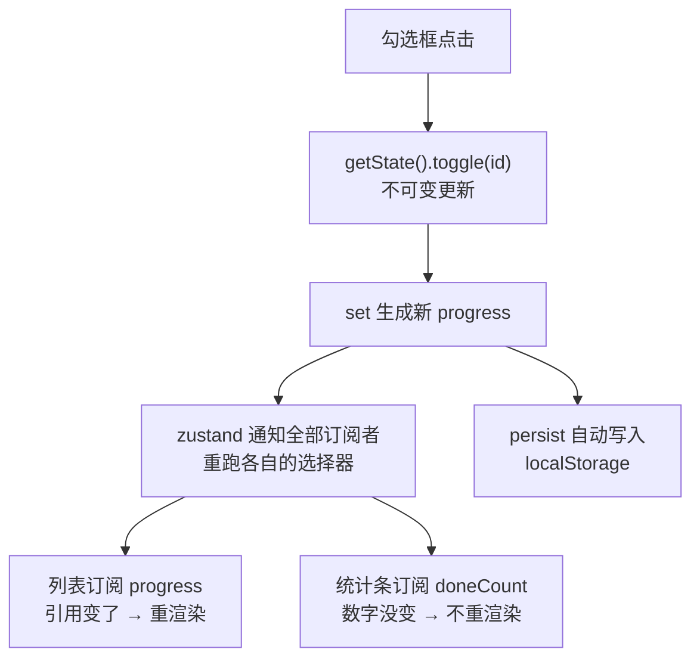
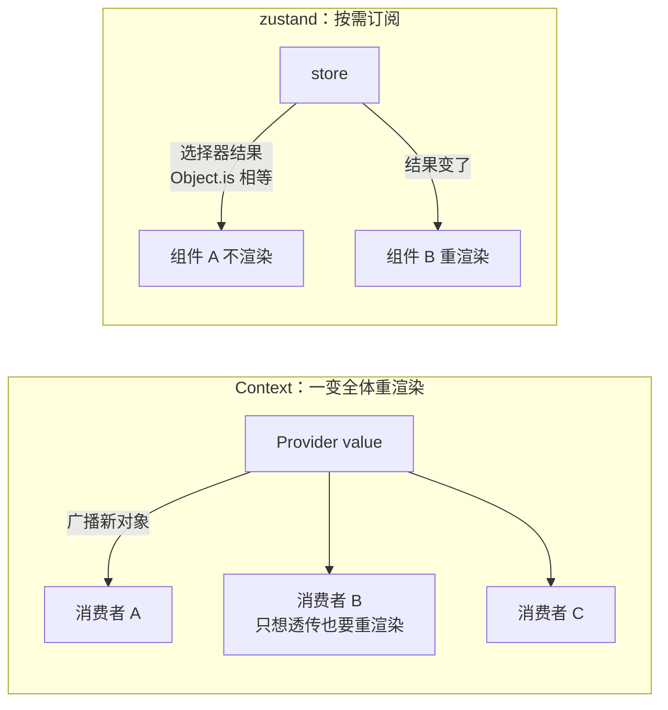

# 第 18 课 · Zustand 状态管理

## 学习目标

完成本课后，你应该能够：

1. 说清楚 Context 和状态管理库的分工：**Context 的本职是依赖注入（把值送到后代手里），不是状态管理**——它不管持久化、不管按需订阅；
2. 会用 zustand 的 `create()` 造一个不需要 Provider 的全局 store，并按"不可变更新"的套路写 actions（`toggle / markAll / reset`）；
3. 会用**选择器**订阅 store 的一小块，理解"选择器结果没变就不重渲染"是 zustand 比 Context 省渲染的根本原因；
4. 会用 `persist` 中间件一行配置把 store 存进 localStorage，并实测"勾选 → 刷新 → 进度还在"；
5. 记住最重要的一条使用铁律：**大多数局部状态仍然用 useState，状态库是为真正全局的少量状态服务的**。

本课对应的示例代码：

- `src/components/lesson18/progressStore.js` —— zustand store：15 课进度 `lessonId → { done, note }` + persist
- `src/components/lesson18/ProgressList.jsx` —— 勾选进度列表 + 统计条（只订阅 doneCount）+ 重置按钮
- `src/components/lesson18/StoreEcho.jsx` —— props 钻透 / Context / zustand 三方案最小对照
- 页面入口在 `src/pages/Lesson18.jsx`

## 核心概念

### Context 是"广播频道"，不是"仓库"

> **一句话记住：** Context 只负责把值送到后代手里（依赖注入）；状态管理、按需订阅、持久化都不归它管。

第 6 课我们用 Context 把主题从顶层送到了三层之下，中间层彻底隐身。但要分清两件事：

| | Context 擅长的 | Context 不擅长的 |
|---|---|---|
| 本质 | **依赖注入**：后代不用 import 数据的来源，只要在 Provider 范围内就能拿到 | **状态管理**：state 存哪、怎么改、谁能订阅、要不要持久化，全得你自己管 |
| 订阅粒度 | `value` 一变，**所有**消费者都重渲染（value 每次渲染都是新对象） | —— |
| 持久化 | 自己写 `useEffect` + `localStorage` | —— |

所以"要不要上状态库"的判断标准不是"跨层传值"——跨层传值 Context 干得很好。真正的信号是：这块状态**多个互不相干的组件要读写、还要持久化**（比如本课的"15 课学习进度"）。这时 Context 会让每个读它的组件都跟着每次更新重渲染，持久化还得手写——该换库了。

### zustand：import 即用的全局 store

> **一句话记住：** create() 一造好 store 就存在于模块里，没有 Provider——任何组件 import 即用。

先感受一下它和 Context 最大的用法差异：store 没有"势力范围"的概念，不需要包 Provider。

```js
const useStore = create((set, get) => ({
  count: 0,
  inc: () => set((s) => ({ count: s.count + 1 })),
}))

// 任何组件，不用包 Provider：
const count = useStore((s) => s.count)   // 选择器：只订阅 count
useStore.getState().inc()                // 组件外/事件回调里也能改
```

三件和 React 习惯高度一致的事：

- **不可变更新同样是铁律**：zustand 靠 `Object.is` 比较选择器结果来决定要不要重渲染。`progress[id].done = true` 这种原地改法它看不见——必须造新对象、新外层对象（第 1 课的套路原样搬过来）；
- `set` 默认**浅合并**：`set({ progress: 新对象 })` 不会覆盖掉 actions（`setState` 是整体替换，这点不一样）；传函数"根据旧值算新值"的习惯则完全一样；
- actions 就是 store 里的普通函数，`useStore.getState().toggle(id)` 在事件回调里直接调用，不需要 dispatch、不需要 reducer。

### 选择器：zustand 省渲染的阀门

> **一句话记住：** 每个订阅者重跑一遍选择器，结果没变（Object.is 相等）就不重渲染——按需订阅的阀门。

为什么 zustand 比 Context 省渲染？答案全在选择器（selector）上。

```js
const doneCount = useStore(selectDoneCount) // (s) => 统计完成的数量
```

store 任何地方变了，zustand 会把**每个订阅者的选择器重新跑一遍**：结果 `Object.is` 相等 → 不重渲染。于是：

- 勾选列表订阅整个 `progress`（它本来就要渲染每一课，合理）；
- 统计条只订阅 `doneCount` 这个数字——某课的 `note` 变了、`progress` 换了新引用，只要数字没变，统计条纹丝不动。

对比 Context：`value` 是每次渲染新建的对象，消费者没有"挑一块"的能力——一变全体重渲染。这是两者性能差异的根源。用法提示：选择器在模块顶层定义成具名函数再导出（本课的 `selectDoneCount`），比组件里写内联箭头函数更稳定、可测试。

**图：一次勾选在 zustand 里的数据流**



### persist：一行配置的持久化

> **一句话记住：** persist 中间件一行配置——改动自动写 localStorage，挂载自动读回。

手写持久化要在 Provider 里写 effect、序列化、容错；persist 把这些活全包了。

```js
create(persist((set, get) => ({ ... }), { name: 'lesson18-progress' }))
```

中间件包在配置函数外面，`name` 是 localStorage 的键。改动一发生就自动写入，挂载时自动读回——第 6 课的 Context 版想持久化，得自己在 Provider 里写 `useEffect` + 序列化 + 容错，这些活 persist 全包了。**注意**：persist 存的是 JSON，所以 state 里只能放可序列化的东西，actions 必须放在 create 外层配置里（zustand 会自动剥离，但别养成把函数塞进 state 的习惯）。

**图：Context 广播 vs 选择器订阅**



## 与手写方案对比

| 需求 | 手写方案（前面课程） | 本课的库 | 库解决了什么 | 代价 |
|---|---|---|---|---|
| 跨层传值 | 第 6 课 Context：`createContext` + Provider + `useContext` 三步走，还得包对位置 | `import` store 直接用，无 Provider | 免掉"包谁谁收听"的结构成本，组件树更扁平 | 引入依赖；store 与组件树解耦后，初学者少了"数据从哪来"的可视线索 |
| 订阅粒度 | Context：`value` 一变全体消费者重渲染；想优化得自己拆多个 context 或 memo | 选择器订阅，结果不变不渲染 | 把"按需订阅"从手工优化变成默认行为 | 选择器返回**新对象**时要 `useShallow`，否则每次比较都不等（易错点 4） |
| 持久化 | 第 6 课若要持久化：自己 `useEffect` 写 localStorage + JSON 序列化 + 容错 | `persist` 中间件一行配置 | 序列化、读写时机、版本迁移全包了 | 多一个 localStorage 键要管理；存的东西必须是可序列化的 |
| 更新逻辑 | 第 1 课 `setState` + 不可变更新，逻辑散在组件里 | actions 集中在 store，`getState()` 任何地方可调 | 更新逻辑有唯一归宿，跨组件复用不用提升状态 | 状态放错地方（局部状态进 store）会造成全局污染 |

一句话总结：Context 解决的是"值怎么送到后代手里"（依赖注入），zustand 解决的是"状态放在哪、谁能改、谁订阅、怎么存"（状态管理）。两者不是替代关系——第 6 课的换肤场景用 Context 依然是对的，因为主题是"配置注入"，不是"需要 persist 和精细订阅的共享状态"。

## 代码导读

### `src/components/lesson18/progressStore.js` —— store 本体

- `LESSON_IDS`：模块常量 1–15；`emptyProgress()` 用 `Object.fromEntries` 生成 Map 状对象 `lessonId → { done: false, note: '' }`，`markAll`/`reset` 都靠它重建——**一次性替换比逐条改干净**；
- `toggle(id)`：`set((state) => ({ progress: { ...state.progress, [id]: { ...旧条目, done: 翻转 } } }))`——外层新对象 + 条目新对象，两层都不可变，注释里专门警告了"原地改内层属性 zustand 看不见"这个坑；
- `markAll()`：保留每课已有 `note`、只把 `done` 置真——展示"读旧 state 算新 state"的典型写法（用了 `get()`）；`reset()`：一行回初始态；
- `persist(..., { name: 'lesson18-progress' })`：持久化就这一行，注释说明它写读 localStorage 的时机；
- 导出 `selectDoneCount` 选择器：统计条专用，"只订阅一个数字"的范本。

### `src/components/lesson18/ProgressList.jsx` —— 同一 store 的两个消费者

- `ProgressSummary`：`useProgressStore(selectDoneCount)`——只订阅数字，注释点明"progress 引用变了但数字没变 → 不重渲染"；渲染 `已完成 x / 15` 统计条；
- `ProgressRow`：`useProgressStore((s) => s.progress[id])`——每行只订阅自己那一小条，别的课变化时这一行不重渲染。旁边的注释专门对比了一个易错写法：`useProgressStore()` 不传选择器拿到的是**整个 state**（`{ progress, toggle, markAll, reset }`），拿它当 progress 用会 `progress[id]` 取到 `undefined`——这是初学 zustand 最常见的翻车点；
- 勾选调用 `useProgressStore.getState().toggle(id)`——事件回调里用 `getState()` 直接改 store，不需要先 `useStore()` 拿 actions，也不产生额外订阅；
- `AllDoneButtons`：全部完成 / 重置两个按钮。要点：`ProgressSummary`、`ProgressRow`、`AllDoneButtons` 三个组件**没有 props 相连、没有共同 Provider**，却通过同一个 store 完全同步——这就是"跨组件状态"的最小样板。

### `src/components/lesson18/StoreEcho.jsx` —— 三方案对照

- 方案 A（props 钻透）：`PropsLayer1 → PropsLayer2 → PropsLayer3` 手递手传 `echoText`，中间层被迫认识数据——第 1–5 课的老办法；
- 方案 B（Context）：第 6 课原样三步走，但注释把两个代价写死在代码里：`value` 新对象 → 全体消费者重渲染（连只透传 children 的 `ContextLayer2` 也要跑）；持久化要自己加 effect；
- 方案 C（zustand）：`StoreLayer3` 直接 `useProgressStore(selectDoneCount)`，`StoreLayer2` 连 import 都没有、天然零重渲染；
- `PropsDrillDemo` 里的输入框是**反例示范**：这棵子树的局部状态用 `useState` 就够了，绝不该进 store——呼应本课铁律。

### `src/pages/Lesson18.jsx` —— 页面编排

只做两件事：把 `ProgressList` 和 `StoreEcho` 摆在一起 + import 本课 css。对照第 6 课的 `Lesson6.jsx`（必须先包 `<ThemeProvider>`），本页**没有任何 Provider**——用法差异第一眼可见。

## 动手试一试

1. **给 store 加 `setCurrentLesson(id)`**：新增 state 字段 `currentLessonId`（初始 1），action 把它设为传入的 id；在 `ProgressList` 顶部加一行"当前学到第 N 课"，点击某课时把它设为当前课。提示：persist 会自动带上新字段；想一想 `currentLessonId` 变化时，勾选列表该不该重渲染（用选择器订阅它试试）。
2. **感受选择器粒度**：`ProgressRow` 已经是 `useProgressStore((s) => s.progress[id])`。做实验验证粒度：在 `ProgressRow` 和 `ProgressSummary` 里各加一行 `console.log('render')`，然后勾某一课——观察只有被勾的那一行和统计条重渲染，其余 14 行纹丝不动；再把选择器换回 `useProgressStore()`（整个 state），看 15 行是否全部重渲染。
3. **用选择器把重渲染压到极限**：给统计条换一个更狠的写法——选择器只返回 `doneCount` 已经做到了；再加一个只订阅"全部是否完成"的布尔选择器，控制"全部完成"按钮的禁用态。提示：`(s) => selectDoneCount(s) === 15`，布尔值的 `Object.is` 比较最便宜。

## 易错点

1. **原地修改 store 里的对象，界面不动**：现象是 `progress[id].done = true` 后勾选框没变化。原因：zustand 靠 `Object.is` 比较选择器结果，你改的是同一份对象的内层属性，引用没变，它认为"什么都没发生"。必须造新对象 + 新外层对象（第 1 课的不可变更新在这里同样是铁律）。
2. **组件外调用 action 时解构了 actions**：现象是回调里 `const { toggle } = useStore()` 放在模块顶层，`toggle` 是 `undefined` 或闭包过期。原因：`useStore()` 是 hook，只能在组件里调用；组件外/事件回调里用 `useStore.getState().toggle(id)`。
3. **把局部状态塞进 store**：现象是输入框每敲一个字，全页相关组件都重渲染，store 里堆满只有单个组件用的字段。原因：混淆了"全局状态"和"局部状态"。铁律：表单草稿、hover 开关这类只属于一棵子树的状态，留在 `useState`；store 只收真正全局的少量状态。
4. **选择器返回新对象导致永远重渲染**：现象是 `useStore((s) => ({ done: s.a, count: s.b }))` 后组件疯狂重渲染。原因：选择器每次返回新对象，`Object.is` 永远不等。解法：要么返回原始值/已有引用，要么用 `useShallow` 做浅比较。
5. **以为 zustand 需要 Provider**：现象是照第 6 课习惯包了一层不存在的 `<StoreProvider>` 报错。原因：zustand 的 store 在 `create()` 调用时已存在于模块作用域，没有"势力范围"概念——import 即用，这是它和 Context 最大的用法差异。

## 自测题

1. "Context 的价值是依赖注入不是状态管理"——这句话里的"状态管理"具体指 Context 缺了哪几件事？
2. `useStore(selectDoneCount)` 里，store 别处变了，zustand 凭什么决定统计条要不要重渲染？如果把选择器写成每次返回新对象会怎样？
3. `ProgressList` 里的 `ProgressSummary` 和 `AllDoneButtons` 没有共同的 props 或 Provider，勾一课时为什么两个组件能同步更新？
4. `toggle` 为什么必须写两层展开（`...state.progress` 和 `...state.progress[id]`）？只展开外层行不行？

### 参考答案

1. 缺了三件事：①按需订阅——`value` 一变全体消费者重渲染，没有"只挑一块"的能力；②持久化——想存 localStorage 得自己写 effect 和序列化；③更新逻辑的归宿——state 的修改逻辑散在组件里，没有 actions 这个集中管理层。它只负责把值送到后代手里。
2. zustand 把每个订阅者的选择器重新跑一遍，用 `Object.is` 比较这次和上次的结果：相等就不重渲染。写成每次返回新对象的选择器，比较永远不等，组件每次 store 变化都重渲染，选择器的"省渲染阀门"完全失效；需要返回多字段时用 `useShallow`。
3. 因为两者都订阅了同一个模块级 store（ zustand 在 `create()` 时就把 store 造好了，不存在 Provider 的势力范围）。勾选触发 `toggle` → store 更新 → 两个组件各自的选择器重跑 → `doneCount` 变了，统计条重渲染。同步靠"共享 store"而不是"共享祖先"。
4. `toggle` 要改的是树状结构最深处的 `done`：外层展开让 `progress` 有新引用（zustand 才看得到变化），内层展开让被改的那一条是新对象（旧条目不被污染、依赖旧条目引用的组件能正确比较）。只展开外层等于原地改内层属性——引用没变的脏对象，zustand 看不见，界面不动。

## 下一课预告

第 19 课：React 19 的新特性——Actions、`use`、优化过的表单体验，看看 React 官方把哪些"以前要手写"的活收编成了内置能力。
