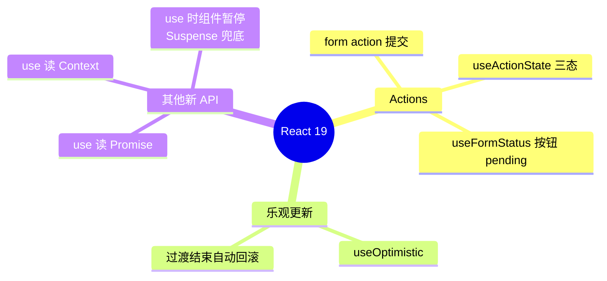
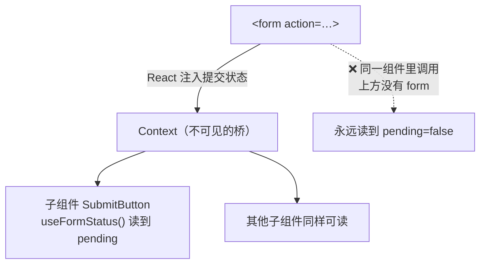
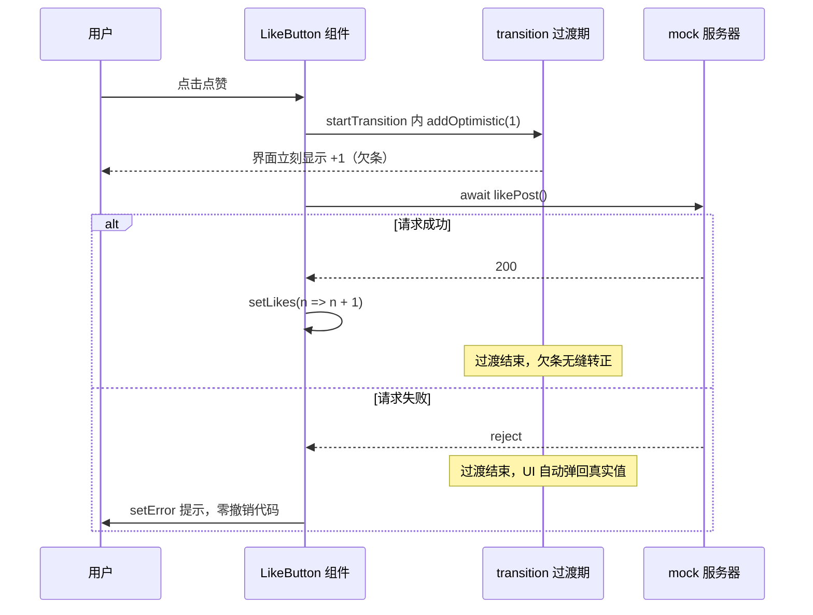

# 第 19 课 · React 19 新特性：Actions 与乐观更新

## 学习目标

完成本课后，你应该能够：

1. 说清 React 19 的核心转向：**表单提交 = 异步 action 成为一等公民**，`<form action={fn}>` 取代手写 `onSubmit + preventDefault`；
2. 会用 `useActionState` 接管提交的 **pending / error / success 三态**，理解 `(prevState, formData) => newState` 的签名与"返回值即 state"的设计；
3. 会用 `useFormStatus` 让提交按钮显示"提交中…"，并解释为什么它必须写在表单的**子组件**里；
4. 会用 `useOptimistic` 实现**乐观更新**：UI 先呈现预期结果，失败时**自动回滚**、一行撤销代码都不用写；
5. 知道 `use()` API 的两种读法（读 Promise / 读 Context）以及它和普通 Hook 的区别。

本课对应的示例代码：

- `src/components/lesson19/mockApi.js` —— 异步点赞/评论 mock：800ms 延迟 + fail 开关
- `src/components/lesson19/LikeButton.jsx` —— useOptimistic 乐观点赞 + 失败自动回滚
- `src/components/lesson19/CommentForm.jsx` —— useActionState 表单提交 + useFormStatus 按钮
- `src/pages/Lesson19.jsx` —— 页面编排 + 全局"模拟失败"开关 + use() 附带演示

## 核心概念

### 从"提交事件"到"提交 Action"

> **一句话记住：** `<form action={fn}>` 让"提交"从事件回调升级为框架调度的一等公民——pending、不重载页面全由框架管。

前 18 课里，表单提交永远长这样（第 1、5 课）：

```js
function handleSubmit(e) {
  e.preventDefault()          // ① 手动拦住浏览器默认行为（页面刷新）
  setSubmitting(true)         // ② 手写 pending 态
  api().then(...).catch(...)  // ③ 手写成功/失败分支
    .finally(() => setSubmitting(false))
}
```

React 19 把这套样板收编为语言级设施：`<form action={formAction}>`。action 是一个**异步函数**，React 负责"提交期间不丢输入、自动暴露 pending 状态、天然不重载页面"。

这不是语法糖——它让"提交"从事件回调升级为**可以被框架调度的一等公民**（服务端组件、表单重置、多表单协调都建立在它上面）。

**图：React 19 新特性分组概览**



### useActionState：三态打包

> **一句话记住：** action 的返回值就是下一次渲染的 state——pending、error、success 三态一次打包拿走。

提交表单要管三件事：pending 提示、错误信息、成功反馈。以前要手写三个 state，现在一个 Hook 全包。

```js
const [state, formAction, isPending] = useActionState(async (prev, formData) => {
  // 校验 → 请求 → 返回新的 state
  return { error: null, success: '已保存' }
}, { error: null, success: null })
```

三个返回值对应你以前手写的三样东西：

| useActionState | React 19 之前的手写等价物 |
|---|---|
| `state` | 自己声明的 `error` / `success` state + 各处 setState |
| `formAction` | `onSubmit={handleSubmit}` + `preventDefault()` |
| `isPending` | 自己声明的 `submitting` state + try/finally 管理 |

关键设计：**action 的返回值就是下一次渲染的 state**，而且第一个参数 `prev` 是上一次的 state——错误提示能天然累积，不用你合并。表单字段用 `formData.get('name')` 取，输入框不必再受控（对比第 17 课 react-hook-form 也是走"非受控 + 统一取值"这条路，方向一致）。

### useFormStatus：按钮自己知道"提交中"

> **一句话记住：** 它读的是最近祖先 form 注入的提交状态——必须写在表单的子组件里，否则永远 pending=false。

为什么按钮不能直接用父组件的 `isPending`？可以传，但要一层层往下传。`useFormStatus` 让按钮自给自足：

```jsx
function SubmitButton() {
  const { pending } = useFormStatus()
  return <button type="submit" disabled={pending}>{pending ? '提交中…' : '发表'}</button>
}
```

它读的是**最近的祖先 `<form>`** 通过 Context 注入的提交状态。所以铁律：**必须写在表单的子组件里**——直接写在 `<form>` 所在的同一个组件里，上方没有 form，永远读到 `pending = false`，按钮永远不会禁用。这也是官方推荐的拆法：把按钮抽出去，按钮自给自足，父组件不用把 `isPending` 一层层传下来。

**图：useFormStatus 的作用范围**




### useOptimistic：先打欠条，失败自动回滚

> **一句话记住：** 乐观值是真实值的临时投影，活在一次 transition 里——过渡结束自动回滚，失败时撤销代码一行都不用写。

点赞、加购物车、发弹幕——这些操作如果等服务器回来再更新 UI，会"迟钝"。乐观更新是：**先呈现预期结果，后台确认；成功坐实，失败回滚**。

React 19 之前（第 11 课的思路）要手写：展示值和真实值两份 state、请求失败时在 catch 里手动还原——漏一处就出现"界面显示已点赞，刷新后点赞没了"的灵异现象。

```js
const [realLikes, setLikes] = useState(128)          // 真实值：只有服务器确认才改
const [shown, addOptimistic, isPending] = useOptimistic(realLikes, (cur) => cur + 1)

startTransition(async () => {
  addOptimistic(1)          // ① 打欠条：UI 立刻 +1
  try {
    await likePost()        // ② 后台确认
    setLikes((n) => n + 1)  // ③ 成功：真实值 +1，欠条无缝转正
  } catch (e) {
    setError(e.message)     // ④ 失败：什么都不用撤销！
  }
})
```

回滚为什么"自动"？因为**乐观值只是真实值的一次临时投影**，它的寿命被限定在一次 transition 内——transition 结束（await 落定），UI 一律回到真实值。失败时真实值没动过，UI 自然弹回原状。

三个使用铁律：

1. `addOptimistic` 必须包在 `startTransition`（或 form action）里，否则没有"过渡结束"这个回滚时机；
2. 更新函数必须是**纯函数**（不能 setState、不能发请求）；
3. 成功路径**必须真的 setState 更新真实值**，否则乐观值一消失，操作就白做了。

**图：乐观点赞的时序——欠条、确认与回滚**




### 附：use() API 一行带过

> **一句话记住：** use() 不是真正的 Hook——能在 if 里调用，读 Promise 未完成时组件暂停，交给 Suspense 兜底。

```js
const message = use(myPromise)   // 读 Promise：未完成时组件暂停渲染，交给外层 <Suspense>
const theme = use(ThemeContext)  // 读 Context：等价 useContext，但可以在 if 里调用
```

`use()` 与普通 Hook 最大的区别：**可以在条件语句和循环里调用**（它不是真正的 Hook）。本课页面里的 `Greeting` 组件用一行 `use(greetingPromise)` 读取了一个 Promise 的结果。

## 代码导读

### `src/components/lesson19/mockApi.js` —— mock 接口

- `likePost(fail)` / `postComment(text, fail)`：统一 800ms 延迟（`NETWORK_DELAY`），长到能看清"乐观值先上、确认后落定"的两段过程；
- 失败 reject **普通 Error**（模拟 HTTP 500），不带取消标记——本课只关心成功/失败两条路，不涉及 AbortController（那是第 11 课读数据的课题）；
- `postComment` 成功后返回服务器"盖章"的评论对象（id、createdAt 由"服务器"生成）——真实系统里这些字段不该前端自己造；
- fail 开关从页面传入：失败路径要**主动演练**，这是第 11 课建立的测试习惯。

### `src/components/lesson19/LikeButton.jsx` —— 乐观点赞

- 两份值的分工：`likes`（useState，真实值，只有服务器确认才 +1）与 `optimisticLikes`（useOptimistic 投影，只活在 transition 里）；
- 更新函数 `(current) => current + 1` 是纯函数；`isPending` 为 true 时数字加半透明闪烁动画（lesson19.css），直观提示"这是待确认的欠条"；
- `handleClick` 全程在 `startTransition(async ...)` 里，顺序就是上面的 ①→④；失败分支只 setError，**没有一行撤销代码**；
- 成功后 `setLikes(n => n + 1)`：真实值追上乐观值，界面无跳变——这是乐观更新体验的最后一环。

### `src/components/lesson19/CommentForm.jsx` —— action 提交表单

- `<form action={formAction}>`：不是 onSubmit，没有 preventDefault；文本框是非受控的，action 里 `formData.get('text')` 取值；
- `submitComment(prevState, formData)` 定义在组件内，闭包读到父组件的 fail 开关；空评论走校验分支返回 `{ error: '评论不能为空' }`，请求失败/成功各自返回对应 state——**三种结果全是 return，没有 setState**；
- `SubmitButton` 是独立子组件，内部 `useFormStatus()` 拿 `pending`：按钮禁用 + 文案切换全由它管，父组件连 `isPending` 都不用传（尽管 useActionState 也返回了它，用来禁用输入框）；
- 顶部注释特别标注：`useFormStatus` 从 **react-dom** 导入，不是 react——这是最高频的报错点。

### `src/pages/Lesson19.jsx` —— 编排与 use() 演示

- 页面级"模拟失败"开关一个 state 同时喂给点赞和评论两个演示，集中控制；
- `Greeting` 组件 + 外层 `<Suspense>` 演示 `use(promise)`：promise 已 resolve 所以直接出结果；若未 resolve，`use()` 会 suspend，由 Suspense 显示 fallback——这把第 12 课的 Suspense 和本课的 use() 串了起来。

### 样式

`src/pages/lesson19.css` 只补了三样 App.css 没有的：pending 闪烁动画、error/success 提示盒、use() 演示高亮。卡片、行布局全部复用 `.card` / `.row` / `.big-number` / `.hint`。

## 与手写方案对比

| 能力 | 手写方案（本课之前） | React 19 / 本课 |
|---|---|---|
| 提交拦截 | `onSubmit` + `preventDefault()`（第 1、5 课） | `<form action={formAction}>`，框架负责不重载、不丢输入 |
| pending 态 | 手写 `submitting` state + try/finally | `isPending` / `useFormStatus()`，框架管生命周期 |
| error / success | 手写两个 state + 各处 setState，还要自己清旧错 | action **return** 新 state，`prev` 参数天然支持累积合并 |
| 乐观更新 | 两份 state（展示值/真实值）+ catch 里手动回滚（第 11 课思路） | useOptimistic 投影，transition 结束自动回真实值，零撤销代码 |
| 逐字段受控 | 每个 input 一个 state + onChange（第 17 课交给 RHF 解决） | 非受控 + `formData.get()`，React 接管取值 |

**库/框架解决了什么**：三态样板和回滚逻辑从"每个表单复制一遍的人肉纪律"变成框架保证的不变量——手写版最常见的 bug（忘 finally 关 pending、忘 catch 回滚、错误提示不清理）在 React 19 里结构上不可能发生。

**代价是什么**：心智模型变了。

- `state` 是"上次 action 的返回值"，而不是"任意可 set 的盒子"——想在 action 外改它反而别扭。
- 乐观更新被绑死在 transition 语义里，多条并发乐观操作的合并策略要自己在纯函数里想清楚。
- `useFormStatus` 的子组件约束、`useActionState` 的 `(prev, formData)` 签名，都是必须记住的新规矩。

第 20 课的 TanStack Query 会给出另一个流派的答案（见下面练习 2）。

## 动手试一试

1. **给 CommentForm 加乐观评论**：用 `useOptimistic` 让新评论"提交瞬间就出现在列表里"，服务器确认后替换成带时间戳的正式版、失败自动消失。提示：需要把评论列表也交给 useOptimistic 投影（真实列表存 useState），action 里 return 的新 state 里带上 `comment` 字段（CommentForm 已经返回了它），追加动作要写进 transition。
2. **对照练习（不必真改）**：把 LikeButton 改写成 TanStack Query 的乐观更新版——`useMutation({ mutationFn: likePost, onMutate: 先取消相关 query 并缓存当前值, onError: 用回滚函数还原, onSettled: 失效重取 })`。感受两个流派的差异：React 19 是"UI 投影 + 框架回滚"，Query 是"手动快照 + 显式还原但带缓存失效"。想清楚：哪种在"列表页 + 详情页都要同步点赞数"时更省心？
3. **多按钮各报各的状态**：给评论卡片再加一个"删除"按钮（mock 加 `deleteComment`），用它自己的 `useActionState`，删除失败时各自的 error 提示互不覆盖。体会"一个 action 一份 state"的隔离原则。

## 易错点

1. **`useFormStatus` 写在表单同一组件里，按钮永远不禁用**：现象是 pending 期间按钮文案不变、可连点。原因：它靠最近的祖先 `<form>` 注入的 Context 取状态，同一组件里上方没有 form。解法：把按钮抽成子组件（本课 CommentForm 的写法）。另一个高频报错是从 `react` 导入它——正确来源是 `react-dom`。
2. **`addOptimistic` 没包在 transition 里**：现象是乐观值一闪而过或根本不显示。原因：乐观投影的寿命 = 一次 transition，没有 transition 就没有"投影生效"的窗口，也没有回滚时机。
3. **成功路径忘了 setState 更新真实值**：现象是点赞后 800ms，数字"弹回"原值——看起来像失败，接口其实成功了。原因：乐观值只是投影，transition 结束一律回落到真实值；真实值没 +1，界面就白点了。
4. **useOptimistic 的更新函数里写了副作用**：现象是请求重复发送、警告刷屏。原因：更新函数在每次渲染都可能被重放，必须是纯函数——只描述"乐观状态下显示什么"，网络请求永远放在 action/transition 里。
5. **还在用 `onSubmit` + `preventDefault` 套 useActionState**：现象是提交后页面刷新、state 全丢。原因：混用了两套机制——绑了 `action` 就不要再绑 `onSubmit`；传统受控组件写法（第 1 课）和 action 提交是两条路，不要缝合。

## 自测题

1. `useActionState` 的三个返回值分别取代了手写方案的哪三样东西？action 函数的签名和返回值各是什么约定？
2. 为什么 useOptimistic 的失败回滚"一行撤销代码都不用写"？乐观值的寿命由什么机制决定？
3. `useFormStatus` 为什么必须写在 `<form>` 的子组件里？直接写在父组件里会读到什么？
4. `use()` 和 `useContext` / 自定义 Hook 读数据相比，最核心的区别是什么？读一个未完成的 Promise 时组件会发生什么、谁来兜底？

### 参考答案

1. 分别取代手写的 error/success state（`state`）、onSubmit+preventDefault（`formAction`）、submitting state（`isPending`）。签名约定 `(prevState, formData)`：第一个参数是上次 action 的返回值，第二个是原生 FormData；返回值就是下一次渲染的 state，所以三种结果（校验失败/请求失败/成功）全用 return 表达，不用 setState。
2. 因为乐观值不是独立 state，而是真实 state 的临时投影，寿命被限定在一次 transition 内；transition 结束（await 落定）UI 一律回落到真实值。失败时真实值从未被修改，所以 UI 自动弹回——回滚是框架语义的一部分，不是使用者要执行的代码。
3. 它通过最近的祖先 `<form>` 注入的 Context 读取提交状态；直接写在拥有 `<form>` 的组件里，其渲染树上方没有 form，Context 缺失，`pending` 永远是 false，按钮永远不禁用。
4. `use()` 不是真正的 Hook：可以在条件语句和循环里调用，且能直接"读取"一个值（Promise 或 Context）。读未完成的 Promise 时组件 suspend（暂停渲染、不抛错），由外层 `<Suspense>` 的 fallback 兜底显示加载态——这正是第 12 课 Suspense 机制在数据读取上的正式应用。

## 下一课预告

第 20 课：服务端数据管理进入 TanStack Query——缓存、失效、mutation 与乐观更新的另一种流派。
