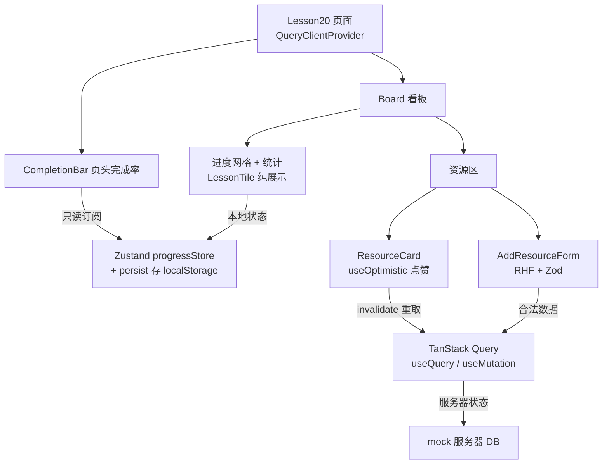
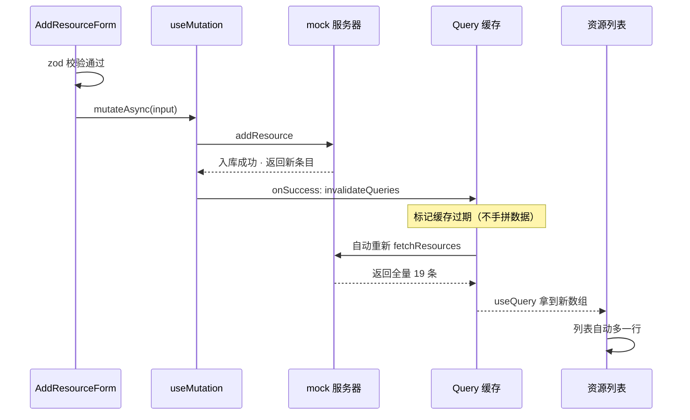
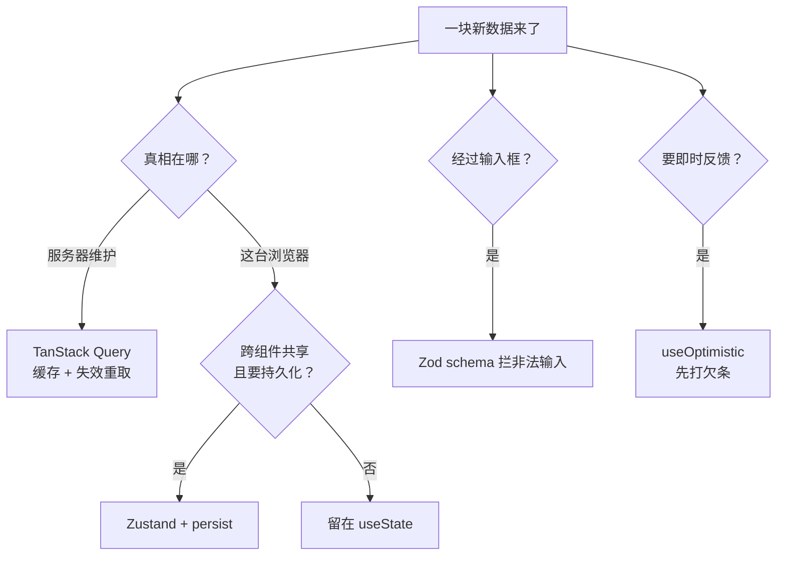

# 第 20 课 · 综合实战 II：课程进度看板

## 学习目标

完成本课后，你应该能够：

1. 用"数据真相在哪"这把刀把状态切成两类：**服务器状态**归 TanStack Query（资源的增删查），**本地状态**归 Zustand（你的勾选与星标），并且能说清为什么混放会出事；
2. 会用 `useMutation` + `invalidateQueries` 完成"写成功 → 缓存作废 → 列表自动刷新"的标准闭环，理解为什么**作废缓存**比**手动拼数据**正确；
3. 会用 React Hook Form 的 `register/handleSubmit/errors` 三件套配上 `zodResolver`，把校验规则集中成一份 Zod schema，错误内联展示；
4. 会用 React 19 的 `useOptimistic` 做"先斩后奏"的乐观点赞，理解乐观值"活在过渡期间、过渡结束自动回滚"的机制，以及失败开关为什么是错误路径的测试钥匙；
5. 把第 16–19 课的四个库装进同一个页面各就各位——这是本课程的毕业设计。

本课对应的示例代码：

- `src/components/lesson20/progressStore.js` —— Zustand + persist：lessonId → { done, starred }，刷新不丢
- `src/components/lesson20/useResources.js` —— Query 管"服务器状态"：mock 数据库 + useQuery + useMutation + invalidate
- `src/components/lesson20/AddResourceForm.jsx` —— RHF + Zod：标题/URL/课号校验，错误内联
- `src/components/lesson20/ResourceCard.jsx` —— useOptimistic 乐观点赞 + 失败开关 + 自动回滚
- `src/components/lesson20/Board.jsx` —— 看板主体：上半进度网格（store），下半资源库（Query），含"只看未完成"
- `src/pages/Lesson20.jsx` —— QueryClientProvider 作用域 + 页头完成率进度条（从 store 派生）
- 样式在 `src/pages/lesson20.css`（`l20-` 前缀，不与 App.css 的通用类冲突）

## 核心概念

### 两类状态，两套工具

> **一句话记住：** 真相在服务器的数据归 Query，真相在本机的数据归 Zustand——先分类，再选工具。

看板上同时住着两种数据，怎么判断各自该用什么工具？判断标准只有一条：**它的真相（source of truth）在哪**？

| | 资源列表 | 课程进度 |
|---|---|---|
| 真相在哪 | "服务器"（本课是 mock 数据库，真实项目是后端） | 用户浏览器 |
| 谁会改它 | 任何用户、任何设备 | 只有这台浏览器的你 |
| 要什么能力 | 缓存、重试、失效重取、请求状态机 | 持久化、跨页面共享 |
| 该用什么 | TanStack Query | Zustand |

放错工具会怎样？两个方向都是灾难：

- 把资源列表塞进 Zustand：缓存失效、后台刷新、并发去重都得你亲手重写，等于实现一个烂版 Query。
- 把"勾了第 3 课"发请求存服务器：为一个本地偏好修一条高速公路，纯属浪费。

所以记住顺序：**先分类，再选工具**，这是真实项目里每天都要做的判断。

**图：看板的组件结构与两条数据通路**




### Query 的写后闭环：invalidate，不要"顺便改缓存"

> **一句话记住：** 写成功后只声明"缓存过期了"，重取交给 Query——单一真相，永不失同步。

添加资源的完整数据流（验证点：点提交后列表自动从 18 条变 19 条）：

```
表单(zod 通过) → addResource.mutateAsync(input) → mock 服务器入库
   → onSuccess: invalidateQueries(RESOURCES_KEY)   ← 声明"缓存过期了"
   → Query 自动重新 fetchResources()               ← 你没有手动 setState
   → useQuery 拿到新数组 → 列表多了一行
```

新手最常见的反模式是什么？在 `onSuccess` 里手动把新条目 `setState` 拼进列表。那等于在 Query 的缓存旁边又养了一份"影子列表"，两份真相迟早打架（后台重取一覆盖，你拼的那条就没了）。

正确姿势是**只声明"数据过期"，重取交给 Query**：单一真相，永不失同步。

**图：添加资源后的写后失效闭环**




### 乐观更新：先给结果，错了再收回

> **一句话记住：** 点击瞬间界面就 +1，请求失败时 React 自动弹回——你要负责的只是让真实值最终正确。

普通提交是"等服务器点头，界面才敢动"——一次点赞要看着按钮转 600ms。乐观更新反过来：**点击瞬间界面就 +1**（假装成功），请求真返回了就顺手确认，失败了 React 19 自动把数字弹回去（回滚）。

`useOptimistic` 的机制值得背下来：

- 乐观值**只活在过渡（transition）期间**：`startTransition` 的 async 函数开始 → 渲染时显示乐观值；函数结束（无论成败）→ 自动回滚到真实值；
- 所以"回滚"不是你写的代码，**你要负责的是让真实值最终正确**：成功后 `invalidate` 重取（Board 传入的 `onLikeSettled`，在过渡内 await 它，回滚瞬间界面已经是服务器确认的新数字，不会闪旧值）；失败后数据库没变，回滚即真相；
- `useOptimistic` 的 reducer 必须是纯函数——它只是"显示器"，发请求是过渡函数的事。

### 表单校验的分层

> **一句话记住：** 规则归 Zod、接线归 zodResolver、展示归内联红字——三层各管一段，互不越界。

`AddResourceForm` 里校验分了三层，各管一段：

1. **规则层（Zod schema）**：`标题 2–40 字 / z.url() 且仅 http(s) / 课号 1–20 的整数`。规则集中一份，和 UI 解耦——换个表单库、放到 Node 后端，schema 照用（验证点：填 `notaurl` 提交，红色提示"请输入合法的 URL"）；
2. **接线层（zodResolver）**：一行代码把 schema 塞进 RHF 的 `useForm`，校验失败时错误按字段名归位到 `formState.errors`；
3. **展示层（内联错误）**：`{errors.url && <p className="field-error">{errors.url.message}</p>}`，错误出现在各自输入框脚下，而不是一个汇总大弹窗。

一个反直觉的细节：输入框**故意不加** `required` / `type="url"` 这类 HTML 原生校验——原生校验会在提交前静默拦截，你根本看不到 Zod 的提示，教学效果归零。`noValidate` 关掉浏览器自作主张，舞台完全交给 Zod。

### persist：持久化是 store 的快照

> **一句话记住：** state 是源头，localStorage 只是它的自动快照——reset 只需 set，不用手动清存储。

`progressStore` 用 zustand 的 `persist` 中间件包了一层：每次 `set` 自动把 state 写进 localStorage（key 是 `name` 选项），页面加载时自动读回。

勾掉几门课、刷新页面、明天再开——进度都在（验证点：勾 1 课 + 星 1 课，刷新后统计和勾选状态原样）。记住方向感：**state 是源头，localStorage 只是它的自动快照**，所以 `reset()` 只需要 `set({ progress: {} })`，不用手动清存储。

## 代码导读

### `src/components/lesson20/progressStore.js` —— 本地状态仓库

- 状态形状 `{ [lessonId]: { done, starred } }`，**惰性创建**：没碰过的课根本不存在这条 key，读的时候由 `selectRecord` 用 `emptyRecord()` 兜底；
- `toggleDone/toggleStar` 是同一个模板的三条不可变铁律：progress 整体换新对象（zustand 靠 `Object.is` 判断变化）、目标记录换新对象、其余记录原样保留（引用不变 → 依赖它们的组件不白渲染）；
- `selectRecord` 放在模块层而不是 store 方法里，是防一个经典误用：store 方法里用 `get()` 读到的不是响应式数据，误把它当"订阅"会出现改了 store 但界面不更新。订阅必须走 `useProgressStore(选择器)`；
- persist 配置里留了 `version: 1` + `migrate` 的示范位：将来状态结构升级时提高 version、在 migrate 里改写旧数据，老用户的存储不会变脏数据。

### `src/components/lesson20/useResources.js` —— 服务器状态的一站式封装

- 文件里住着一个假"服务器"：模块级 `DB` 数组（18 条官方文档/教程链接，覆盖第 1–19 课主题）、自增主键 `nextId`（绝不用数组长度当 id，删数据会撞号）、`fetchResources/addResource/likeResource` 三个接口，全部带真延迟（500/400/600ms）——loading 态肉眼可见才算数；
- `likeResource(id, fail)` 的失败分支是**错误路径的测试钥匙**：reject 时数据库不动（没加 likes），前端过一会儿就得把乐观的 +1 收回去；
- `useResources()` 把 Query 的两个 hook 包成一个 hook：`useQuery`（`RESOURCES_KEY` 缓存键 + `fetchResources`）、`useMutation`（`mutationFn: addResource` + `onSuccess: invalidateQueries`）。组件看到的只是 `{ resources, isLoading, error, refetch, addResource, isAdding, addError, invalidateResources }`——queryKey 这种实现细节不出模块；
- `invalidateResources` 返回的是 Promise：ResourceCard 在过渡里 `await` 它，等重取完成过渡才结束（见 ResourceCard 一节）。

### `src/components/lesson20/AddResourceForm.jsx` —— 输入合法化

- `resourceSchema` 三个字段的规则全部集中于此。两处 Zod v4 细节：`z.url()` 是顶层 URL 校验（替代旧的 `z.string().url()`），外面再 `.refine` 限协议；`lessonId` 用 `z.coerce.number()`——输入框给的永远是字符串，coerce 先转数字再校验，清空后是 `'' → 0`，天然命中 `min(1)` 的提示；
- `handleSubmit(async (data) => {...})`：只在校验全通过时调用你的函数。`await onAdd(data)` 接的是 `mutateAsync`，失败会 throw——在这里接住，**reset 放在成功之后**，用户的输入一个字不丢（清空了才发现提交失败，是最气人的体验）；
- 错误内联展示是统一模式：`errors.xxx?.message` 渲染在对应输入框脚下，`?.` 兜住"还没有错误"的 undefined。

### `src/components/lesson20/ResourceCard.jsx` —— 乐观更新样板

- `useOptimistic(resource.likes, (current, delta) => current + delta)`：真实值是 Query 给的 `likes`，乐观值叠加在它上面；reducer 纯函数，只管算"此刻显示几"；
- `handleLike` 的标准骨架：`startTransition(async () => { addOptimisticLike(1); try { await likeResource(...); await onLikeSettled() } catch (e) { setLikeError(e.message) } })`。成功路径在过渡内 await invalidate，回滚无缝续接新数字；失败路径不重取（库没变），过渡结束乐观值自动弹回，我们只补一条"已回滚"提示解释发生了什么；
- 每张卡片一个"点赞失败"复选框（lesson11 的失败开关传统）：错误路径必须可以人为制造，不能靠祈祷服务器恰好挂掉。

### `src/components/lesson20/Board.jsx` —— 两类状态的合流点

- 上半张：订阅 store（`progress` 单独订阅——zustand v5 铁律，一次订阅返回新对象会无限重渲染；`toggleDone` 等 action 引用永不变，单独订阅零开销）→ 15 格网格 + 完成/星标统计 + "只看未完成"过滤 + 清空进度。统计值全部现算派生，不进 state；`hideDone` 是 UI 偏好，也不进 store（它不需要持久化）；
- 下半张：`useResources()` 的三态渲染（loading 提示 / 红盒 + 重试 / 列表），表单传 `onAdd`（内部 mutateAsync），每张卡片传 `onLikeSettled={invalidateResources}`——数据从哪来是 Board 的事，子组件保持"给什么画什么"；
- `LessonTile` 是不订阅 store 的纯展示组件：订阅收拢在父层，子组件只吃 props（和第 9 课 memo 的前提一脉相承）。

### `src/pages/Lesson20.jsx` —— 作用域与页头

- `useState(() => new QueryClient())`：client 只建一次。直接 `const client = new QueryClient()` 写在渲染体里，每次渲染都 new 一个——缓存全丢、请求全重发。真实项目在 `main.jsx` 包一次全应用共享；本项目是多课沙盒，每课自建 client，缓存互不串扰；
- `CompletionBar` 只订阅 `progress` 一个切片，只数 1–15 的 key（和 Board 的网格口径一致——两个独立订阅点的统计口径必须一致，否则页头和网格的数字对不上），宽度用内联 style 绑定派生百分比，CSS transition 负责丝滑。

## 与手写方案对比

第 20 课的四个库，每一个都对应前面课程手写过的等价物。**库解决了什么、代价是什么**，两侧都看才算学会：

### 第 16 课 Query vs 第 11 课 `src/components/lesson11/useFetch.js`

- 手写方案给了什么：三态、refetch、AbortController + 序号防竞态——约 60 行，每个项目每个页面都得复制一遍；
- Query 多解决的：**缓存与去重**（同 key 的组件共享一份数据，不重复请求）、**失效重取**（invalidate 一句话，手写方案得自己设计"哪些数据过期了"的通知系统）、**后台刷新与窗口聚焦重取**、mutation 的生命周期回调。本课"添加后自动刷新"在手写方案里要手写事件总线或提升状态，在 Query 里是一行 `invalidateQueries`；
- 代价：Provider 作用域要设计（本课每页一个 client）、queryKey 的心智模型（键就是缓存地址，键错 = 数据错）、包体积、请求行为不再"所见即所得"（何时重取是 Query 说了算，得理解 staleTime/gcTime）。

### 第 17 课 RHF+Zod vs 第 1/5 课手写表单（`src/pages/Lesson1.jsx`、`src/components/lesson5/UncontrolledForm.jsx`）

- 手写方案：每个字段一对 `value/onChange`、一个提交前逐字段 if 检查、一套散落的错误字符串。第 1 课的受控输入让"数据驱动 UI"看得见摸得着，第 5 课的非受控（ref 取值）说明"不每键重渲染"也是一种选择——RHF 内部正是后者；
- 库解决的：字段注册（`register('url')` 一行顶三行）、校验规则集中成 schema（可测试、可跨端）、错误归位与触达时机（`mode: 'onTouched'`：碰过才即时校验，提交时全量校验）、`isSubmitting/isDirty` 这些状态免费拿；
- 代价：两套 API（RHF 的 form 状态机 + Zod 的 schema 语言）、resolver 的间接层（错误从 schema issue 映射到 `errors` 对象，出了问题要会跨两层排查）、简单表单用库属于杀鸡用牛刀。

### 第 18 课 Zustand vs 第 6 课 `src/components/lesson6/ThemeContext.jsx`

- 手写方案：Context 需要 Provider 包树、value 记得 memo、消费方在任何一层都不能漏；状态更新逻辑分散在使用 `useState` 的地方；
- 库解决的：**没有 Provider**（import 即用，组件树外面一个单例）、**切片订阅**（选择器决定谁重渲染，不用手动拆 Context 或 memo）、action 与状态同居一处（`toggleDone` 就住在 store 里，逻辑内聚）、`persist` 一个中间件白送 localStorage 持久化（第 6 课手写要 effect + 序列化 + 容错）；
- 代价：多一个全局单例（测试要记得 reset store）、v5 的选择器规则（返回新对象会无限循环，需要 `useShallow`）、"哪里都能改 store"需要纪律约束。

### 第 19 课 React 19 useOptimistic vs 传统"提交按钮转圈圈"

- 传统受控提交：点击 → `isSubmitting` 置 true → 等响应 → 才更新界面。用户盯着按钮 600ms，什么反馈都没有；
- React 19 给的：`startTransition` 直接吃 async 函数（action），`useOptimistic` 在过渡期间叠加一个"假装成功"的视图，过渡结束自动回滚——回滚逻辑是框架写的，你只写"怎么乐观"和"真实值怎么来"；
- 代价：要理解**过渡期间**这个新概念（乐观值不是普通 state，它活在 transition 的生命周期里）、错误处理要自己接住（catch 里补提示，否则回滚得莫名其妙）、乐观视图与真实值的间隙是新的竞态面（本课用"过渡内 await invalidate"消掉闪烁）。复杂度从"界面等服务器"转移到"理解两套值的交接时机"——便宜不是白来的，但账算下来仍是赚的。

## 知识点回扣表

每个功能 ↔ 它属于哪课 ↔ 核心概念 ↔ 落在哪个文件：

| 功能 | 课次 | 核心概念 | 文件 |
|---|---|---|---|
| 页头完成率进度条 | 第 1 课 + 第 9 课 | state 派生值（不另存状态）+ 切片订阅最小化重渲染 | `src/pages/Lesson20.jsx` |
| 进度网格勾选/星标 | 第 4 课 + 第 9 课 | 回调下行、纯展示子组件（LessonTile 只吃 props） | `src/components/lesson20/Board.jsx` |
| 刷新后进度仍在 | 第 18 课 | Zustand persist：state 是源头，localStorage 是快照 | `src/components/lesson20/progressStore.js` |
| 统计（完成 X/15 · 星标 Y） | 第 10 课 | 派生统计，绝不与源数据各存一份 | `Board.jsx` |
| "只看未完成"筛选 | 第 14 课 | UI 偏好是临时 state，过滤是渲染期派生 | `Board.jsx` |
| 资源列表加载/错误/重试 | 第 16 课 | useQuery 请求状态机 + 缓存键 | `src/components/lesson20/useResources.js` |
| 添加资源 → 列表自动刷新 | 第 16 课 | useMutation + invalidateQueries 写后闭环 | `useResources.js` + `AddResourceForm.jsx` |
| 非法 URL / 课号被拦 | 第 17 课 | Zod schema 集中规则，zodResolver 接线，错误内联 | `src/components/lesson20/AddResourceForm.jsx` |
| 提交失败输入不丢 | 第 17 课 | mutateAsync 的 throw 在表单层接住，reset 在成功后 | `AddResourceForm.jsx` |
| ⭐ 点赞秒回 | 第 19 课 | useOptimistic + startTransition(async) 乐观更新 | `src/components/lesson20/ResourceCard.jsx` |
| 点赞失败自动回滚 | 第 19 课 | 过渡结束乐观值自动回滚；真实值由 Query 保证 | `ResourceCard.jsx` |
| 点赞失败开关 | 第 11 课 | mock 可失败，错误路径靠开关主动验证 | `useResources.js` 的 `likeResource` |

### 16–19 课的四个库如何互相配合

看板一页，四库各管一段，边界就是"数据的真相在哪"：

- **Query 管服务器状态**（`useResources.js`）：资源列表的真相在"服务器"。Query 负责取数、缓存、请求状态机，以及最重要的——写操作成功后作废缓存自动重取；
- **Zustand 管本地状态**（`progressStore.js`）：勾选与星标的真相在浏览器。Zustand 负责全局共享 + persist 持久化，页头和网格两个订阅点自动同步；
- **RHF 管表单输入**（`AddResourceForm.jsx`）：添加资源的人口。Zod 拦住非法数据，合法的 `{ title, url, lessonId }` 交给 Query 的 `mutateAsync`——表单库只管"输入变合法"，不碰缓存不碰列表；
- **React 19 管提交体验**（`ResourceCard.jsx`）：点赞不等服务器。`useOptimistic` 给即时反馈，`useTransition` 包住 async 动作；成功后调 Query 的 invalidate 同步真相，失败靠过渡结束自动回滚。

三条流水线在页面上并行不悖：

- 服务器状态闭环：表单 → mutateAsync → 服务器 → invalidate → 列表更新；
- 本地状态闭环：勾选 → store → localStorage → 刷新仍在；
- 提交体验闭环：点击 → 乐观值 → 请求 → 确认/回滚。

**判断新数据该进哪个系统的口诀：真相在服务器进 Query，真相在本地进 Zustand，经过输入框的先过 Zod，用户手快的先给乐观反馈。**

**图：新数据该进哪个系统**




## 动手试一试

1. **按课号筛选资源**：在资源区加一个 `<select>`（全部 / 1–20），列表只显示 `resource.lessonId` 匹配的条目。提示：过滤是渲染期派生，和"只看未完成"同款思路；先别把课号塞进 queryKey——想想什么时候才值得让每课一份独立缓存（比如后端支持按课分页时）。
2. **给进度记录加"完成时间"**：`toggleDone` 勾选时写上 `doneAt: Date.now()`，网格悬停显示日期；然后把 `version` 提到 2，在 `migrate` 里给老用户的旧记录补 `doneAt: null`。提示：migrate 的入参是旧结构 + 旧版本号，出参必须符合新结构。
3. **点赞加"取消赞"**：给卡片记一个 `likedByMe`（放哪类状态？），已赞时再点 ⭐ 发送的是取消赞，乐观值 -1。提示：useOptimistic 的 reducer 接收的"增量"可以是 +1/-1，direction 由点击时的状态决定。

## 易错点

1. **QueryClient 写在渲染体里**：现象是每次交互后列表重新 loading、缓存像失忆一样。原因：`const client = new QueryClient()` 每次渲染都执行，组件树下面换了个全新 client。解法：`useState(() => new QueryClient())` 初始化器只跑一次（本课 `Lesson20.jsx` 的写法）。
2. **zustand 选择器返回新对象**：现象是控制台疯狂渲染、浏览器卡死（"The result of getSnapshot should be cached"警告）。原因：v5 用 `Object.is` 比较选择器结果，`(s) => ({ a: s.a, b: s.b })` 每次都是新对象，永远"变了"。解法：分开订阅多个字段，或用 `useShallow` 包一层（本课 Board 的写法）。
3. **onSuccess 里手动把新数据拼进列表**：现象是新条目显示一下就消失，或和重取回来的数据重复。原因：Query 缓存重取时会整体覆盖 `data`，你拼的影子列表不在缓存里。解法：只 `invalidateQueries`，重取交给 Query（见核心概念）。
4. **在 useOptimistic 的 reducer 里发请求**：现象是请求发多次、行为时序混乱。原因：reducer 是"算显示值"的纯函数，渲染期间可能被调用多次；副作用必须放在 `startTransition` 的 async 函数体里。
5. **表单提交失败后输入被清空**：现象是校验明明通过、提交报错了，回头一看表单空了。原因：`reset()` 写在了 `await onAdd(data)` 之前。解法：reset 只在成功分支执行，失败分支让 `mutateAsync` 的 throw 把控制流带进 catch（本课 `AddResourceForm.jsx` 的顺序就是正确性）。

## 自测题

1. 页头的完成率进度条为什么既不用 `useMemo` 也不用再存一个 state？如果把 `percent` 存进 store，会埋下什么隐患？
2. 点"添加资源"后列表自动多了一条——请从点击事件开始，把这条数据流完整走一遍（至少经过 RHF、mutateAsync、服务器、invalidate、useQuery 五站）。
3. 点赞失败后数字为什么会"自己弹回去"？回滚是谁执行的？如果此时不弹提示，用户会误解什么？
4. 为什么"资源列表"不能放 Zustand、"勾选进度"不值得放 Query？判断标准用一句话说出来。

### 参考答案

1. 15 条数据现算几微秒，useMemo 的缓存成本比计算本身还贵；percent 能从 progress 一路推导出来，再存一份就是两个真相——勾选动作要同步改两处，漏一处界面就自相矛盾（页头 40%、统计 3/15）。派生值的原则：能在 render 里算出来的，不进 state、不进 store。
2. 提交 → `handleSubmit` 先跑 Zod 校验（不通过则错误进 `errors`，数据流到此为止）→ 通过后 `addResource`（即 `mutateAsync`）把 `{title, url, lessonId}` 发给 mock 服务器的 `addResource`，延迟 400ms 后入库返回新条目 → mutation 的 `onSuccess` 触发 `invalidateQueries(RESOURCES_KEY)`，把该缓存键标记为过期 → Query 自动调用 `fetchResources()` 重新拉全量（19 条）→ `useQuery` 收到新 data → Board 重渲染，列表多一行；同时表单 `reset`，输入框清空但保留课号。
3. 回滚是 React 执行的：乐观值只活在 `startTransition` 的过渡期间，async 函数结束（这里是 catch 后过渡结束）时 React 自动把界面切回真实值。真实值始终来自 Query 的 `resource.likes`，而失败的 `likeResource` 根本没改"数据库"，所以真实值还是旧数字。没有提示的话，用户会以为"刚才那一下是网络慢还是没点上？再点一次？"——可能重复点赞，也可能以为赞上了其实没有。乐观更新必须配失败提示，这是它的使用成本。
4. 判断标准一句话：**数据的真相（谁写入、谁维护、谁来仲裁正确值）在哪一侧**。资源列表的真相在服务器——任何用户都能增改，前端存的只是缓存，所以归 Query 管（缓存失效、重取、并发去重都是它的工作）；勾选进度的真相在这台浏览器——只有本地用户写它，没有"服务器版本"需要对齐，放 Query 等于为本地偏好维护一套缓存失效协议，纯属浪费。

## 下一课预告

没有下一课了——第 20 课是本课程的毕业设计。从这里出发的三个方向：

- **服务端渲染与元框架**（Next.js / React Router v8 的 framework mode： SSR、数据加载上移到路由层）；
- **TypeScript**（本课程刻意用纯 JS 让你专注概念，真实项目里 Zod schema 能同时变成类型，RHF 的 `errors` 全程有类型提示）；
- **更深的 React 内功**（useSyncExternalStore、调度原理、编译优化 React Compiler）。

写代码愉快，我们真实项目里见。
