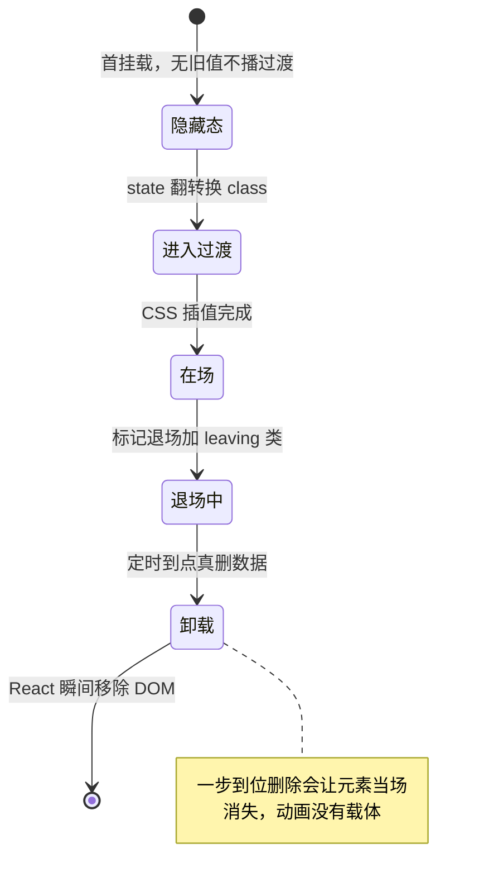
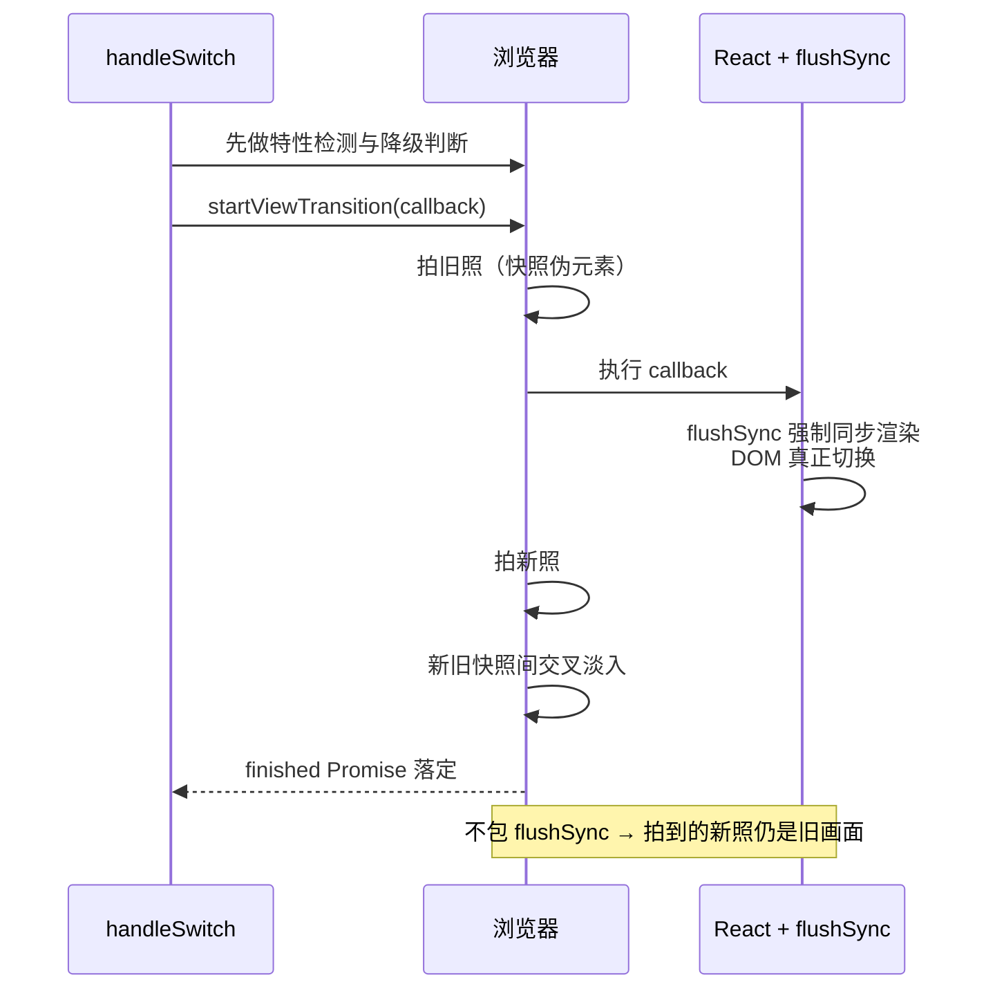
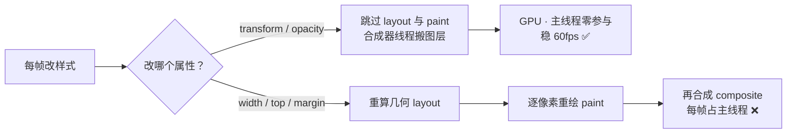

# 第 23 课 · 动画与过渡

## 学习目标

完成本课后，你应该能够：

1. 说清动画的分工铁律——**React 管起止（state → class），CSS 管过程（transition 插值中间帧）**，并能解释为什么 JS 逐帧改样式（setInterval/requestAnimationFrame 手搓补间）是最差的实现方式；
2. 会用 delayedUnmount 模式实现退场动画：理解"React 卸载是瞬间的、不存在'退场中'状态"这一难题的根因，把一次删除拆成"标记退场 → 到点真删"两次状态更新，并处理防重入、时长对齐、定时器回收三件套；
3. 会用 `document.startViewTransition` 做整块平滑切换，理解"快照照片"的工作原理、`flushSync` 在其中不可缺的原因，以及特性检测 + 自动降级的渐进增强写法；
4. 记住本课铁律：**动画只动 transform/opacity（合成器线程），别动 width/top/margin（每帧重排）**，并能说出为什么；
5. 会用 CSS `@media (prefers-reduced-motion: reduce)` 全局降级 CSS 动画、用 JS `matchMedia` 降级快照动画——无障碍不是可选项。

本课对应的示例代码：

- `src/components/lesson23/FadeToggle.jsx` —— state 驱动 class 切换：进入过渡的最低成本方案
- `src/components/lesson23/ExitAnimation.jsx` —— delayedUnmount：列表项删除的退场动画完整实现
- `src/components/lesson23/ViewTransitionDemo.jsx` —— startViewTransition 包裹 state 更新 + 特性检测降级
- `src/pages/Lesson23.jsx` —— 页面编排 + 铁律卡（transform/opacity、prefers-reduced-motion）
- 样式在 `src/pages/lesson23.css`（`l23-` 前缀；最后一节是 reduced-motion 全局降级）

## 核心概念

### 动画的分工：React 管起止，CSS 管过程

> **一句话记住：** React 只负责换 class，中间每一帧全归 CSS 的 transition。

最常见的新手错误是用 JS 播动画：`setInterval` 每 16ms 把 opacity 加 0.05。这条路的代价清单：

- 主线程被占满（掉帧全责）；
- 每次改 style 都触发样式计算；
- 组件重渲染和动画计时互相打架；
- 代码量是 CSS 版的三倍。

正确分工是：

```
React：setState(visible: false → true) → className 换了   ← 只负责"从哪个状态到哪个状态"
浏览器：transition: opacity .35s → 自动插值 0.03/0.37/0.81… ← 中间每一帧全归它
```

两个推论：

1. **动画的"进度"不是 state**，别为它建变量——想读中间值用 `getComputedStyle`；
2. transition 的触发条件是"计算值发生变化"，所以**元素首次挂载不会播 transition**（没有旧值可比）——想要首次进场动画，要么先渲染成隐藏态再翻转（本课 FadeToggle 的做法），要么用 `@keyframes` animation（挂在元素上就播，不依赖旧值）。

**图：一个元素的动画状态机（含退场难题）**




### CSS 动画优先于 JS 动画库：选型理由

> **一句话记住：** 默认答案是 CSS；CSS 做不了的（中断、弹簧、编排）才上库。

真实项目里动画需求的默认答案应该是 **CSS（transition + @keyframes）**，理由按权重排：

1. **性能免费**：`transform/opacity` 的过渡由合成器线程完成，不占主线程；JS 驱动的每一帧都在跟你的 React 渲染抢主线程；
2. **绝大多数需求只是"状态 A ↔ 状态 B"**：hover、展开、淡入、位移——声明两个终态一条 transition 就完事，不需要库；
3. **没有依赖成本**：动画库（framer-motion 约 30KB+ gzip）是常驻体积；CSS 方案删掉几行规则就没了；
4. **与 React 的边界干净**：React 只管 state，CSS 只管过程，两者不需要新的心智模型；动画库则引入自己的组件树（`<AnimatePresence>` 等）和生命周期概念。

那什么时候才轮到库？需求超出"两态过渡"的能力范围时：

- **中断重定向**（动画播到一半反向）；
- **基于物理的弹簧动画**；
- **复杂编排**（多元素错峰入场）；
- **退场动画的自动管理**（见下一节）。

先确认 CSS 做不了，再上库——选型顺序是"CSS → CSS+delayedUnmount → 库 → View Transitions"，跳级就是过度设计。

### 退场动画的难题与 delayedUnmount

> **一句话记住：** React 卸载是瞬间的——想播退场动画，就得把"真删"推迟到动画播完。

进入过渡便宜，退场动画贵，根因在一行话里：

> **React 的卸载是同步且瞬间的——setState 删掉数据，下一次 commit 元素就从 DOM 里消失了，不存在"退场中"这个渲染状态；而 CSS transition 需要元素留在 DOM 里才能渐变。两个条件物理上互斥。**

delayedUnmount 模式的解法是**推迟卸载，给动画让路**——把一次删除拆成两次状态更新：

```
点击删除
  → 第一次更新：leavingIds.add(id)        ← 只标记"退场中"，items 不动
  →    React 重渲染 → 元素加 --leaving 类 → CSS 开始播（opacity 1→0）
  → setTimeout(400)                       ← 与 CSS transition 时长对齐
  → 第二次更新：items.filter(...)         ← 这时才真删，React 这一刻才卸载元素
```

配套三件套（漏一个都是真 bug）：

- **防重入**：退场中屏蔽重复点击，否则定时器叠加；
- **时长对齐**：JS 的 400ms 和 CSS 的 0.4s 是两个时钟，`ExitAnimation.jsx` 顶部常量与 `lesson23.css` 里的大字注释互相提醒；
- **卸载清场**：`useEffect` cleanup 里 `clearTimeout`，防止组件死后回调再 setState。

更精确的变体是监听 `transitionend` 事件再卸载（动画一结束立刻删，不用人肉对齐时钟），但要处理事件不触发的边缘情况（元素中途 `display:none`、transition 被打断、标签页后台化丢事件），通常配一个兜底定时器——简单场景 `setTimeout` 足够。

### View Transitions：浏览器替你做"前后两帧"

> **一句话记住：** 浏览器拍新旧两张快照做过渡，你只需 flushSync 保证"拍新照时 DOM 已变"。

`document.startViewTransition(callback)` 的流程：拍旧照 → 执行 callback（DOM 真正变化）→ 拍新照 → 在两张快照之间做交叉淡入/变形。动画发生在**快照（伪元素）**上，真实 DOM 只切换一次——所以天然流畅，也不用你写任何补间代码。

三个必须知道的实践点（都写在 `ViewTransitionDemo.jsx` 的注释里）：

- **特性检测 + 降级**：`typeof document.startViewTransition === 'function'` 不成立就直接 setState——功能一模一样，只是瞬间切换。**动画是渐进增强，永远不能是功能前提**；
- **flushSync 不可缺**：callback 靠"返回时 DOM 已变"拍新照，而 React 的 setState 是异步批处理——不包 `flushSync`，浏览器拍到的"新照"还是旧画面，动画等于白做；
- **`view-transition-name` 收窄范围**：默认动画整页根快照（整页一起淡切）；给面板设 `view-transition-name: l23-panel` 后只有该元素的新旧照片参与变换。同一名字同一时刻只能属于一个元素。

**图：startViewTransition 的快照时序**




### prefers-reduced-motion：两道闸门

> **一句话记住：** CSS 动画用 `@media` 闸，快照动画用 `matchMedia` 闸——缺一不可。

系统开启"减少动态效果"的用户（常见于前庭功能障碍，位移动画会引发眩晕）必须得到尊重，这是无障碍硬要求。两类动画要用不同的闸门：

- **CSS 动画**：`lesson23.css` 末尾的 `@media (prefers-reduced-motion: reduce)` 一处声明掐掉本课全部 transition/animation——属性值瞬间跳终态。若代码依赖 `transitionend` 驱动下一步，用 `0.01ms` 而不是 `none`（时长不为零，事件仍会立即触发）；
- **View Transitions 快照动画**：不走你的 CSS，得在 JS 里 `matchMedia('(prefers-reduced-motion: reduce)').matches` 命中后主动跳过 `startViewTransition`。

**两道闸缺一不可**：只写 CSS 的降级，快照动画照播；只写 JS 的降级，普通 transition 照播。

## 代码导读

### `src/components/lesson23/FadeToggle.jsx` —— 两态过渡的最小样板

- 组件里只有一个 state（`visible`）和一个按钮——动画的所有复杂性都让渡给了 CSS：`.l23-fade-box`（基座，声明起止值之一 + transition）和 `.l23-fade-box--hidden`（只覆盖另一个起止值）两个类负责其余一切；
- 初始 `visible = false` 是刻意设计：首次挂载不播 transition（没有旧值），先渲染成隐藏态，第一次点击才构成真正的"进场过渡"——这是 transition 与 animation 的核心差异的最直观演示；
- `data-visible` 属性是给调试/自动化断言的钩子：样式类名可以随便重构，data 属性表达的"业务状态"不变——测试别绑死在 className 字符串上（本课三个组件都遵守这个约定）；
- 悬念留在注释里：这里的"隐藏"只是 `opacity: 0`，元素还在 DOM 里、还占位——真消失还带动画，是下一张卡的课题。

### `src/components/lesson23/ExitAnimation.jsx` —— delayedUnmount 完整实现

- **两份状态职责泾渭分明**：`items` 是"真实在场名单"（动了 = 真卸载），`leavingIds` 是"退场中名单"（只影响样式类）。新手最常见的错误是删除一步到位（`items` 直接 filter）——动画根本没机会播；
- `handleRemove` 是模式的全部：防重入短路 → `setLeavingIds`（演出开始）→ `setTimeout(EXIT_DURATION_MS)` 到点后 `setItems` filter（谢幕卸载）+ 清 leavingIds。Set 是引用值，更新必须换新对象（第 4 课不可变更新的老铁律）；
- `EXIT_DURATION_MS = 400` 与 `lesson23.css` 的 `transition: … 0.4s` 是**必须人肉对齐的两个时钟**——注释在两处都写了警告；想要单一真相可以 `getComputedStyle` 读回时长或改用 `transitionend`，复杂度换一致性，教学项目选择简单直白；
- `timersRef`（登记表 id → timer）+ `useEffect` cleanup 是异步清场铁律的又一次出现（第 11 课、第 16 课都遇到过）：谁启动的异步，谁在 cleanup 里回收。cleanup 里现场读 `timersRef.current` 而不是提前解构——永远拿到最新的登记表；
- `data-state="idle" | "leaving"` 是"退场中元素仍存在于 DOM"这件事的断言锚点，重置按钮则演示了"强制归位"：掐掉全部定时器、恢复名单、清空 leaving。

### `src/components/lesson23/ViewTransitionDemo.jsx` —— 新 API 的标准姿势

- `handleSwitch` 的结构就是渐进增强的三段式：`reducedMotion`/`!SUPPORTED` 双闸门直接 setState（降级路径）→ 否则 `document.startViewTransition(() => flushSync(() => setState(...)))`（增强路径），返回的过渡对象上接了 `ready.catch`/`finished.catch`——过渡被打断（快速连点触发浏览器自动 `skipTransition`、或减少动态效果跳过）时这两个 Promise 会 reject，不接住就是控制台里的 unhandled rejection；跳过是内建的正常中断，不是错误，而 `updateCallbackDone` 刻意不接（flushSync 里的真 bug 必须照常暴露）；
- `flushSync` 那一行是全文件最容易被看漏、又最不能删的代码——React 的异步渲染撞上"callback 返回时拍新照"的浏览器约定，不同步就白做（详见核心概念）；
- `SUPPORTED` 常量在模块层做一次特性检测（API 存在与否不会变）；注释同时提醒：SSR 项目里读 `document` 的代码必须挪进 effect/事件回调，否则服务端直接崩——本项目是纯客户端 Vite 应用，所以可以放心写在模块层；
- UI 上显式展示支持状态徽章（✅ 支持 / ⚠️ 已降级）：让"降级"成为可见的事实而不是默默的分支。`switchCount` 则是"state 确实变了"的肉眼旁证。

### `src/pages/Lesson23.jsx` + `src/pages/lesson23.css` —— 铁律卡与全局降级

- 铁律卡置顶：只动 `transform/opacity` ✅、别动 `width/height/top/left/margin` ❌、尊重 `prefers-reduced-motion` ✅——整课最重要的一段话；
- CSS 侧的分层与命名约定延续全课程：基座类声明 transition、变体类只改起止值（两处都写 transition 是漂移隐患）；`l23-` 前缀隔离命名空间；文件末尾 `@media` 一处声明完成 reduced-motion 全局降级（注释里解释了 `none` 与 `0.01ms` 的取舍）。

## 退场动画三种方案对比

同一个需求——"删除列表项时先播动画再卸载"——三条实现路线：

| | ① delayedUnmount（手写） | ② 动画库（react-transition-group 等） | ③ View Transitions |
|---|---|---|---|
| 核心思路 | 自己造"退场中"状态，setTimeout 到点再真删 | 库接管：`<CSSTransition>`/`<AnimatePresence>` 在卸载时机与动画结束之间做仲裁 | 浏览器拍前后快照，DOM 直接切换，动画发生在快照上 |
| 代码量 | 约 40 行（两份状态 + 定时器管理） | 组件包裹 + `in`/`timeout` 等属性声明 | 一个函数调用 + flushSync |
| 中断/重复触发 | 自己处理（本课的防重入是简化版） | 库的成熟价值所在：打断反向、嵌套过渡都处理好了 | 浏览器内建（自动 skipTransition 旧过渡） |
| 依赖成本 | 零 | +若干 KB 常驻体积、一套库的生命周期概念 | 零 |
| 兼容性 | 全浏览器（原理是基础 API） | 全浏览器 | Chrome/Edge 111+、Safari 18+，Firefox 较晚——必须特性检测降级 |
| 适用场景 | 一两处退场需求，不想为此引库 | 大量进出场编排、复杂序列动画、要弹簧物理选 framer-motion | 整块 UI 的切换（面板、路由级视图），不在乎老浏览器降级 |

**选型口诀**：三条路的成本与能力边界，就是"CSS 做不了的时候再升级"这条选型链的展开。

- 一处退场：手写 delayedUnmount；
- 成片的进出场编排：上库（本课程按约定**不安装** react-transition-group，知道它的 `<CSSTransition in timeout unmountOnExit>` 解决的就是本课手写的那个问题即可）；
- 现代浏览器场景的整块切换：用 View Transitions 并做好降级。

## 性能注意

1. **只动 transform/opacity（本课铁律）**。浏览器渲染一帧的流水线是 layout → paint → composite：
   - 改 `width/top/margin` 要重跑前两步（每帧重排 + 重绘，元素越多越卡）；
   - 改 `transform/opacity` 直接跳到 composite（合成器线程搬图层，主线程零参与）。
   - 验证方法：DevTools → Performance 面板录一段，动画期间应该看不到紫色（Layout）和绿色（Paint）的条。

**图：transform 与 width 在渲染流水线上的分岔**



2. **别用 `will-change` 当预防针**。它提醒浏览器"这个元素要动了，提前建图层"——图层是显存，全站滥加等于逼浏览器维护几百个图层，内存暴涨反而掉帧。只加给确实在动画的元素，动画结束移除；
3. **动画期间别在 JS 里干重活**。transition 播放的 400ms 里，如果同一时刻 React 在渲染大列表或发请求解析数据，主线程阻塞照样卡（合成器只管图层，新帧的内容还得主线程出）。动画是演出，别在演出时搬家具；
4. **长列表删除的"补位收缩"别硬做**。退场中的元素还占着格子（本课的已知取舍），补位收缩发生在卸载瞬间——如果想让补位也丝滑，动画 height 会逐帧重排（违反铁律），正确姿势是 FLIP（First-Last-Invert-Play：记前后位置，用 transform 反演补差），它把位移交给合成器；
5. **别信眼睛，信帧率**。DevTools → Performance → FPS/帧时间轴，或 Rendering 面板开 "Frame Rendering Stats"。动画"看起来顺"和"每帧 16.7ms 内完成"是两回事，前者会骗人；
6. **reduced-motion 是发布项不是彩蛋**。上线前检查系统开关打开后动画是否真的全部消失（CSS 闸 + JS 闸各验一遍）。

## 动手试一试

1. **给 FadeToggle 加"入场方向"**：加一个 state 在 `translateX(24px)` 和 `translateY(-24px)` 两个隐藏态之间选（`--hidden-x` / `--hidden-y` 两个变体类）。提示：变体类只覆盖起止值，transition 仍在基座类——想想为什么这样分层改起来最省。
2. **把退场改成 transitionend 驱动**：`handleRemove` 里去掉 setTimeout，在元素上挂 `onTransitionEnd`（注意只认 `e.target === e.currentTarget && e.propertyName === 'opacity'`，冒泡上来的子元素过渡别误删），再补一个 600ms 兜底定时器防事件丢失。提示：对比两个版本的代码量与心智负担，你会更理解"简单可靠"四个字。
3. **给 ViewTransitionDemo 的面板加"滑动"个性**：在 `lesson23.css` 里用 `::view-transition-old(l23-panel)` / `::view-transition-new(l23-panel)` 伪元素改默认的交叉淡入为左出右进。提示：默认动画跑在 `animation` 上，覆盖它的 `animation` 声明即可；别忘了 reduced-motion 用户什么都不会看到——这是特性不是 bug。

## 易错点

1. **删除一步到位，动画没播**：现象是点删除元素瞬间消失，transition 像不存在。原因：`setItems(prev => prev.filter(...))` 直接删数据，元素当场卸载，CSS 没机会渐变——"卸载是瞬间的"与"transition 需要元素活着"互斥。解法：delayedUnmount 两步走（本课 ExitAnimation）。
2. **setTimeout 时长与 CSS 时长没对齐**：现象是动画播到一半元素被"拖下台"（JS 短了）或动画播完元素还挂着 100ms（JS 长了）。原因：CSS 动画钟和 JS 卸载钟是两个独立的钟。解法：常量与 CSS 里的大字注释互相锁定（本项目写法），或 getComputedStyle 读时长 / transitionend 驱动。
3. **startViewTransition 里不包 flushSync**：现象是切换时画面"闪一下"或干脆像没动画。原因：callback 返回时浏览器拍"新照"，而 React 的 setState 是异步批处理，DOM 还没变——拍到的新照 = 旧照。解法：`flushSync(() => setState(...))` 强制同步渲染。
4. **给 width/top 写 transition**：现象是动画卡顿、列表越大越明显，Performance 面板里每帧都是紫色 Layout 条。原因：这几个属性的每次变化都触发重排 + 重绘，不在合成器的能力范围里。解法：换 `transform: translateX(...)` 表达同样的视觉位移（本课铁律）。
5. **首次挂载"没有进场动画"**：现象是元素一出现就是终态，transition 从未播过。原因：transition 需要"计算值变化"才触发，首次挂载没有旧值可比。解法：初始渲染成隐藏态再翻转（FadeToggle 的做法），或改用 `@keyframes` animation（挂上就播，不依赖旧值）。
6. **reduced-motion 只做了一半**：现象是系统开了"减少动态效果"，CSS 动画消失了但 View Transition 还在播（或反之）。原因：CSS `@media` 管不到浏览器驱动的快照动画；JS 的 matchMedia 管不到 CSS transition。解法：两道闸都设（css 文件末尾 + ViewTransitionDemo 的 JS）。

## 自测题

1. 为什么"进入过渡"一个 state 加一行 class 就够，"退场动画"却需要 delayedUnmount 这样的模式？用"卸载的时机"把根因说清楚。
2. `flushSync` 在 startViewTransition 的 callback 里做了什么？删掉它，浏览器会拍到什么样的"新照"？
3. 同事说"我把列表项删除动画的时长从 400ms 改成了 600ms，怎么动画残影多挂了 200ms？"——请说出两个时钟分别是谁、在哪两个文件里，以及除人肉对齐外的两种对齐方案。
4. `transform` 和 `width` 的动画在浏览器渲染流水线里走的路有什么本质区别？为什么一个是合成器线程、一个每帧都要主线程出手？

### 参考答案

1. 进入过渡的元素始终在 DOM 里，state 翻转只是让计算值变化，transition 自然播放；退场的终点是**卸载**，而 React 的卸载是同步瞬间的——setState 删数据后下一次 commit 元素就没了，不存在"退场中"的渲染状态，CSS 没有可以渐变的载体。delayedUnmount 的本质是把"卸载"这个动作从数据删除推迟到动画播完（setTimeout 到点），中间人为造出一个 React 本没有的"退场中"状态。
2. flushSync 强制 React 在同步块内完成渲染并把 DOM 变更提交到页面——保证 callback 返回时新画面已就位。删掉它，setState 的生效时机由 React 调度器决定（宏任务之后），浏览器在 callback 返回瞬间拍到的"新照"仍是旧 DOM——新照 = 旧照，交叉过渡无从谈起（表现为闪一下或毫无动画）。
3. 两个时钟：CSS 的 transition 时钟（`lesson23.css` 里 `.l23-exit-item` 的 `transition: … 0.4s`）和 JS 的卸载时钟（`ExitAnimation.jsx` 的 `EXIT_DURATION_MS = 400`）。JS 只改了 CSS、没同步 JS 常量，于是动画播 600ms，但 400ms 时元素已被卸载（本例描述相反方向同理）。替代方案：① `getComputedStyle(el).transitionDuration` 读回真实时长再 setTimeout；② 监听 `transitionend` 事件到点再卸载（需处理事件丢失，配兜底定时器）。
4. 改 `transform` 不改变元素的布局盒子（占位、邻居位置全不变），浏览器只需在合成阶段把已有图层平移/缩放/透明化——纯 GPU、合成器线程、主线程零参与；改 `width` 改变了布局盒子本身，浏览器必须重新计算整棵受影响子树的几何（layout），再把受影响区域逐像素重画（paint），最后才能合成——每帧都占主线程，元素越多越容易超出一帧的 16.7ms 预算，表现为掉帧。

## 下一课预告

第 24 课 · 构建与部署：`npm run build` 产出了什么（bundle、hash 指纹、tree-shaking）、Vite 的生产优化（代码分割、预加载）、部署到静态托管的完整链路——开发期的 `dev server` 之外，你的应用第一次以"产品形态"落地。
