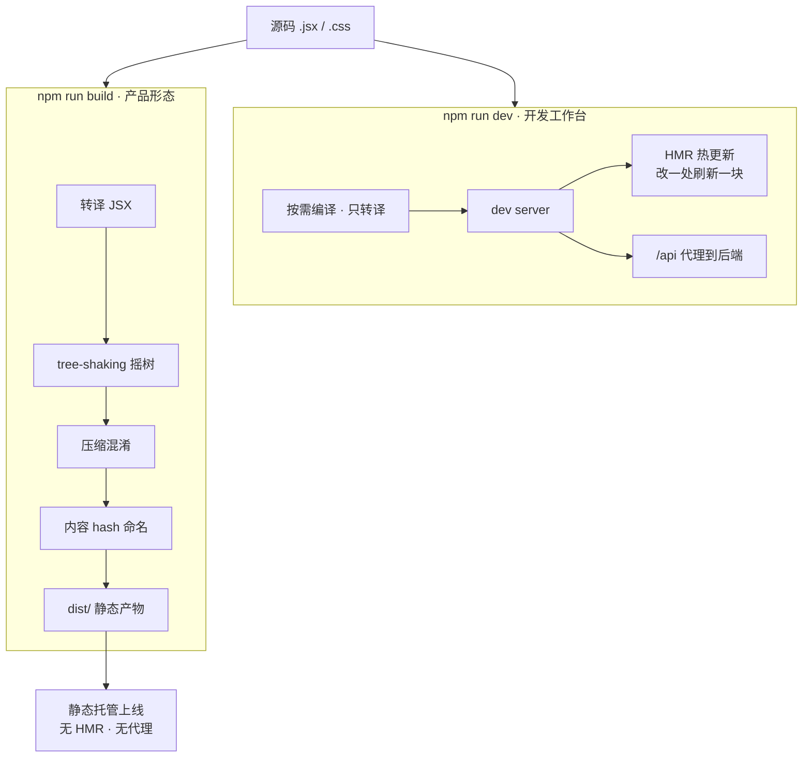
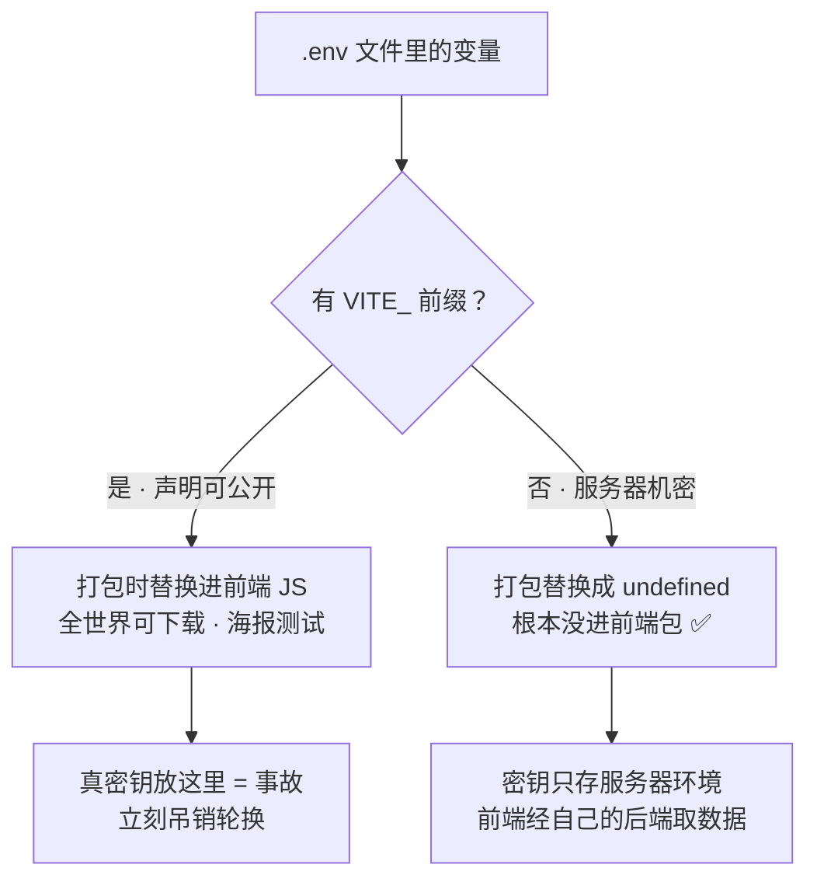
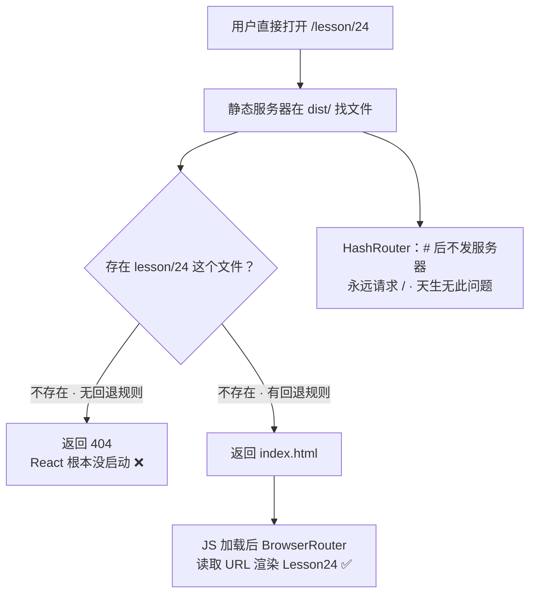

# 第 24 课 · 构建与部署

## 学习目标

完成本课后，你应该能够：

1. 说清楚 `npm run dev` 和 `npm run build` 的本质区别：前者是"开发期工作台"（HMR、按需编译、代理），后者把源码变成"可部署的静态文件"（转译、摇树、压缩、加 hash）——线上只有后者；
2. 会读构建产物：`dist/` 里每个文件是什么、文件名里的 hash 指纹和浏览器缓存的关系、chunk 是怎么被拆出来的、source map 在排错中扮演什么角色；
3. 会用 `import.meta.env` 管理环境变量：VITE_ 前缀规则、`.env` 家族的优先级、MODE/DEV/PROD 三个内置开关，以及最重要的安全红线——**密钥永远不进前端包**；
4. 会把一个 SPA 部署到静态托管（Vercel / Netlify / GitHub Pages），并说清楚 SPA 路由回退（找不到的路径 → index.html）为什么是 BrowserRouter 项目的必备配置；
5. 会跑 Lighthouse 并读懂五项指标，知道本项目当前的真实瓶颈（单 JS chunk 546 kB）和可落地的优化方向。

本课对应的示例代码：

- `src/components/lesson24/EnvDemo.jsx` —— 演示一：环境变量（VITE_ 白名单、`||` 兜底、MODE/DEV/PROD、无前缀变量的下场）
- `src/components/lesson24/BundleTips.jsx` —— 演示二：产物知识卡（hash 指纹 / chunk 来源 / tree-shaking / source map / 压缩）+ 摇树翻牌小测
- `src/pages/Lesson24.jsx` —— 页面编排：build 产物卡、三种托管步骤卡、SPA 回退原理卡、上线 checklist
- 页面专属样式在 `src/pages/lesson24.css`（l24- 前缀）

## 核心概念

### 构建发生了什么：从源码到 dist/

> **一句话记住：** 部署就是把 dist/ 放上任意静态服务器——线上没有 HMR，只有纯静态文件。

`npm run build`（本项目即 `vite build`）依次做五件事：

1. **转译**：JSX 编译成普通 JS、现代语法按需降级，浏览器拿到的是它认识的代码；
2. **摇树（tree-shaking）**：顺着 ESM 的 import/export 引用图，把没被任何地方用到的导出从产物里删掉；
3. **压缩混淆**：去空行、缩短变量名（`useState` 变成 `a` 之类），本课实测 340 个模块最终压成一个 546 kB 的 JS；
4. **内容 hash**：产物文件名带上内容指纹（`index-DWEM_vww.js`），内容变名字才变；
5. **拷贝与汇总**：`public/` 目录原样拷入（本项目的 `favicon.svg`、`users.json`），一切写进 `dist/`。

**部署 = 把 `dist/` 原样放到任意静态文件服务器上**，仅此而已。

dev server 的所有便利在线上都不存在：

- 没有 HMR；
- 没有依赖预构建；
- 没有代理；
- 也没有"刷新就能看到最新代码"——线上世界是纯静态的。

**图：dev 模式 vs 生产构建两条流水线**

### 实测记录：本项目 dist/ 清单与 gzip 前后大小

在项目目录跑 `npm run build`（vite v8.3.8，340 modules transformed）的真实输出：

| 文件 | 原始大小 | gzip 后 | 说明 |
|---|---|---|---|
| `dist/index.html` | 0.46 kB | 0.29 kB | 唯一入口，引用带 hash 的 assets |
| `dist/assets/index-Gq-tLW4c.css` | 17.30 kB | 4.12 kB | 全部课程的 CSS 合并压缩 |
| `dist/assets/HeavyChart-CU_NBqNY.js` | 1.45 kB | 0.85 kB | **第 12 课 LazySection 动态 import() 拆出的 chunk** |
| `dist/assets/index-DWEM_vww.js` | 545.99 kB | 175.02 kB | 其余全部 JS：源码 + 所有依赖 |

`ls -lh dist/assets`：total 560K（HeavyChart 1.5K、index js 534K、css 17K）；`dist/` 根目录另有 `favicon.svg`（9.3K）、`index.html`（462B）、`users.json`（227B，`public/` 原样拷贝）。

这份清单给了四个一手结论：

- **摇树与压缩的威力**：546 kB → gzip 175 kB，传输量降约 68%（CSS 降约 76%）——gzip/brotli 通常再降 60–80%，`npm run build` 输出末列的 gzip 数字就是线上实际传输量的近似；
- **你在第 12 课已经亲手拆过 chunk**：`HeavyChart-*.js` 就是 `React.lazy(() => import('./HeavyChart'))` 的产物，只有滚到那一节才会下载；
- **默认没有 vendors chunk**：所有第三方库和业务代码合在 `index-*.js` 一个文件里。Vite 不主动拆 vendors，要靠构建配置（`manualChunks` 等）显式拆——拆与不拆的权衡见下文 Lighthouse 一节；
- **构建器给了一条警告**："Some chunks are larger than 500 kB after minification"。这不是错误，是提示：首屏 JS 有 546 kB，慢网络下首屏时间会被拖长。

构建后跑 `npx vite preview`（本地起一个"只伺服 dist/ 的静态服务器"）实测：

- `GET /lesson/24` 返回 200（462 字节的 index.html——**深链接直接命中，SPA 回退生效**）；
- `GET /assets/index-DWEM_vww.js` 返回 200 且 `content-type: text/javascript`。

验证完即关闭 preview。注意 preview 验的是**构建产物**，和 dev server 是两个世界。

### 环境变量：import.meta.env 与 VITE_ 前缀

> **一句话记住：** VITE_ 是"可以公开"的白名单——只有带前缀的变量才进前端包。

`import.meta.env` 是 Vite 注入的**构建时常量对象**：dev server 启动或打包那一刻，`.env` 文件里的值被直接替换进代码——不是运行时读文件。两个推论：

- 改了 `.env` 必须**重启 dev server / 重新 build**，热更新不感知它（本课第一易错点）；
- dev 和 build 读的是不同的模式（mode）：`npm run dev` 是 `development`，`npm run build` 是 `production`。页面上 `MODE/DEV/PROD` 三个值在你切到构建产物时会翻转。

**VITE_ 前缀规则**：只有 `VITE_` 开头的变量会被暴露给前端代码。这是白名单防御，不是加密——`.env` 里往往混着数据库密码、支付密钥这类服务器变量，若全量注入，任何人 F12 一句 `console.log(import.meta.env)` 就全拿走了。

Vite 的原则：**不主动进包，显式标 VITE_ 才放行。** 反过来，`import.meta.env.DATABASE_PASSWORD` 在白名单里查不到，打包时直接替换成 `undefined`——它从未进入前端包，也不是"藏起来了"，而是根本没进去（EnvDemo 的表格里可以亲眼看到这个 undefined）。

**`.env` 家族优先级**（从低到高，后者覆盖前者）：

| 文件 | 何时加载 | 用途 |
|---|---|---|
| `.env` | 所有模式 | 全环境通用的默认值 |
| `.env.local` | 所有模式 | 本机覆盖值，**进 .gitignore 不提交** |
| `.env.production` | 仅 `npm run build` | 生产构建专用（**优先于 `.env`**，dev 时看不见） |
| `.env.development` | 仅 `npm run dev` | 开发专用 |
| `.env.[mode].local` | 对应模式 | 模式 + 本机，优先级最高 |

所以"`VITE_API_URL` 在开发指向 localhost、上线指向真域名"的标准做法是：`.env.development` 和 `.env.production` 各写一份同名变量，代码一行不改。

本项目没建 `.env`，`VITE_COURSE_NAME || 'React 学习课程'` 的 `||` 兜底正是为"配了/没配"两种环境共存设计的——读环境变量的惯例永远是"读 + 兜底"，别假设它一定存在。

四个内置变量不用配置：`MODE`（模式名）、`DEV`/`PROD`（布尔开关，适合写 `if (import.meta.env.PROD)` 接入监控）、`BASE_URL`（部署基路径，GitHub Pages 子路径部署时要关心它）。

### 环境变量安全红线：密钥永不进前端

> **一句话记住：** 前端包里没有秘密——密钥只存服务器，前端经自己的后端取数据。

把这条单独一节，因为它值得当纪律背下来：

- **前端包里没有秘密**。凡是被打进 `dist/` 的东西（JS、HTML、CSS、`public/` 文件），全世界都能下载并阅读——混淆只是换了件衣服，不是保险箱；
- 所以：**API 密钥、数据库连接串、支付凭证、管理后台密码，永远只存在服务器环境里**（服务器 `.env` + 后端接口、或托管平台的服务端环境变量/Functions）。前端需要数据，就让你自己的后端拿着密钥去调，再把结果还给前端；
- `VITE_` 前缀 = "我声明这个值可以公开"。写进 `.env` 的每个 `VITE_*`，都要自问一句：**把它印在海报上我亏不亏？** 亏就不要加前缀，它自然进不了前端包；
- 判断口诀：前缀是 `VITE_` 的值必然公开（它就在你能下载的 JS 里）；不带前缀的值前端拿不到（打包时被替换成 undefined）——**越权信任任何一边都是事故**；
- 一旦某个真实密钥被提交进 Git 历史，处理方式是**立刻吊销轮换**（revoke & rotate），删文件、改历史都是次要的。

**图：VITE_ 白名单的进出规则**

### 产物四件事：chunk、摇树、source map、压缩（BundleTips 的展开）

> **一句话记住：** hash 管缓存、chunk 管按需、source map 管排错、gzip 管传输。

四件产物知识逐个说。

**hash 指纹与缓存**：`index-DWEM_vww.js` 里的 hash 是内容指纹。浏览器缓存按"文件名"命中——下次部署如果依赖没升级，这部分代码 hash 不变 → 缓存继续命中，改动过的文件 hash 变 → 自动失效。

**这就是静态资源敢设一年强缓存的机制**，而 `index.html` 不带 hash，必须保证每次都能拿到新的。

**chunk 从哪来**：

- 入口代码 → index chunk；
- `React.lazy(() => import('./X'))` 的每个动态导入点 → 单独 chunk、访问到才下载（本项目的 `HeavyChart-*.js` 就是活证据）；
- 第三方依赖体量大时，用构建配置拆出 vendors chunk，让"业务代码天天变"与"依赖几乎不变"分开缓存。

分包不是为了文件好看，是为了**缓存命中**和**首屏只加载首屏要用的代码**。

**tree-shaking 生效条件**：ESM 的 import/export 是编译期可分析的静态结构，打包器顺着引用图删掉没人用的导出。三个条件缺一不可：

1. 源码写 `import/export` 而不是 `require`（CommonJS 是运行时调用，没法静态分析）；
2. 具名导入而不是整包默认导入（`import { debounce } from 'lodash-es'` vs `import _ from 'lodash'`）；
3. 依赖包自身"可摇"（`package.json` 的 `sideEffects` 声明干净）。

页面上的翻牌小测把这四种情况做成了可亲手验证的题。

**source map**：一张"压缩后位置 → 源码位置"的映射表。产物是压缩混淆过的（变量成 `a/b/c`、空行全无），线上报错堆栈人读不懂。

有 map，浏览器 DevTools 和错误监控平台才能把堆栈还原成你写的源码。

Vite build **默认不生成** map（`build.sourcemap: true` 打开）——map 等于把未压缩源码公开发布，商业项目常选"线上不出 map、错误监控平台私有上传"两全。

**gzip/brotli**：一句话——产物是纯文本，托管平台默认压缩传输、浏览器解压执行，实测本项目 JS 降 68%、CSS 降 76%。

### 静态托管与 SPA 回退：最后一公里

> **一句话记住：** 回退规则把任何路径都变成 index.html 的别名，让 Router 有机会接管 URL。

三种主流静态托管，共同三要素是**构建命令 `npm run build`、产物目录 `dist`、SPA 回退规则**，差异只在第三项：

| 托管 | 步骤概览 | 回退规则 | 备注 |
|---|---|---|---|
| Vercel | GitHub 导入仓库 → Build Command `npm run build` → Output Directory `dist` | Rewrites：`{ "source": "/(.*)", "destination": "/index.html" }`（面板或 `vercel.json`） | 对 SPA 最省心，推送即自动部署 |
| Netlify | 连接仓库 → Build command → Publish directory `dist` | Redirects：`/*  /index.html  200`（`netlify.toml` 或面板） | 必须 200（代理回退），写 301 会变成真跳转 |
| GitHub Pages | Actions workflow（或 gh-pages 分支）跑 `npm run build` | 无自定义回退 → 把 `dist/index.html` 复制为 `404.html` 兜底 | 子路径部署必须 `vite build --base=/仓库名/`，否则资源 404 |

**回退为什么必须配**（本项目就是活例子）：`src/main.jsx` 用的是 `<BrowserRouter>`（第 3 课），`/lesson/24` 只是前端路由——`dist/` 里并不存在 `lesson/24` 这个文件。用户刷新、直接输网址、分享链接时，请求先到静态服务器：

1. 服务器在 `dist/` 找名为 `lesson/24` 的文件 → 不存在；
2. 没有回退规则 → 返回 404，React 根本没机会启动，用户看到错误页；
3. 有回退规则 → 返回 `index.html` → JS 加载后 `BrowserRouter` 读取 URL `/lesson/24`，路由表渲染 `Lesson24`。

一句话：**回退规则把"任何路径"都变成 index.html 的别名，让 Router 有机会接管 URL**。

不想配规则的替代品是 `HashRouter`（URL 变 `#/lesson/24`，服务器看到的永远是 `/`，天生无此问题），代价是 URL 难看、SEO 与锚点受限——现代方案首选 BrowserRouter + 回退。

**图：深链接请求的两种命运**

## 完整部署 checklist

上线前逐条打勾（页面底部有速查版）：

1. `npm run lint` 零警告、`npm test` 全绿——上线前最后一道质量门；
2. `npm run build` 本地成功，读一遍构建输出确认无警告（本项目当前会有一条 chunk > 500 kB 提示，知情即可）；
3. `npx vite preview` 亲测核心交互——preview 跑的是构建产物，dev server 通过不代表产物没问题（minify 后才暴露的问题在这里现形）；
4. `.env` 里没有密钥；暴露给前端的只有 `VITE_` 开头且"可公开"的变量（逐个过一遍海报测试）；
5. `base` 路径与托管目录匹配——GitHub Pages 这类子路径部署必须 `--base=/仓库名/`，否则 CSS/JS 全 404；
6. SPA 回退规则已配（Vercel Rewrites / Netlify Redirects 200 / GitHub Pages 404.html）；
7. 深链接实测：浏览器直接打开 `https://…/lesson/24`（任何一个带层级的路由）确认不 404；
8. `index.html` 的 `<title>`、favicon、meta 描述已定制——本项目默认还是 `my-react-app`（curl 产物可亲眼确认），上线前该改成产品名；
9. Lighthouse 跑一遍，把五项分数记下来当基线，之后每次改版对比（见下节）。

## Lighthouse：五项指标含义与本项目可做的优化

Lighthouse（Chrome DevTools → Lighthouse 面板，选 Mobile + Performance）对页面打五项分：

| 指标 | 含义 | 一句话记法 |
|---|---|---|
| Performance | 加载与交互速度：FCP 首次内容绘制、LCP 最大内容绘制、TTI 可交互时间、CLS 布局抖动等加权 | "用户多快能看到并用到页面" |
| Accessibility | 无障碍：对比度、alt、标签关联、键盘可达、ARIA | "所有人都能用吗" |
| Best Practices | 工程最佳实践：HTTPS、控制台报错、废弃 API、图片比例 | "有没有明显的坑" |
| SEO | 搜索引擎可读性：meta 描述、title、链接可抓取 | "搜索引擎看得懂吗" |
| PWA（渐进式 Web 应用） | 可安装、离线可用、Service Worker（新版 Lighthouse 已弱化此项） | "像不像一个 app" |

对照本项目（构建实测数据）可做的优化，按性价比排序：

1. **拆首屏 JS（针对那条 500 kB 警告）**：546 kB 单 chunk 是最大瓶颈。抓手：路由级 `React.lazy`——16–20 课的重库课（TanStack Query、RHF+Zod、Zustand）只有访问对应课时才需要它们的代码，把每课页面懒加载后，首屏 JS 预计能砍掉一半以上；依赖极大且基本不变的库再考虑拆 vendors chunk 改善缓存命中；
2. **深链接 + 回退先于一切美化**：SPA 不配回退，任何分享/刷新都是 404，Lighthouse 的 SEO 与 Best Practices 都会扣分——这是功能性缺陷，不是调优项；
3. **补上 meta**：`<title>` 还是默认的 `my-react-app`，没有 meta description；每课页面可动态设置 `document.title`，首页补描述；
4. **可访问性顺手做**：本项目已有 `aria-valuenow` 进度条（第 20 课）、`scope="row"` 表头（本课 EnvDemo）——新代码保持这个习惯，比事后补成本低；
5. **图片与字体**：本课实测产物里没有图片资源（favicon.svg 仅 9.3K），这项暂无债可还；将来引入截图/插图时再谈懒加载与格式选择。

先建基线（记下当前五项分数），每做一项优化重跑对比——**性能工作是"测量 → 改 → 再测量"，不测量就优化是猜。**

## 代码导读

### `src/components/lesson24/EnvDemo.jsx` —— 演示一：环境变量

- 模块顶部直接读 `import.meta.env`：`COURSE_NAME = import.meta.env.VITE_COURSE_NAME || 'React 学习课程'`（读 + `||` 兜底的惯例写法）、`SECRET_FROM_SERVER = import.meta.env.DATABASE_PASSWORD`（故意读一个无前缀变量，教学演示它在前端的下场是 undefined）；
- 表格六行：VITE_ 变量原始值 / 兜底后的页面标题 / `MODE` / `DEV` / `PROD` / 无前缀敏感变量 → `undefined —— 根本没进前端包 ✅`。在 dev 下看 MODE=development、DEV=true，学完本课用 `vite preview` 打开同一页对照"翻转后的"三个值；
- 文件顶部块注释完整给出 VITE_ 前缀规则（白名单防御的设计动机）、非 VITE_ 变量"根本没被替换"的机理、`.env` 家族优先级表；
- "看看 import.meta.env 里实际有什么"按钮展开完整 key 名单：dev 下是 `BASE_URL/DEV/MODE/PROD/SSR` 加白名单变量——**dev 与 build 后这份名单不同**，因为打包时整个对象被静态替换成字面量；
- `EnvRow` 小组件收拢表格行，`tone` 上色区分"安全"与"红线"两类值。

### `src/components/lesson24/BundleTips.jsx` —— 演示二：产物知识卡 + 摇树小测

- `CARDS` 模块级常量：hash 指纹与缓存、chunk 三种来源（入口 / 动态 import / 手动拆 vendors）、tree-shaking 三条件、source map 是什么与为什么默认不生成、gzip/brotli 一句话；
- `QUIZ` 四道翻牌题：lodash-es 具名导入（能摇）/ lodash 整包默认导入（不能）/ `require` 解构（不能，运行时调用）/ CSS 副作用导入（不能，没有"导出"可摇）——点击翻面看结论与原因，`revealed` 用 Set 存已翻开项、不可变更新（`new Set(prev)`）；
- 文件顶部块注释按"本文件教什么"展开五张卡的知识，页面卡面只放浓缩版——注释是教材正文，卡片是提词器。

### `src/pages/Lesson24.jsx` —— 页面编排与部署知识

- `HOSTS`：三种托管的步骤数据（构建命令 / 产物目录 / 各自的回退配置与坑），`CHECKLIST`：九条上线检查项速查版（逐条解释在本文档 checklist 一节）；
- "npm run build 之后，产物是什么"卡：build 五步（转译 → 摇树 → 压缩 → hash → 拷贝 public）+ 产物目录树；
- "SPA 路由回退"卡：引用本项目 `src/main.jsx` 的 `<BrowserRouter>`，按"请求先到服务器 → 找不到文件 → 有/无回退两种命运"四步讲清为什么必须配，结尾给 HashRouter 替代方案及其代价；
- 数据全在模块顶部，组件只渲染——延续第 20 课"页面 = 编排车间"的收尾风格。

### `src/pages/lesson24.css`

`l24-` 前缀隔离命名：环境变量表（含 l24-ok/l24-bad 红绿语义色）、知识卡自适应网格（`auto-fit + minmax`，窄屏自动降列）、翻牌按钮、产物目录树深色块、托管三卡、checklist 的 `::before` 对勾。通用布局继续复用 App.css 的 `.card/.row` 与 index.css 的 `.hint`。

## 动手试一试

1. **亲手体验"重启才生效"**：项目根目录建 `.env`，写 `VITE_COURSE_NAME=我的第一个上线应用`。先不重启，刷新页面看标题（还是兜底值）；然后重启 dev server 再看（变成新值）。把同名变量写进 `.env.production` 再 `npm run build && npx vite preview`，看构建产物里的值——同一个变量名，dev 和 build 各吃各的文件。做完记得删掉这个实验 `.env`（别提交）。
2. **当一次部署工程师**：把本项目推到 GitHub，接入 Vercel 或 Netlify，Build Command 填 `npm run build`、Output Directory 填 `dist`。部署成功后做两件事：浏览器直接打开线上 `/lesson/24` 验证回退规则生效；把 Rewrites/Redirects 规则暂时删掉重新部署，再刷新深链接看 404——亲眼见过 404 才算真正理解回退。GitHub Pages 路线则补 `--base=/仓库名/` 和 404.html 两个坑。
3. **给课程应用做路由级代码分割**：把 `main.jsx` 里 16–20 课的静态导入改成 `React.lazy(() => import('./pages/Lesson16.jsx'))` + `<Suspense>`（第 12 课的全部知识），重新 `npm run build`，对比 index chunk 的体积变化（本项目懒加载 HeavyChart 前后 546 kB 里只省出 1.45 kB——因为重的是依赖本身；把用重库的整页懒出去，才能省出 TanStack Query/RHF/Zod 那几百 kB）。

## 易错点

1. **改了 `.env` 不重启**：现象是变量"死活不生效"，反复检查拼写又没错。原因：`import.meta.env` 是构建时常量，dev server 启动那一刻就定死了，热更新不感知 `.env` 变化。规则：动 `.env` 必重启（build 则重新 build）。
2. **把密钥写进 `VITE_` 变量**：现象是"本地好好的，上线被人刷接口/刷用量"。原因：`VITE_` 开头的值会被原样打进产物 JS，产物是全世界可下载的公开文件——混淆不是加密。规则：`VITE_` = 印在海报上的自觉；密钥只进服务器环境。
3. **部署后刷新/分享链接 404**：现象是首页正常，从 `/lesson/24` 刷新或直接打开就 404。原因：BrowserRouter 的路径是前端路由，服务器上没有这个文件，又没配"找不到就回 index.html"的回退规则。规则：SPA 上线 = 传 dist + 配回退，缺一不可；GitHub Pages 记得 404.html，Netlify 的 Redirects 必须写 200 不是 301。
4. **以为混淆/压缩是安全手段**：现象是"我的密钥在产物里，但变量名都变成 a/b/c 了，别人看不懂"。原因：混淆只影响可读性，接口调用照样抓包可见，字符串原样躺在文件里可搜索。安全来自架构（密钥不下发），从不来自隐藏。
5. **只验 dev server 就宣布部署完成**：现象是本地一切正常，线上样式丢失/资源 404/交互报错。原因：dev server 和构建产物是两个世界——minify 才暴露的代码问题、base 路径、public 拷贝遗漏，只有产物里才有。规则：部署前必跑 `npx vite preview` 亲测核心交互（本课 checklist 第 3 条）。

## 自测题

1. 为什么只有 `VITE_` 前缀的变量会出现在前端包里？`import.meta.env.DATABASE_PASSWORD` 在前端读到的是什么、为什么？
2. 本项目 `npm run build` 后 `dist/assets/` 里有个 `HeavyChart-CU_NBqNY.js`，它是怎么来的？如果把它改成静态导入，产物和网络请求会发生什么变化？
3. `import { debounce } from 'lodash-es'` 和 `import _ from 'lodash'` 在产物体积上为什么天差地别？tree-shaking 生效的三个条件分别是什么？
4. 用户把 `https://你的域名/lesson/24` 发给朋友，朋友直接打开却看到 404。请按"请求 → 服务器 → 浏览器"的顺序解释发生了什么，以及回退规则（rewrites/redirects/404.html）是怎么救场的？`HashRouter` 为什么天生没有这个问题？

### 参考答案

1. Vite 用白名单防御：只有显式标了 `VITE_` 前缀的变量才会被替换进前端代码——设计动机是 `.env` 里混着服务器机密，全量注入等于把机密随产物公开。`DATABASE_PASSWORD` 不在白名单里，打包时这个表达式被直接替换成 `undefined`：不是被藏起来，而是它的值从未离开服务器/CI 环境，前端包里根本没有这个数据。
2. 它是第 12 课 `React.lazy(() => import('./HeavyChart'))` 动态导入点的产物：每个 `import()` 点单独成 chunk，访问到那一节才下载。改成静态导入后，这 1.45 kB 会合并进 `index-*.js`（首屏必须全部加载），`HeavyChart` 单独的网络请求消失——体积增量虽小，但"按需加载"变成了"全量预付"；这就是路由级代码分割的原理，重库页面懒出去才能省出大头。
3. lodash-es 是 ESM 包且 `sideEffects` 干净：具名导入让打包器能静态分析出"只用了 debounce 及其依赖"，其余方法不进包；lodash 主包是 CommonJS/UMD 且整包默认导入，`_` 是一个运行时对象，编译期无法知道你用了哪些方法，只能全量打包。三条件：① 源码用 `import/export`（CommonJS 的 require 无法静态分析）；② 具名导入而非整包默认导入；③ 依赖包自身可摇（sideEffects 声明干净）。
4. 顺序：浏览器发 `GET /lesson/24` → 静态服务器在 dist/ 里找名为 `lesson/24` 的文件 → 不存在 → 没有回退规则时返回 404 页面，JS 没机会加载，React 完全没启动。回退规则把"找不到的路径"一律改回 `index.html`（200）：HTML 先到 → JS 加载 → `BrowserRouter` 读到 URL `/lesson/24` → 路由表渲染 Lesson24。`HashRouter` 的路径部分永远是 `/`，真实路由信息放在 `#` 后面——而 `#` 后的内容浏览器根本不会发给服务器，所以服务器永远只处理 `/`，天然不缺文件。

## 下一课预告

第 25 课（毕业课）：二十几课走完，从 `useState` 到构建部署，你已经拥有一个完整的前端工程师入门工具箱。最后一课不引入新库，而是做一次全课程的自检与复盘：毕业自检清单、把本项目真正部署上线的实战收尾、以及一份"接下来学什么"的路线图——然后，去写属于你自己的项目。
