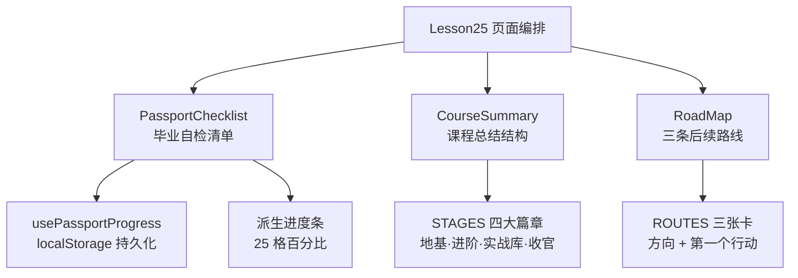
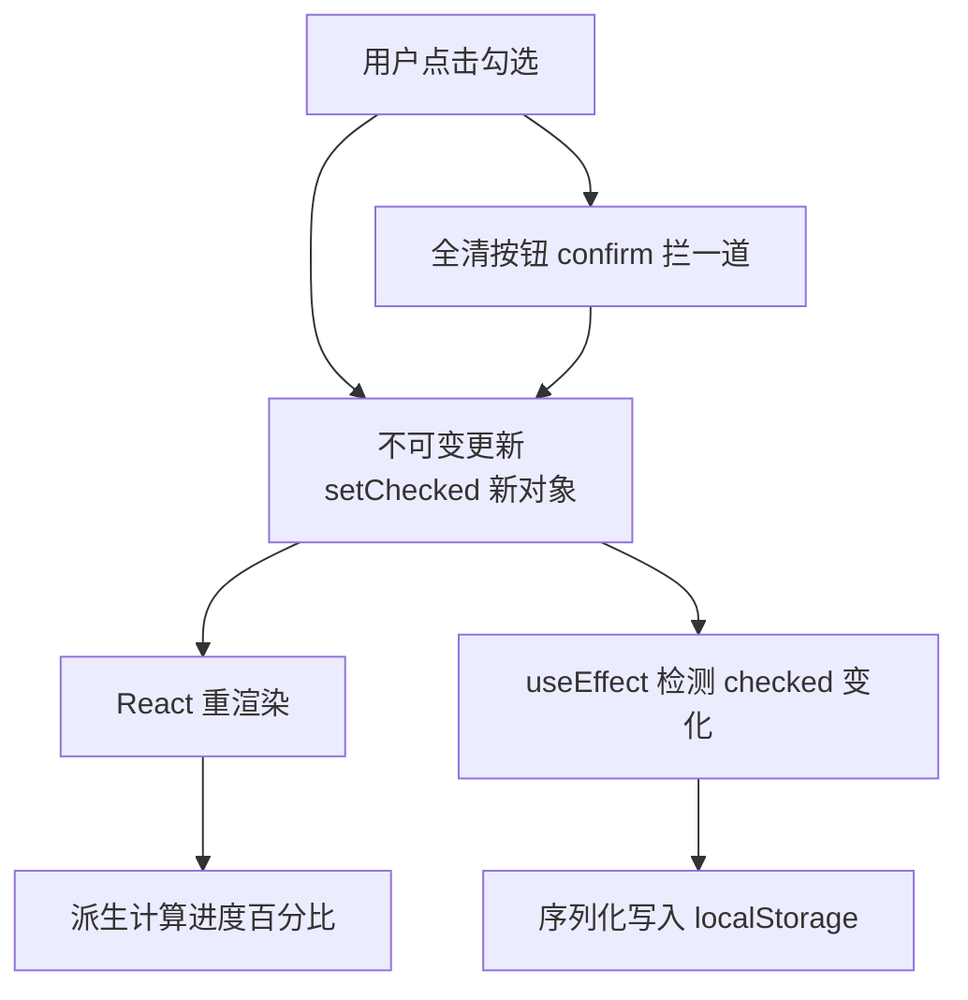
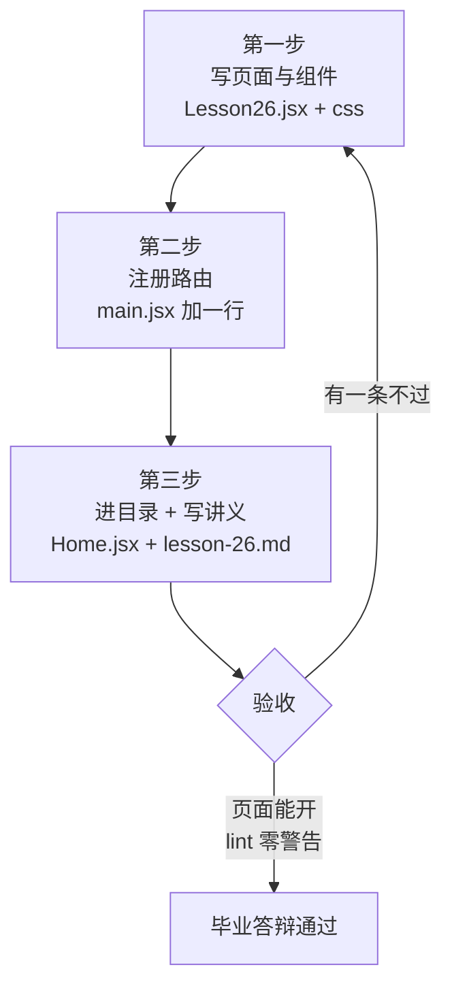

# 第 25 课 · 毕业项目：学习护照

最后一课没有新 API。

这一课交给你的是三样东西：一张**毕业自检清单**（把 25 课复盘一遍）、一张**课程总结结构图**（把主线刻进脑子里）、一张**后续路线图**（毕业之后往哪走）。

学习方式：打开 http://localhost:5173/lesson/25 ，逐条自问清单上的检查项。答不上就回那课的页面和讲义，直到护照上 25 格全部盖章。

## 学习目标

完成本课后，你应该能够：

1. 会用"学习护照"逐条自检 25 课核心概念——每课一条"我能解释 / 我能写出"，勾选进度持久化在 localStorage（刷新不丢、全清可重来）；
2. 能复述课程主线：一段地基（第 1–10 课）+ 三大篇章（进阶篇 / 实战库篇 / 收官篇），并说清每个篇章"学完你能做什么"；
3. 能说出毕业后的三条路线（Next.js 与 RSC、React Native、开源与作品集）各自解决什么问题，并为第一条路线写下"本周就能动手"的第一个行动；
4. 能按"加课三步"独立给本项目扩展一节自选主题的第 26 课——这是最硬的自检：能往课程里加课的人，才算真正掌握了这门课的组织方式；
5. 理解"学完不是终点"：React 知识是工具，成长来自构建真实项目。

本课对应的示例代码：

- `src/pages/Lesson25.jsx` —— 页面编排：护照页头（课程名 + 三大篇章徽章）+ 毕业致辞 + 三个内容组件
- `src/components/lesson25/PassportChecklist.jsx` —— 25 条检查项 + useState 本地持久化 + 进度条 + 全清按钮
- `src/components/lesson25/CourseSummary.jsx` —— 三大篇章结构图（纯 JSX/CSS 绘制，文案与 doc/README.md 主线同源）
- `src/components/lesson25/RoadMap.jsx` —— 三条后续路线卡：导论 + 第一个行动建议
- `src/pages/lesson25.css` —— 全部 `l25-` 前缀样式，篇章配色全页统一

**图：毕业项目的功能模块结构**



## 毕业自检清单怎么用

清单在 `PassportChecklist.jsx` 里：25 条检查项按课程主线分成四组（地基 1–10、进阶 11–15、实战库 16–20、收官 21–25），每条都标了课号徽章。

用法只有一条铁律：**先口答，再打勾**。

能不看讲义解释清楚、或当场写出核心代码，才算通过。含糊的条目点回那课的页面（`/lesson/N`）和讲义（`doc/lesson-N.md`）复盘。

勾选进度写进 localStorage（key：`lesson25:passport`），明天打开还在。"全清重来"按钮先弹 confirm 再清空——**破坏性操作永远拦一道**。

从实现上看，这个清单是把第 8 课 `useLocalStorage` 的套路迷你重演了一遍：

```js
// 读：惰性初始化——读存储是 IO，绝不放进渲染体（渲染必须纯）
const [checked, setChecked] = useState(() => {
  try {
    const raw = localStorage.getItem(STORAGE_KEY)
    return raw !== null ? JSON.parse(raw) : {}   // 用 !== null 判断"存没存过"
  } catch { return {} }                           // 存储被禁用/坏 JSON：退回全未勾
})
// 写：副作用进 useEffect，勾选一变就序列化写盘
useEffect(() => {
  localStorage.setItem(STORAGE_KEY, JSON.stringify(checked))
}, [checked])
```

两个设计决策值得注意：

- 进度百分比是**派生值**：从 `checked` 现算，绝不另存一份"进度" state——两份真相迟早打架，第 20 课同款铁律。
- 勾选更新走**不可变更新**：`setChecked(prev => ({ ...prev, [lesson]: !prev[lesson] }) )`——直接改旧对象再 set，引用没变 React 就跳过重渲染。

**图：勾选更新与持久化的数据流**



## 代码导读

### `src/pages/Lesson25.jsx` —— 纯编排页

- 页面自身**不持有任何 state**：页头（标题 + 徽章 + 致辞）是无状态 JSX，三块内容各自由独立组件承担——这正是第 22 课"容器与展示"的收尾示范：页面只决定摆什么、按什么顺序；
- 三大篇章徽章的数据单独抽成 `STAGE_BADGES` 常量，文案与 CourseSummary、doc/README.md 保持同源——同一种篇章，全项目只用一种说法；
- 毕业致辞是一段独立样式的引言块（`l25-address`）：毕业页该有一点仪式感，但文案的落点仍然是行动（"去构建"），不是抒情。

### `src/components/lesson25/PassportChecklist.jsx` —— 有状态的清单

- `SECTIONS` 常量是唯一的数据源：篇章 → 检查项（课号 + 文案），UI 靠两层 `map` 渲染——以后想加检查项，改数据就行，不动 JSX；
- `usePassportProgress()` 是页面私有的持久化 hook：惰性初始化读 + useEffect 写（见上一节）。没复用第 8 课的文件是因为教学项目各课自包含（`lessonN/` 目录互不依赖），把同样的两步再走一遍本身就是复习；
- 进度区：`big-number` 大百分比 + 外槽内条进度条（宽度内联绑定派生值，`role="progressbar"` 供读屏器）+ 全清按钮；
- "全清"不手动删 localStorage——`setChecked({})` 之后 useEffect 自然把空对象写回。**单一数据源，改 state 即同步存储**；
- 勾选行的 `done` 类复用 App.css 现成的 `.card li.done label` 划线样式——能复用就不新造。

### `src/components/lesson25/CourseSummary.jsx` —— 纯 JSX/CSS 结构图

- 结构图完全不用图片库：篇章是带左色条的块（`l25-stage`），块与块之间插 `↓` 连接条（`aria-hidden`，纯装饰），终点是深色实底的"毕业"块——CSS 的边框颜色和背景色就够表达层次；
- 四个篇章的数据抽成 `STAGES`，每段三行：课名流水线（取自 README 主线）、一句"学完你能做什么"（`canDo` 字段）。总结要具体到能力："独立完成一个真实小应用"比"学了 10 课"有用得多；
- 本组件无 state、无交互，是标准的展示型组件。

### `src/components/lesson25/RoadMap.jsx` —— 三条路线卡

- `ROUTES` 数据三张卡同构：`tag`（方向一/二/三）+ `intro`（导论）+ `action`（第一个行动）。布局用 `grid-template-columns: repeat(auto-fit, minmax(260px, 1fr))`，窄屏自动落成单列，免写媒体查询；
- 每条路线都强制配"第一个行动"——模糊的方向感没有用，能本周动手的最小行动才有用。

### `src/pages/lesson25.css` —— 篇章配色系统

全部 `l25-` 前缀；一个篇章一种颜色并在全页保持一致：基础灰、进阶紫、实战库青、收官琥珀——徽章、清单分组、结构图三处同色，颜色本身就在讲"结构"。

## 毕业挑战：给本项目加一个第 26 课

这是本课的"动手试一试"，也是毕业答辩的第一问。

自选一个主题（建议方向：列表虚拟化、WebSocket 实时数据、PWA 离线缓存、微前端、拖拽排序……任何你好奇的），把它做成一节真课。

**加课三步**（呼应第 3 课——你现在读到的每一课都是这三步加进来的）：

**图：加课三步流程**



1. **写页面与组件**：`src/pages/Lesson26.jsx`（第 4 课起组件放 `src/components/lesson26/`，页内样式写 `src/pages/lesson26.css`）——参考任意一课的页面结构：顶部块注释讲"本文件教什么"，页头 + 若干 `.card` 演示卡；
2. **注册路由**：`src/main.jsx` 路由表加一行 `/lesson/26` → `Lesson26`——第 3 课学过的"SPA 靠前端路由组织多页面"，此刻亲手复现；
3. **进目录 + 写讲义**：`src/pages/Home.jsx` 的 `lessons` 数组加一条（标题、简介），`doc/` 下写 `lesson-26.md`——讲义用统一模板：学习目标 → 核心概念 → 代码导读 → 动手试一试 → 易错点 → 自测题。

验收标准：`/lesson/26` 页面能打开、交互能点、`npm run lint` 零警告、首页能看到新课条目。做完这一步，你就同时验证了第 1（组件）、3（路由）、15（lint/test 护栏）和本课的全部内容。

## 后续学习路线

三条方向不互斥，但别同时走：挑一条，完成它的"第一个行动"，有了手感再决定换道。页面上的路线卡（`RoadMap.jsx`）是这三段的卡片版。

### 方向一：Next.js 与 React Server Components

你在这门课里写的 SPA 把整棵组件树和 JS 打包发到浏览器再渲染——首屏要等 JS。

Next.js 的默认答案不同：**服务端组件（RSC）在服务器上渲染成 HTML 直接下发，不打进浏览器 JS 包**，数据获取、重计算、密钥都留在服务端，浏览器只收"结果"。

需要交互的部分标 `'use client'`，变回你熟悉的客户端组件——state、hooks、事件全部照旧。

所以"React 你已经学完了"是真的：Next.js 补的是**渲染发生在哪**（RSC/客户端组件的边界）与**路由/构建层**（App Router 文件即路由、构建、缓存）的工程能力。

**第一个行动**：把本项目用 Next.js 重写首页和前 3 课——"文件即路由"与 `main.jsx` 的集中式路由表对比一遍，再把第 11 课的手写 fetch 换成服务端组件直连数据。

### 方向二：React Native——一次学习，多端交付

React Native 让你用**同一套 React 知识**（组件、props、state、hooks 全部复用）写 iOS / Android 应用：`div`/`span` 换成 `View`/`Text`，`onClick` 换成 `onPress`，CSS 换成 `StyleSheet`（默认 flex 布局）。

真正的新东西只有两件：样式能力比 CSS 窄、以及"原生控件"的交互手感与 Web 不同。

这门课的性价比在这里兑现——学一次 React，Web 和 App 两头用。

**第一个行动**：装 Expo（官方脚手架），把第 1 课的 TodoList 原样搬进手机模拟器——逻辑一行不用改，只换标签名和样式写法，体验"知识平移"。

### 方向三：开源贡献与作品集

学完最好的证据是**作品**，不是结业证书。

作品集第一条目可以就是本项目：这门课程本身（25 个页面 + 配套讲义）按第 24 课的方法 build + 部署上线，就是一份能点开、能交互、有源码的展示。

开源贡献是第二步：你已经在第 16–18 课真实用过 TanStack Query、React Hook Form、Zustand——给它们提一个复现良好的 issue、或修一个文档错字，都是真实贡献。贡献的门槛比想象中低，价值在于"公开地、可验证地写出正确的东西"。

**第一个行动**：按第 24 课流程 `npm run build` 并部署到静态托管，然后在 README 补一段截图 + 功能清单 + 在线地址，作为作品集第一篇。

## 易错点

1. **把 localStorage 的读放进渲染体**：现象是每次渲染都读一遍存储（性能浪费），StrictMode 下还会读两次。原因：读存储是 IO，渲染必须纯、可能被重跑。正确写法是惰性初始化 `useState(() => 从存储恢复)`，只在首次渲染读一次。
2. **进度百分比另存一份 state**：现象是勾了两条但进度条不动、或数字对不上。原因：进度和勾选是两份真相，改了一份忘了另一份。正确做法：百分比永远从 `checked` 现算（派生值），不落任何存储、不进任何 state。
3. **直接改对象再 `setChecked(同一引用)`**：现象是点了勾选界面没反应，刷新后却"莫名其妙生效了"（localStorage 里已经是改过的对象）。原因：React 靠引用比较决定是否重渲染，改旧对象引用不变。正确做法是不可变更新：`setChecked(prev => ({ ...prev, [lesson]: !prev[lesson] }))`。
4. **"全清"只删了 localStorage 忘了 setState**：现象是刷新前界面还显示旧勾选，存储里却已空——界面和存储两套世界不同步。原因：把存储当成了需要"手动维护"的第二数据源。正确做法：只改 state（`setChecked({})`），持久化交给 useEffect 自动写盘——单一数据源。
5. **破坏性操作不拦一道**：现象是一下误触把几十条勾选记录清光。原因：全清这类操作离手指太近。正确做法：`window.confirm` 先确认（本项目做法），或做成"再点一次才生效"的两段式按钮。

## 毕业答辩五问

不用真的答辩，但每问都应该能口答 30 秒以上。答不上的，回对应课的页面把 demo 再点一遍。

1. 用一句话讲完这门课：`UI = f(state)` 之后，剩下的 24 课分别回答了 state 之外的哪些问题？
2. 第 11 课手写 `useFetch` 和第 16 课 TanStack Query 的分界线在哪里？什么时候手写仍然是更好的选择？
3. "组件是状态机：props 是输入，state 是记忆，渲染是输出。"拿你在第 10 课写的某个组件，按这三要素拆解一遍。
4. TSX 里的类型标注在运行时存在吗？它改变了 React 的什么，又没改变什么？
5. 要把本项目部署上线（第 24 课）：`vite build` 的产物和 dev server 有什么本质区别？API 密钥写在源码里为什么上线前必须挪走？

### 参考答案

1. 第 2 课答"副作用怎么办"，第 3 课答"多页面怎么组织"，第 4/5/6/7 课答"state 该放哪、不进 state 的值放哪、跨层共享、复杂迁移怎么收敛"，第 8 课答"逻辑怎么复用"，第 9 课答"什么时候才需要管性能"，第 11–15 课答"工程化怎么办"（请求、按需加载、兜底、并发、测试），第 16–18 课答"什么该交给库"（服务器状态、表单、全局状态），第 19 课答"最新版本带来了什么"，第 21–24 课答"怎么交付"（类型、模式、动效、上线）。
2. 分界线是**数据是否"多组件共享 + 会被写操作改"**：是的话，跨组件缓存、去重、失效广播这些手写要么做不到、要么每次重复写且容易漏，值得上 Query；一次性、单组件的小请求，第 11 课的 `useFetch`（零依赖、机制全在自己代码里）仍然更好——库的代价是多一层抽象和一套调试成本。
3. 以笔记应用的 `NoteEditor` 为例：props 输入是 `note` 对象和保存回调；state 记忆是草稿正文/搜索词这类"会变且渲染要用"的值；渲染输出是当前 props + state 下的 JSX。凡是"改了想让它显示"的才进 state；`ref` 里的 DOM 引用、定时器 id 这些"存在但不参与渲染"的绝不进。
4. 运行时不存在——类型在 `vite build` 时被整体擦除，浏览器执行的 JS 里没有任何类型信息。它改变了开发期体验（编辑器补全、重构、把"传错 props"从运行期 bug 提前到编译期报错），没改变 React 的执行模型：组件仍然是"props 进、JSX 出"的函数，该有的重渲染一次不少。
5. dev server 是"按需即时编译 + HMR"的开发服务，代码没压缩、没分包；`vite build` 产物是静态文件（压缩、tree-shaking、代码分割后的 JS/CSS/HTML），交给任何静态托管即可，不需要 Node 进程。密钥写在前端源码里会**原样进入打包产物**，任何访问者打开 DevTools 就能看到——凡是不能公开的秘密只能放服务端（这正是 RSC/后端存在的理由之一）。

## 结业寄语

没有"下一课预告"了——下一课由你写（见毕业挑战）。

这 25 课教会你的是一门手艺的语法，而手艺的精进只发生在一遍遍真实构建里：部署它、扩展它、拆了重写它、讲给别人听。

学习护照盖章之后，去构建真实项目吧。毕业快乐！🎓
