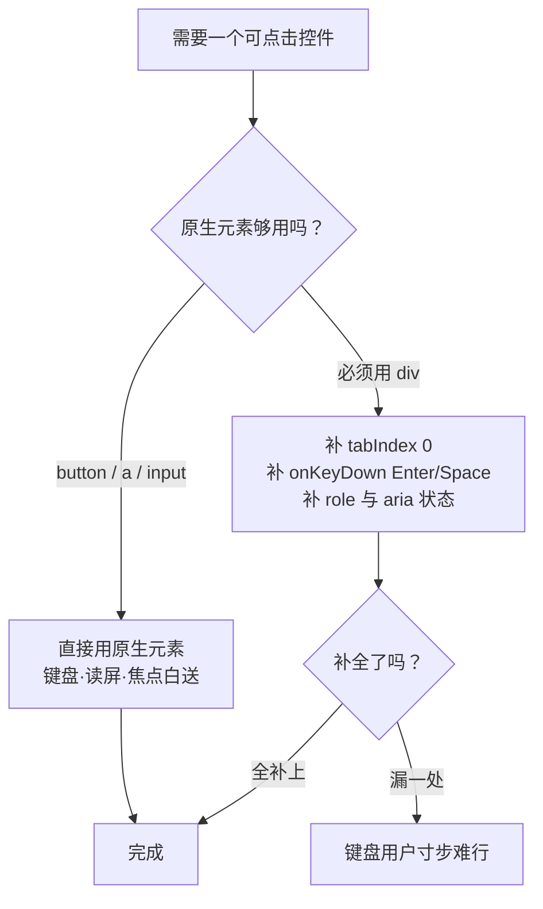
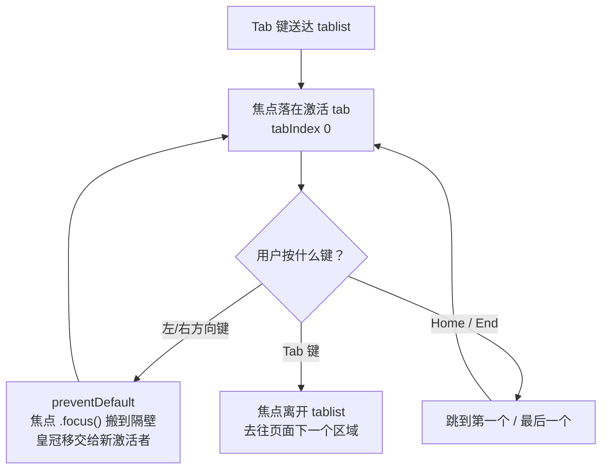
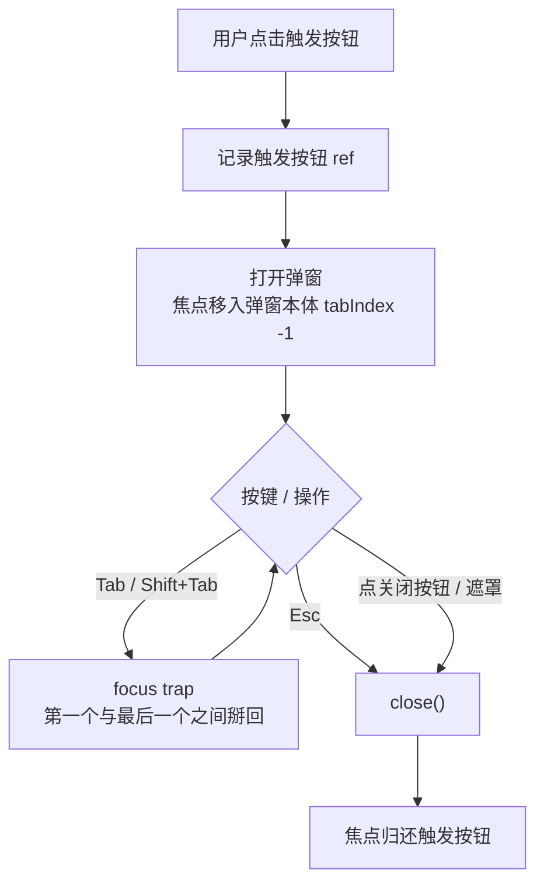
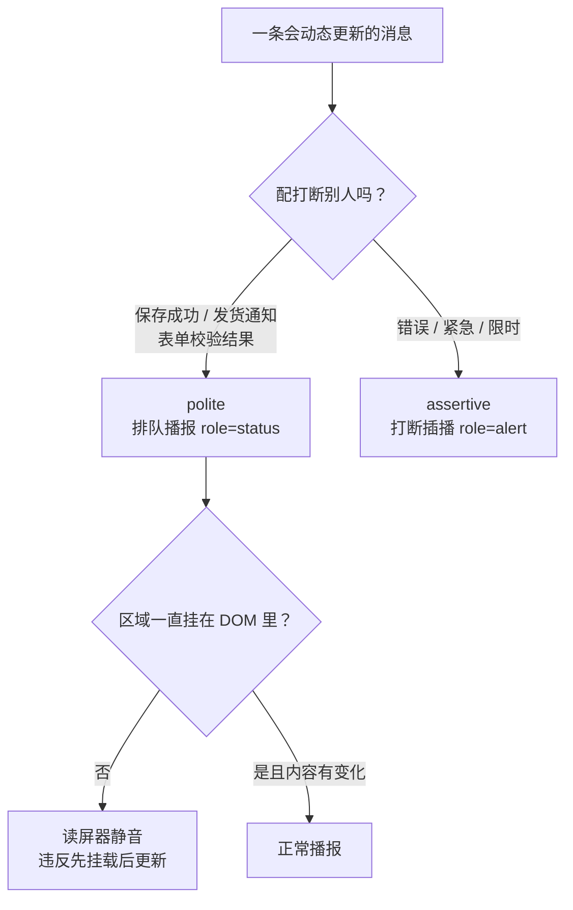

# 第 26 课 · 可访问性 (a11y)

## 学习目标

完成本课后，你应该能够：

1. 说清楚并背下本课三条铁律：**语义化 HTML 优先**（原生 `<button>` 优于 `
`）、**ARIA 是补充不是替代**（role/aria 只翻译结构、不产生任何行为）、**键盘可达是底线**（Tab/方向键/Esc/Enter/Space 能完成一切核心操作）；
2. 能把一个"看起来能用"的组件升级成 WAI-ARIA 规范组件：给第 22 课的 Tabs 补齐角色链（tablist/tab/tabpanel + aria-selected/aria-controls/aria-labelledby）、**roving tabindex** 和方向键 + Home/End 导航；
3. 能手写对话框的**焦点四件套**——打开时焦点移入、Tab 循环困在弹窗内（focus trap）、Esc 关闭、关闭后焦点归还触发按钮——并说清教学版 trap 与生产方案（原生 `<dialog>`、`inert` 属性、focus-trap-react）的差距；
4. 掌握 `aria-live` 两档（polite 排队播报 / assertive 打断插播）的分工与两条使用铁律（先挂载后更新、换文字才会再播报）；
5. 建立**多重编码**意识：状态信息用"颜色 + 图标 + 文字"至少两重编码，永远不把含义只放在颜色上（色觉障碍用户约 8%，黑白打印和强光屏幕会"吃掉"颜色这一重）。

本课对应的示例代码：

- `src/components/lesson26/AccessibleTabs.jsx` —— 第 22 课 Tabs 的完整 a11y 升级版：角色链补全、roving tabindex、方向键/Home/End 键盘导航、ref 登记表供焦点搬家；调用方 API 一字未变
- `src/components/lesson26/AccessibleModal.jsx` —— 无障碍对话框：焦点四件套的教学版实现，每处简化都注释了生产方案差距
- `src/components/lesson26/LiveRegion.jsx` —— aria-live polite/assertive 对比（模拟异步通知）+ 三重编码正反例 + `grayscale(1)` 黑白视图开关
- 页面入口在 `src/pages/Lesson26.jsx`（每张卡附"键盘路线"提示），样式在 `src/pages/lesson26.css`（含 `:focus-visible` 焦点环与 `prefers-reduced-motion` 降级）

## 核心概念

### 三条铁律：本课的主线，也是永远的顺序

> **一句话记住：** 先选对 HTML，ARIA 只做翻译，键盘走得通才算过关——顺序永远如此。

为什么很多"看起来能用"的组件对一部分用户等于不存在？因为鼠标之外的通道——键盘、读屏器（把屏幕内容念出来的软件）——看不到视觉把戏，只认结构。

三条铁律就是为这些通道立规矩。

**① 语义化 HTML 优先。** 浏览器给原生元素白送了一整套行为。

比如 `<button>`：天然可被 Tab 聚焦、Enter/Space 触发点击、读屏器念出"按钮"、`disabled` 时自动退出 Tab 序；`<input>` 配 `<label htmlFor>` 天然有名字。

用一个 `
` 再怎么补 `role="button"` 和 `tabIndex={0}`，也得手工补键盘事件、手工处理 Space 键滚动页面的默认行为——而且永远补不全。**先选对 HTML，再做别的。**

**图：语义化优先的决策路径**

**② ARIA 是补充不是替代。** ARIA（Accessible Rich Internet Applications，一组无障碍属性的规范）做的唯一一件事，是把 UI 的角色（role）、状态（aria-selected/aria-pressed…）、关系（aria-controls/aria-labelledby…）**翻译**给辅助技术。

它不产生任何行为：给一个 div 挂上 `role="tab"`，不会让它变得可聚焦、不会让方向键工作、不会在视觉上有任何变化——"键盘切换"必须你亲手写 onKeyDown。

反过来，本课 Tabs 在第 22 课就挂了 role 和 aria-selected，但键盘用户依然寸步难行——缺的不是属性，是行为。

**③ 键盘可达是底线。** 视障用户靠读屏器 + 键盘，行动障碍用户可能拿不动鼠标，大量普通用户只是暂时离不开键盘。

验收标准简单粗暴：**拔掉鼠标，只用 Tab / 方向键 / Esc / Enter / Space，核心流程要能走通。**

这条做不到，前两条都是装饰。

### roving tabindex：让一组按钮只占一个制表位

> **一句话记住：** 一组 tab 整体只占一个制表位——激活的给 `tabIndex={0}`，其余给 `-1`，方向键负责搬焦点。

键盘规范（WAI-ARIA APG）要求 Tabs 这类"组内导航"组件整体只占**一个**制表位：Tab 键把用户送到组里一次，之后组内移动交给方向键。靠什么实现？先看 `tabIndex` 三个取值，各管一件事：

| 值 | 含义 | 用途 |
|---|---|---|
| `0`（默认） | 参与 Tab 序，按 DOM 顺序停靠 | 普通可聚焦元素 |
| `-1` | 不进 Tab 序，**但可以被 `.focus()` 程序聚焦** | roving tabindex 的"隐身"成员、弹窗本体 |
| 正整数 | 手工指定 Tab 序位置 | **不要用**——DOM 长了以后手工编号必然错乱，是公认反模式 |

实现就是 roving tabindex（roving 意为"漫游"）：**当前激活的 tab 给 `tabIndex={0}`，其余全给 `-1`**——于是 Tab 键永远只停在一个 tab 上。

方向键的 handler 用 `.focus()` 把焦点搬到隔壁（`-1` 元素照样可以被程序聚焦，这正是 `-1` 的存在意义），同时更新激活状态。

焦点像一顶"皇冠"在组内成员间漫游，`tabIndex={0}` 永远戴在当前激活者头上——这就是名字里 roving 的来历。

配套的规范还有两处细节：

- 方向键默认会滚动页面，handler 里必须 `event.preventDefault()` 吞掉；
- 左右取模实现"到头绕回"（`(i - 1 + n) % n` 防止 -1 取模出错）。

另外还有两派：**选择随焦点**（automatic activation：焦点到哪面板跟到哪，本课采用）与**手动激活**（manual activation：方向键只移焦点，Enter/Space 才切面板，适合面板渲染很重的场景）。

**图：roving tabindex 焦点流转**

### 对话框的焦点四件套

> **一句话记住：** 打开移入、Tab 困住、Esc 关闭、关闭归还——四道题全对，弹窗才对键盘用户存在。

弹窗对鼠标用户只是"盖了一层"，对键盘/读屏用户是四道必须全对的题：

1. **打开时焦点移入**：否则焦点还留在触发按钮上，按 Tab 会逛到弹窗底下的页面，读屏器也不播报弹窗。本课聚焦弹窗**本体**（`tabIndex={-1}` 的容器）而不是第一个控件——读屏器聚焦容器后按 `aria-labelledby` 先播报标题（"报幕"），而且第一个控件常是"取消"按钮，直接落上去容易 Enter 误触。
2. **Tab 循环困在弹窗内（focus trap，焦点陷阱）**：Tab 是键盘用户的"眼睛"。弹窗声明了 `aria-modal="true"`（背后的内容视为不存在），Tab 若能跑出去，等于让人"看见"了不存在的背景。实现：在容器上拦 Tab 键，聚焦元素在**第一个**时按 Shift+Tab → 转回最后一个；在**最后一个**时按 Tab → 转回第一个；中间的移动放行给浏览器默认行为。
3. **Esc 关闭**：键盘用户的关闭通道，与关闭按钮地位平等。
4. **关闭后焦点归还触发按钮**：不归还的话焦点掉回 `<body>`，用户被"传送"回页面开头，正在做的事断了线。实现上注意：关闭的通道可以多（关闭按钮 / Esc / 点遮罩），但**归还只写一次**——全部汇到同一个 `close()` 里。

**图：对话框焦点的完整旅程**

教学版 focus trap 与生产方案的差距（知道简化在哪，才不会把简化当真相）：

- 选择器硬编码；
- 不感知 shadow DOM 和动态插入的元素；
- 弹窗开着时背景仍可被读屏光标漫游到（真正封锁靠 `inert` 属性）。

生产的三个正解：

- 原生 `<dialog>` + `showModal()`（浏览器自带焦点困住、Esc 关闭和 `::backdrop` 遮罩）；
- 给背景容器加 `inert` 属性（一键"不可聚焦不可点击"）；
- focus-trap-react 这类专门库。

### aria-live：把"看得见的更新"变成"听得见的更新"

> **一句话记住：** 提前圈一块"直播区"让读屏器播报更新——polite 排队说，assertive 打断说。

读屏器不会自动播报 DOM 变化——屏幕上文字变了，耳机里一片安静。

`aria-live` 提前圈一块"直播区"，声明"这块的内容会变，变了请播报"。

只有两档，选择标准是**这条消息配不配打断别人**：

- `aria-live="polite"`（官方简写 `role="status"`）：排队播报，等读屏器把当前的话说完再插播。发货通知、保存成功、表单校验结果——90% 的动态更新用这档。
- `aria-live="assertive"`（官方简写 `role="alert"`，另自带 `aria-atomic="true"`）：立刻打断当前播报。只留给错误、紧急、限时操作——滥用插播等于对读屏用户大喊大叫。

**图：polite 还是 assertive 的选择决策**

两条使用铁律，违反任何一条的区域直接"静音"：

1. **先挂载、后更新**：live region 第一帧就要在 DOM 里，之后只改文字内容。消息到达那一刻才挂载的区域，读屏器常常当它不存在——它没来得及"订阅"这块区域。
2. **换文字才会再播报**：更新的内容与上次一模一样，多数读屏器不再出声。想再次提醒就换内容（本课的发货通知每次带不同序号，就是这个原因）。

### 多重编码：颜色永远不能是唯一通道

> **一句话记住：** 状态信息至少两重编码（颜色 + 图标 + 文字），丢掉任何一维信息还活着。

为什么颜色靠不住？约 8% 的男性有不同形式的色觉障碍（红绿色盲最常见）。

黑白打印、强光下看屏、低对比度墨水屏，也都会抽掉"颜色"这一维。

规则：**颜色 + 图标 + 文字，至少两重编码**——丢掉任何一维，信息还活着。

两个配套细节：

- 装饰性图标加 `aria-hidden="true"`：文字已经说了状态，读屏器再念个"对勾"是噪音；
- 图标按钮（比如 ✕）没有文字，就必须有 `aria-label` 给出可访问名称，否则读屏器只能念出"按钮"。

另外记住 CSS 侧的三条 a11y 基本功：

- 焦点样式永不裸奔：可以定制 `:focus-visible` 的样式，但禁止 `outline: none` 不给替代；
- 动效尊重 `prefers-reduced-motion`；
- 点击热区别小于 44px（运动障碍用户）。

本课的 `lesson26.css` 自己就在示范这三条。

## 代码导读

### `src/components/lesson26/AccessibleTabs.jsx` —— 第 22 课 Tabs 的 a11y 完全体

- 外壳 `AccessibleTabs` 多了两件新装备：`useId()` 生成 id 前缀（`tab-<-tab-why` / `-panel-why` 这对 DOM id 由 aria-controls/aria-labelledby 互指，读屏器靠它建"标签↔面板"地图；手写随机数会在 SSR 水合时错位），以及一张 `tabRefs` 登记表（`useRef(new Map())`）——每个 Tab 挂载时把自己的真实 DOM 登记进来，键盘导航要"替用户"搬家焦点，`.focus()` 必须调在真实 DOM 上；
- ★ 一个 React 19 专属易错点写在 ref 回调里：**ref 回调的返回值会被当作清理函数**。写成单表达式 `(el) => map.set(id, el)` 会把返回的 Map 当清理函数在卸载时调用——回调体一律用块体 `{ … }`；
- 键盘导航只有一份 `handleListKeyDown`，挂在 tablist 上（按钮的 keydown 免费冒泡上来）：左右取模绕回、Home/End 跳两端、`preventDefault()` 吞掉页面滚动、`setActiveId` 换面板、`.focus()` 搬焦点——注释里专门强调最后这步：**aria-selected 只会让读屏器念对，真实焦点必须亲手搬**；
- roving tabindex 落在 Tab 组件的一行里：`tabIndex={isActive ? 0 : -1}`；Panel 补了 `aria-labelledby`（面板先报标签名）和 `tabIndex={0}`（面板里可能没有可聚焦内容，给键盘用户留一个能进面板的制表位——面板里已有输入框时可去掉）；
- 调用方 API 与第 22 课一字未变（`<Tabs.List><Tabs.Tab id>…` 的组合形状）——好的 a11y 升级应该对调用方零破坏。

### `src/components/lesson26/AccessibleModal.jsx` —— 焦点四件套的教学标本

- `close()` 是唯一的回家门：关闭按钮、Esc、遮罩点击三条通道全汇到它，`triggerRef.current?.focus()` 归还焦点只写一次——关的方法可以多，回家的路必须只有一条；
- 打开聚焦在 `useEffect` 里做，目标是弹窗本体（`tabIndex={-1}` 让 div 可被程序聚焦）而不是第一个控件——"报幕"优先，且避免焦点直接落在"取消"上被 Enter 误触；
- `trapTabKey` 是教学版 focus trap 的全部：查一圈 `FOCUSABLE_SELECTOR` 匹配的元素，在第一个按 Shift+Tab 或在最后一个按 Tab 时 `preventDefault()` 并掰回另一端，其余放行。`handleKeyDown` 里有一道实测踩坑换来的守卫：**只认 `event.key === 'Tab'` 才进 trap**——Shift 等修饰键【自身的 keydown】也带着 shiftKey 状态冒上来，不拦的话 trap 会提前搬走焦点、真正的 Tab 反而出圈（详见易错点④）。注释同时诚实交代它的三个不感知（shadow DOM、动态插入、display:none 假匹配）与生产三个正解（`<dialog>.showModal()` / `inert` / focus-trap-react）；
- `handleOverlayClick` 里 `event.target === event.currentTarget` 的判断是经典 bug 预防：不判断的话点击弹窗内部任意处，事件冒泡到遮罩，弹窗就"点哪都关"；注释同时指出遮罩关闭对读屏用户不可见——Esc 和关闭按钮才是保证通道；
- ✕ 图标按钮挂了 `aria-label="关闭对话框"`——图标按钮没有文字，可访问名称必须补上；触发按钮挂 `aria-haspopup="dialog"` 提前告知读屏器"我会弹对话框"。

### `src/components/lesson26/LiveRegion.jsx` —— 让更新听得见，让状态不只靠颜色

- polite/assertive 两个直播区**从第一帧就在 DOM 里**，之后点一百次按钮也只是 `setState` 改文字——先挂载后更新的铁律用结构兑现；polite 区写了全属性 `role="status" aria-live="polite"` 便于教学，assertive 区用显式 `aria-live="assertive" aria-atomic="true"` 并注释 `role="alert"` 是它的简写；
- 异步通知用 `setTimeout(…, 1000)` 模拟"1 秒网络延迟"——正是这个延迟让 live region 有存在意义（更新发生时用户焦点在别处）；每次通知带递增序号，绕开"内容相同不再播报"；定时器 id 收进 ref、卸载时 `clearTimeout`（第 2 课"副作用必须还债"铁律）；
- 三重编码正反例共用一份服务器状态：反例只有色点（无文字无语义——读屏用户一片空白、色盲用户三颗一样的点，双重出局），正解是"颜色 + 图标 + 文字"状态胶囊（图标 `aria-hidden`，文字才是读屏通道）；`grayscale(1)` 滤镜开关一键切换黑白视图——色觉障碍用户看到的从来都是这一版；黑白开关按钮用 `aria-pressed` 实现标准的"开关按钮"模式；
- 正解清单整块是 polite live region，状态变化读屏用户也听得见——注释里指出了粒度取舍（整表重读 vs 生产里只播一行摘要），把两部分内容缝在一起。

### `src/pages/Lesson26.jsx` 与 `lesson26.css`

- 页面纯编排：卡〇三条铁律立主线；卡一 Tabs 演示里页面扮演调用方（第 22 课同款视角，组合 API 原样复用）；卡二对话框带一个输入框和两个按钮（给 focus trap 三个可聚焦元素可转）；卡三卡四由 `LiveRegionDemo` 整块摆放；每张卡写明"键盘路线"——本课的验收方式就是照着路线不碰鼠标走完；
- `lesson26.css` 全部 `l26-` 前缀：`:focus-visible` 定制焦点环（键盘聚焦才出现，鼠标点击不打扰）、`kbd` 键帽样式、live 区"通知条"长相（`min-height` 防消息到达前塌陷）、三重编码正反例并排、`@media (prefers-reduced-motion: reduce)` 关掉过渡——样式文件自己也在示范 a11y。

## 动手试一试

1. **把 Tabs 改成手动激活（manual activation）**：把 `setActiveId` 从方向键分支里拆出来，方向键只搬焦点；Enter/Space 才换面板（提示：原生 button 的 Enter/Space 本来就触发 onClick，所以"激活"可能已经免费存在——想清楚再动手，体会语义化优先铁律的威力）。做完对比：automatic 和 manual 各适合什么面板？
2. **把"整表播报"改成"一行摘要播报"**：三重编码卡里，正解清单的 `aria-live="polite"` 在机器多了以后会整表重读。给清单外面加一行摘要元素（如"3 台机器：1 台宕机"），把 live region 挪到摘要上，清单不再直播——读屏用户听到的更新粒度从"整表"缩到"一句话"。
3. **做一次读屏器实测**：Cmd+F5 唤起 VoiceOver，用 VO+方向键漫游本课页面和第 25 课学习护照页，各找出至少一个"念不出名字"或"念得莫名其妙"的控件（纯图标按钮、无 label 输入框是重灾区），用 `aria-label` 或可见 label 修掉。提示：VoiceOver 按 VO+U 可以打开"转轮"按标题/控件列表检查页面结构。

## 易错点

1. **加了 `role="tab"` 就以为方向键导航会自动出现**：现象是属性全对、读屏器也念对了，但按左右键页面只会滚动、焦点纹丝不动。原因：ARIA 只翻译结构、不产生行为——键盘导航是行为，必须亲手写 onKeyDown（含 `preventDefault()`）。这正是"ARIA 是补充不是替代"最具体的样子。
2. **React 19 的 ref 回调写成单表达式**：现象是卸载瞬间控制台报"清理函数不是函数"类错误。原因：ref 回调的返回值被当作清理函数，`(el) => map.set(id, el)` 返回的 Map 会在卸载时被 React 当函数调用。修法：回调体用块体 `{ map.set(id, el) }`，永远不依赖返回值。
3. **live region 更新了但读屏器不播报**：现象是消息明明到了，耳机里没声音。原因通常是两个之一：区域是消息到达那一刻才挂载的（违反"先挂载后更新"，读屏器没来得及订阅）；或新内容与上次完全相同（多数读屏器不重复播报，加序号/时间戳换内容）。检查顺序：先看区域是不是一直在 DOM 里，再播一次看内容变没变。
4. **focus trap 被修饰键骗了 / 圈内清点出错**：现象（本课代码真实踩过、浏览器实测抓到）是"从第一个元素按 Shift+Tab"永远落在**倒数第二个**元素上，而不是绕回最后一个。原因分两层：① 按下 Shift 的瞬间，Shift 键【自身的 keydown】先于 Tab 到达，同样带着 `shiftKey=true`、target 还是第一个元素——trap 把它误认成"按了 Shift+Tab"，提前把焦点搬到末尾；随后真正的 Tab keydown 从末尾出发走浏览器默认行为，又退一格。修法：键盘入口处只认 `event.key === 'Tab'` 才进 trap（Esc 分支同理只认 `event.key === 'Escape'`）。② 同类错误还有圈定清点本身：`querySelectorAll` 不会过滤 display:none 但匹配选择器的元素，也不感知动态插入和 shadow DOM——first/last 清点错了，圈就歪了。生产方案（`<dialog>` / `inert` / focus-trap-react）把这些边界都兜住。
5. **图标按钮没名字 / 状态只用颜色**：现象是读屏器对着 ✕ 按钮只念"按钮"，黑白视图下三台服务器"宕机了但看不出来谁宕机"。原因：没有文字的按钮没有可访问名称（必须 `aria-label`）；颜色是所有视觉编码里最脆弱的一维（8% 色觉障碍 + 黑白打印 + 强光），永远不允许它单独承载信息。修法都是"加一重编码"：名字、图标或文字。

## 自测题

1. `tabIndex` 的 `-1`、`0`、正整数各是什么含义？roving tabindex 用哪两个值的组合解决了什么问题？"皇冠在组内漫游"这个比喻对应哪两行代码？
2. 为什么给 div 加上 `role="button"` 之后，键盘用户仍然用不了它？要让 div-button 真正可用，最少要补哪些东西？对比原生 `<button>`，你补的这些东西浏览器本来白送了什么？
3. 对话框焦点四件套（移入 / 困住 / Esc / 归还）各缺一件时，键盘或读屏用户的体验分别坏在哪一步？为什么"归还焦点"建议写在统一的 `close()` 里而不是各关闭分支里？
4. polite 和 assertive 怎么选？为什么 live region 必须"先挂载、后更新"？为什么重复推送一模一样的文案常常听不到第二遍？

### 参考答案

1. `-1`：不进 Tab 序但可被 `.focus()` 程序聚焦；`0`：按 DOM 顺序参与 Tab 序；正整数：手工指定 Tab 序（反模式，不要用）。roving tabindex 用 `0` 和 `-1` 的组合，让"组内导航"组件（Tabs 等）整体只占一个制表位：Tab 键只停一次，组内移动交给方向键——满足 APG 对 Tabs 的键盘要求。皇冠漫游对应 `tabIndex={isActive ? 0 : -1}`（皇冠只戴在激活者头上）和键盘 handler 里的 `tabRefs.current.get(nextId).focus()`（皇冠被程序搬到隔壁，`-1` 元素照样能被聚焦）。
2. 因为 ARIA 不产生行为：`role="button"` 只让读屏器把它念成"按钮"，div 依然不可聚焦、没有 Enter/Space 处理。最少要补：`tabIndex={0}`（进 Tab 序）、onKeyDown 里处理 Enter 和 Space（Space 还要 `preventDefault()` 防页面滚动）、再补 aria 状态维护（如 aria-pressed）。原生 button 白送的正是这一整套：天然进 Tab 序、Enter/Space 直接触发 click（连带 onClick 统一）、disabled 自动退出 Tab 序、读屏器念"按钮"——这就是"语义化 HTML 优先"的全部含义。
3. 缺"移入"：打开弹窗后焦点还在触发按钮上，Tab 直接逛到背景页面，读屏器也不播报弹窗——对键盘用户弹窗像没打开。缺"困住"：Tab 跑到背景，操作弹窗时"看见"（误触）了已声明不存在的背景元素。缺"Esc"：键盘用户没有保证的关闭通道，可能被真的困死在弹窗里。缺"归还"：关闭后焦点掉回页面开头，用户被传送回陌生位置，正在做的事断线。归还写在统一 `close()` 里是因为关闭通道有多个（按钮/Esc/遮罩），只在每个分支里写归还必然漏掉某条新增的通道——回家的路只有一条才不会漏。
4. 选择标准是"配不配打断别人"：常规更新（发货、保存成功）用 polite 排队播报；错误、紧急、限时操作才用 assertive 打断插播。先挂载后更新是因为读屏器在区域出现的那一刻"订阅"它——消息到达时才挂载的区域没有被订阅，播报就不会发生。重复文案听不到第二遍，是因为多数读屏器只在内容**变化**时播报，内容与上次相同就当没变——想再次提醒就换文字（加序号、时间戳）。

## 下一课预告

第 27 课：前端安全。界面能用了、所有人都能用了，接下来是"不被坏人用"。

要回答的问题：

- XSS 攻击为什么 `dangerouslySetInnerHTML` 是全 React 最危险的名字？
- 用户输入在哪些环节会变成代码？
- `httpOnly` cookie 与 localStorage 存 token 的安全差异在哪？
- 以及"前端的安全从来只是纵深防御的第一层"这个清醒的认知。

本课的读屏器实测习惯到那边还有一课的用武之地——安全审计和 a11y 审计一样，都是"拿攻击者的姿势把自己的页面重新走一遍"。
