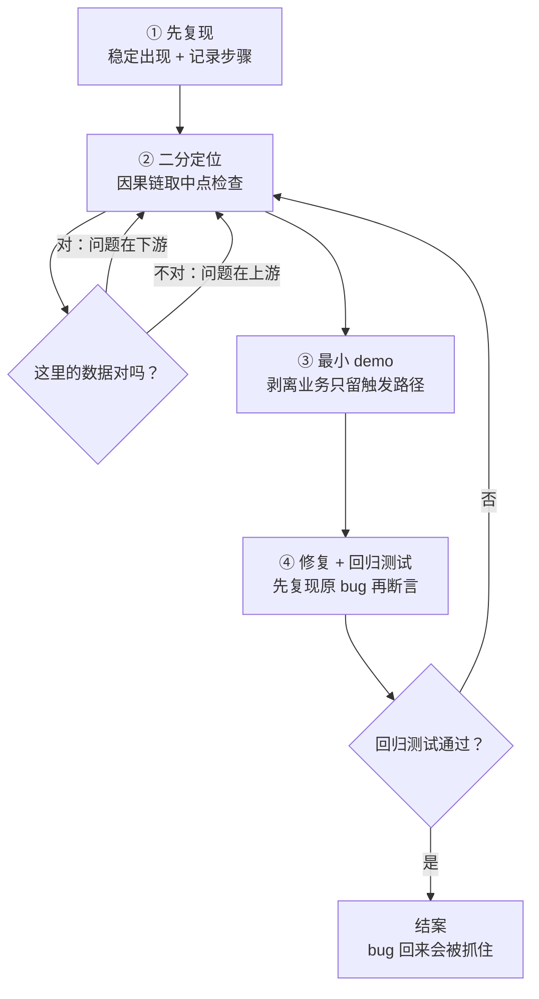
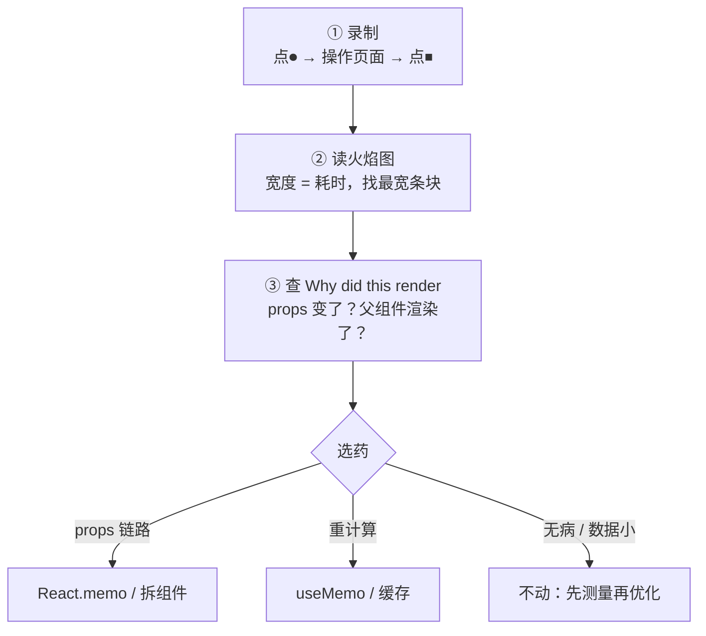
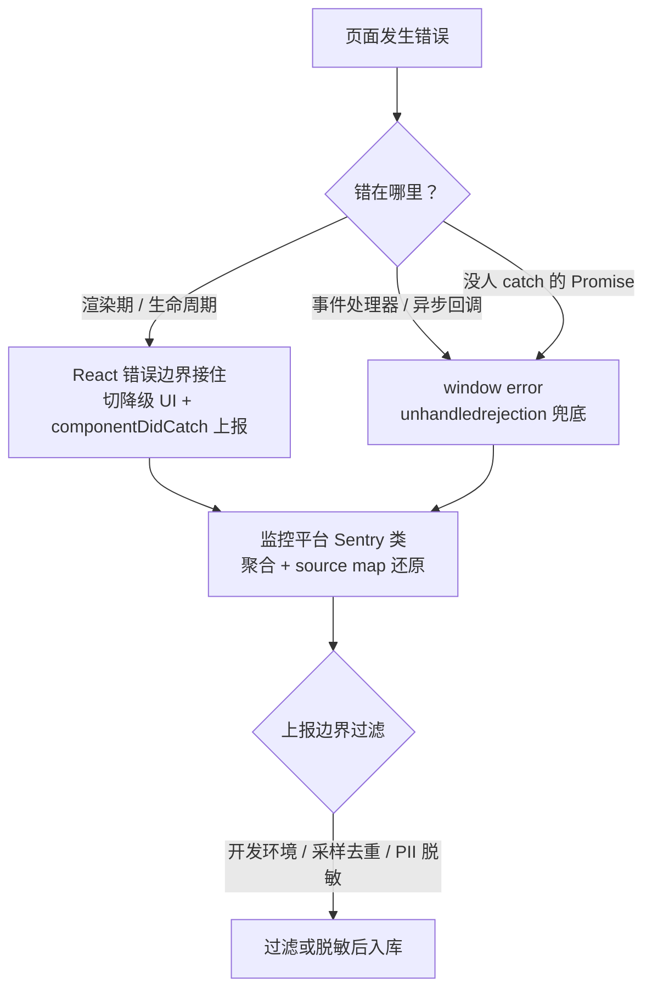

# 第 29 课 · 调试方法论与 DevTools

前 28 课教的是"怎么写对"，这一课教的是"写错了怎么办"。

写对靠知识，找错靠**方法 + 工具**：

- 方法是一套可复用的排查流程（先复现 → 二分定位 → 最小 demo → 修复加回归测试）；
- 工具是浏览器里那两块面板（Console 与 React DevTools）和一层兜底的错误监控。

打开 http://localhost:5173/lesson/29 ，页面里的 Bug 实验室能让你亲手把三个经典 bug 点坏再修好。**先复现，再修复**，是本课全部内容的地基。

## 学习目标

完成本课后，你应该能够：

1. 会按"复现 → 二分定位 → 最小 demo → 修复 + 回归测试"四步排查一个陌生 bug，并说清每一步淘汰了什么可能性（呼应第 15 课：修复必须补一条回归测试，证明 bug 下次回来会被抓住）；
2. 能亲手复现并修复三个经典 React bug：state 突变（push 后界面不更新）、闭包过期（定时器/监听器读到旧 state）、effect 缺依赖（用旧 props 渲染），并说出每个 bug 的"现象 → 原因 → 一行修复"；
3. 会用 console 的实用方法（`table` / `dir` / `count` / `time` / `group`）代替一堆 `console.log`，让排查输出自己长出结构；
4. 会用 React DevTools 做两件事：在组件树里选中组件查看它的 props / state / hooks，用 Profiler 三步（录制 → 火焰图 → Why did this render?）找出"谁渲染慢"（呼应第 9 课"先测量再优化"）；
5. 能说出错误监控的分工：React 错误边界管渲染期，window 的 `'error'` / `'unhandledrejection'` 管剩下的一切，Sentry 类平台负责"看见 + 还原（source map）"，并说清线上不发 map、平台私有上传 map 的两全做法（呼应第 24 课）。

## 核心概念

### 系统化排查流程：四步走完，不靠灵感

> **一句话记住：** 复现、二分、最小 demo、修复加回归测试——四步流程替代瞎猜，每查一次嫌疑减半。

遇到"页面不对劲"，普通人凭直觉乱改，工程师按流程走。

第一步是**先复现**。让 bug 稳定出现，记下精确步骤。不能复现的 bug 等于不能修理的机器——复现本身就在给你线索："只有刷新后第一次点击才出错"这句话已经排除了半个仓库的原因。本课 Bug 实验室的三个实验，就是三个"已驯服"的复现场景。

第二步是**二分定位**。问题是一段因果链：数据 → 处理 → state → 渲染 → DOM。在链的中间取一个点检查："这里的数据对吗？"对 → 问题在下游；不对 → 问题在上游。每检查一次，嫌疑范围减半，三四次就缩到一行代码。检查工具就是下面的 console 方法和 DevTools 组件树。

第三步是**最小 demo**。把 bug 从业务代码里剥离出来：新建一个只有十几行的组件，只保留能触发 bug 的路径。本课实验室的三个 demo 就是这么造的。造最小 demo 的过程常常 bug 自己就好了——因为剥离依赖的过程正好暴露了"真正的原因藏在被你删掉的那段里"。

第四步是**修复 + 回归测试**。改完不是终点（呼应第 15 课）：补一条"先复现原 bug，再断言修复后行为"的测试。从此 `npm test` 每次跑，都在替你确认这个 bug 没有回来。**没有回归测试的修复，只是"这次看起来好了"。**

一个心态提醒：**先提假设，再动手验证**。"我猜是闭包过期——让我用一个 setTimeout 最小 demo 验证"远好于"随便改改试试"。每轮只验证一个假设，否则你连"是哪个改动起效的"都说不清。

**图：系统化排查四步流程**

### console 对象实用方法速查

> **一句话记住：** table、dir、count、time、group 让排查输出自带结构，别再堆一排 console.log。

`console.log` 之外，这些方法让排查输出自己长出结构：

| 方法 | 干什么 | 什么时候用 |
| --- | --- | --- |
| `console.table(数组/对象数组)` | 渲染成可排序的表格 | 看列表数据的形状：一眼看出哪一项缺字段 |
| `console.dir(对象/DOM 节点)` | 展开成可折叠的树（DOM 节点显示 JS 属性而非 HTML） | `log` 打印 DOM 只给你 HTML，`dir` 给你真正的属性（`childNodes`、React 内部字段） |
| `console.count('标签')` | 同名调用自动计数 | "这个函数到底被调了几次？"（比如怀疑 effect 死循环时一放便知） |
| `console.time('标签')` / `console.timeEnd('标签')` | 同名标签计时，输出毫秒 | 快速量一段代码耗时；测组件渲染慢请用 Profiler（更系统） |
| `console.group('标签')` / `groupEnd` | 输出折叠成组 | 一次渲染打印多条信息时归拢，不然 Console 一片雪花 |
| `console.assert(条件, '消息')` | 条件为假才输出 | 在代码里埋"这里本该成立"的断言，不打扰正常路径 |

另有两个使用习惯：

- Console 面板里 `$0` 指向 Elements 面板当前选中的节点；
- Sources 面板打断点（或代码里写 `debugger`）比 console 万能——断点处所有变量、调用栈都可直接看。

### React DevTools 之一：组件树与 props 检查

> **一句话记住：** 组件树是二分定位的中间检查点：props 对不对，一眼分清问题在上游还是本组件。

二分定位需要一个"中间检查点"，React DevTools 就是它。浏览器装上 React Developer Tools 扩展后，F12 里多出 **⚛ Components** 面板：

- 左侧是**组件树**：真实渲染出来的组件按父子关系排列（对应第 10 课"组件树"）。点任何一个组件，右侧立刻显示它的 **props、state、hooks**——这是二分定位最常用的"中间检查点"：props 和你想的不一样？问题在上游；props 对但界面不对？问题在这个组件自己的渲染逻辑。
- 右上角的 ⚙ 里可开关 "highlight updates"：谁在频繁重渲染，页面上会闪框标出——配合 Profiler 使用。
- 树里点 `$$` 或 `<>` 图标可以直接跳到对应的 DOM 节点或源码。
- 改 props/state 面板里的值，界面立刻变——"如果这个 prop 是 0 会怎样"这类假设不用改代码就能验证。

### React DevTools 之二：Profiler 三步找慢渲染

> **一句话记住：** 录制 → 读火焰图（宽度 = 耗时）→ 查 Why did this render，找到"谁渲染慢"再决定拦哪里。

第 9 课说过"先测量再优化"，Profiler 就是测量本身。三步（页面里的 ProfilerGuide 组件配了现成的练习台）：

1. **录制**：Profiler 面板点 ⏺ → 操作页面 → ⏹。
2. **读火焰图**：每一条块 = 一次提交里的一个组件，**宽度 = 耗时**；找最宽的条块，点开看它本次提交的耗时与渲染次数。
3. **查 Why did this render?**：选中条块，右侧面板给出原因（"props 变了：seed 从 3 → 4"/"父组件渲染了"）。知道"为什么渲染"才知道"该拦哪里"（`React.memo`？拆组件？缓存计算？）。

**图：Profiler 三步找慢渲染**

页面里同时内置了 React 自带的 `<Profiler>` API（`onRender` 回调，能拿到 `phase` 与 `actualDuration`）——没装扩展也能量到同样的数字。

注意一条铁律：**onRender 里不能 setState**。否则"渲染 → 报告 → 再渲染"会烧成死循环。

### 错误监控：错误的三层去向 + 上报边界 + source map

> **一句话记住：** 错误边界管渲染期，window 兜底事件管其余一切，监控平台负责聚合还原；线上不发 map，私有上传配对 release。

错误被"看见"的顺序分三层：

1. **React 错误边界**（第 13 课）：只兜**渲染期**错误——渲染体、生命周期、子组件树的构造。事件处理器、定时器、异步回调里的错误它管不到。
2. **浏览器兜底事件**：剩下的一切最终落到 `window` 的 `'error'`（同步未捕获错误、资源加载失败）与 `'unhandledrejection'`（没人 catch 的 Promise）。MonitorConcepts 组件在本页真实挂了这两个监听——你点按钮制造的 demo 错误，面板会实时捕获。
3. **监控平台（Sentry 类）**：把上面两层自动收走，聚合成"哪条错误、影响多少用户、出现在哪个版本"。

平台的**上报边界**（不是所有错误都值得原样上报）有这几条：

- 开发环境静音或打 env 标；
- 设采样率与聚合去重（同一错误刷一千次只记 count）；
- `beforeSend` 里做 **PII 脱敏**——错误消息可能夹带用户数据；
- 循环抛错必须节流，否则监控自身雪崩。

**图：错误的分层去向与上报边界**

**source map 与生产调试**（呼应第 24 课）：生产 bundle 压缩混淆，用户报错的堆栈是 `a.b(...)` 加列号，人读不懂。

source map（源码映射）是"产物位置 → 源码位置"的对照表。但 `vite build` 默认不生成它，也不该发布——map ≈ 公开源码。

两全做法：**线上不出 map + 每次构建的 map 私有上传给监控平台**，release 版本一一配对。线上堆栈在平台里还原成你写的源码行。这也是本课与第 30 课（迷你监控台）的接口。

## 代码导读

### `src/components/lesson29/BugShowcase.jsx` —— 三个 bug 的活体实验室

- 每个实验统一结构：**错误版/修复版 分段开关**（`ModeToggle`）+ 演示区 + `Diagnosis`（现象/原因/修复 三行诊断单，左边框红/琥珀/绿，颜色本身就在讲"排查读到哪一步"）；
- **实验一（state 突变）**故意把 `items` 存在演示组件里、切开关不清空 state：先在错误版点几次"添加"（界面不动），再切修复版点一次——之前"消失"的任务全部现身。这个"幽灵数据现身"瞬间就是这类 bug 最迷惑人的地方：数据一直在，React 不知道要重渲染。错误版还有一枚"🔍 强制重渲染"照妖镜按钮，用 `setItems([...items])` 造新引用逼出真面目；
- **实验二（闭包过期）**的修复版演示 **latest-ref 套路**：`useEffect`（无依赖数组）每次渲染后把最新 count 抄进 `useRef`，定时器回调读 `ref.current`——"截图"变"直播"。定时器 id 存 ref、卸载时 `clearTimeout`，顺手复习第 2 课"副作用要清理"；
- **实验三（effect 缺依赖）**用两个兄弟子组件（`GreetingBroken` / `GreetingFixed`）呈现同一逻辑只差依赖数组的两种命运。真实项目里装了 `eslint-plugin-react-hooks` 的项目会在保存瞬间报 `react-hooks/exhaustive-deps`——**本项目用的 oxlint 没启用这条规则**，所以错误版能活着跑给你看：`<pre>` 代码块里原文引用了 lint 报文。这本身就是一课：**护栏没报 ≠ 代码没错**；
- 呼应关系：实验一 ↔ 第 1 课（不可变更新铁律），实验二 ↔ 第 2 课（闭包与 effect），实验三 ↔ 第 2 课依赖数组。

### `src/components/lesson29/ProfilerGuide.jsx` —— Profiler 三步引导 + 可测的慢渲染

- 文件头注释明说：**本页故意保留一个可测的慢渲染**——`SlowGrid` 渲染体里跑三千万次纯计算循环（约几十毫秒），没有"真的慢"的组件，火焰图上根本看不出条块差异。教学专用，真实项目渲染体绝不允许这种循环；
- 循环的校验和顺便渲染出来：一是防引擎把"结果没人用的循环"优化掉，二是 seed 变化时色块肉眼可见地变——"这次渲染真的发生了"；
- 组件外面包了 React 的 `<Profiler id="slow-grid" onRender>`，回调**只写 ref 不 setState**（文件头注释解释了死循环风险），点"抄一份统计到界面"才把 ref 内容复制进 state 渲染成小表——这个"ref 暂存、按钮快照"的读写分离模式值得记住；
- "🐢 慢循环开关"让你录完慢的再录个快的，同一次录制里直接对比条块宽度。

### `src/components/lesson29/MonitorConcepts.jsx` —— 兜底事件真机演示 + 概念卡

- `useEffect`（空依赖，挂载一次）真实挂 `window` 的 `'error'` 与 `'unhandledrejection'`，**清理函数成对摘除**——不摘的话每进出本页就多挂一对，监听越积越多（呼应第 2 课）；
- "🧨 同步错误"在事件处理器里直接 `throw`（React 不接事件处理器的错误，它落进 `'error'`）；"🔥 Promise 拒绝"只 reject 不 catch（约一拍后浏览器派发 `'unhandledrejection'`）。面板故意**不调用** `e.preventDefault()`：让你亲眼确认"面板捕获的"和"console 报红的"是同一条错误（注释里说明了何时该拦）；
- 捕获面板 `aria-live="polite"`：新错误进来时读屏器自动播报——监控面板本身就是无障碍的受益者；列表倒序、最多留 6 条；
- 三张概念卡（`CONCEPT_CARDS` 常量）与讲义同源：兜底事件分工 / 上报边界 / source map 与 release 配对。

### `src/pages/Lesson29.jsx` 与 `src/pages/lesson29.css`

- 页面延续第 25 课以来的编排模式：自身零 state，三块内容独立成组件，页头给出"先复现再修复"的使用建议；
- 样式全部 `l29-` 前缀：分段开关 `.l29-seg`、诊断单 `.l29-abc`（现象红/原因琥珀/修复绿的左边框）、深色代码块 `.l29-pre`（lint 报文单独 `.l29-lint` 标红）、捕获面板 `.l29-panel`、步骤计数器 `.l29-steps`（CSS `counter` 自动编号）、概念卡三宫格 `.l29-grid3`（`auto-fit` 窄屏自动降列，免写媒体查询）；通用布局照旧复用 App.css 的 `.card` / `.row` / `.big-number` 与 index.css 的 `.hint`。

## 动手试一试

只给提示，答案都在页面里：

1. **把三个 bug 各点坏一次再修好**：实验一切错误版点三次"添加"→ 点"强制重渲染"看真相 → 切修复版再加一次（注意"幽灵任务"现身）；实验二点"启动定时读取"后 2 秒内狂点 +1，对比两个版本的汇报；实验三切到小红，看错误版的问候语停在谁那里，再切修复版对照。
2. **用 React DevTools 找"为什么渲染"**：给 Profiler 练习台录一次制，火焰图里找到最宽的条块，读出 "Why did this render?" 的原因；关掉慢循环再录一次，对比同一个组件的条块宽度。
3. **给错误面板喂两条不同的错误**：一条同步、一条 Promise；打开 Console 面板对照，确认同一条错误在两边都出现；然后想想：如果这是线上用户的环境，堆栈里的 `a.b(...)` 要靠什么才能还原成源码？

## 易错点

1. **调试时凭感觉乱改，改好也说不清为什么好了**：现象是"试了几处，忽然就好了"，下次同类 bug 依旧束手无策。原因：没有"先复现、一次只验证一个假设"的纪律，改了三个地方根本不知道是哪个起效。正确做法：按四步流程走，每轮只动一处。
2. **用 `console.log` 修完 bug 忘了删**：现象是上线代码里留着一堆 `console.log(用户数据)`——既是噪音也可能泄露隐私。原因：log 当成了临时便签却没清理机制。正确做法：排查期用，修完即删；需要长期留的观察点换成 `console.assert` 或监控埋点。
3. **在 Profiler 的 `onRender` 回调里 setState**：现象是页面卡死/疯狂重渲染。原因：onRender 在每次提交后触发，setState 又触发新提交 → 再 onRender → 死循环。正确做法：数据先写 ref，需要展示时用按钮或定时器"抄"进 state（本页 ProfilerGuide 的做法）。
4. **只在开发环境修 bug，忘了"线上是另一份压缩代码"**：现象是本地好好的，用户截图的报错在源码里搜不到对应行号。原因：线上跑的是压缩混淆后的 bundle，行号列号全部对不上。正确做法：报错靠 source map 还原（私有上传 + release 配对），本地复现时用同一份构建产物 `vite preview` 验证。
5. **以为挂了 ErrorBoundary 就万事大吉**：现象是事件处理器/定时器里的错误用户端白屏，监控却一条没收到。原因：ErrorBoundary 只兜渲染期错误，异步世界的错误归 `'error'` / `'unhandledrejection'` 兜。正确做法：边界（渲染期）+ 兜底事件监听（其余一切）+ 监控平台三层都要有。

## 自测题

1. 二分定位一个"列表偶尔缺一行"的 bug：你会选因果链上的哪个点做第一次检查？为什么？
2. `items.push(x)` 之后调用 `setItems(items)`，界面为什么不更新？给出两种都能解决问题的写法，并说出它们分别在什么场景更合适。
3. `useEffect(() => { localStorage.setItem('last', user.id) }, [])` 有什么隐患？lint 会怎么报？修好它。
4. 一个用户报告的错误堆栈是 `t.gn(e)`——从堆栈到源码行之间还差哪两样东西？它们各自在哪里？

### 参考答案

1. 从**数据源头**开始（接口返回/父组件传下的 props）：先确认"进来的数据全不全"。全 → 问题在你自己的处理/渲染（下游），且能立刻把嫌疑砍掉一半；不全 → 问题在上游，根本不用看渲染代码。从源头开始还能顺便回答"是拿不到还是丢了的"这个最关键的分叉。（从中间任何点开始都行——二分的本质是"每查一次砍一半"，选最便宜、信息量最大的检查点即可。）
2. `push` 原地突变，数组引用没变；`setItems(同一引用)` 被 React 判定"没变化"，跳过重渲染。写法一：`setItems([...items, x])`（不可变替换，最常用，本课实验一的修复版）；写法二：`setItems(prev => [...prev, x])`（函数式更新，适合连续多次添加、或回调/定时器里拿着旧闭包添加的场景——它不引用外部变量，天然免疫闭包过期）。深层对象同理用展开或 `structuredClone` 造新引用。
3. 依赖数组写 `[]`，effect 只在挂载时执行一次，之后 `user` 换了多少轮，写入 localStorage 的永远是挂载那一刻的旧 `user.id`。装了 `eslint-plugin-react-hooks` 的项目会报：`React Hook useEffect has a missing dependency: 'user'. Either include it or remove the dependency array.`（`react-hooks/exhaustive-deps`；本项目 oxlint 未启用此规则）。修复：依赖数组补上 `[user.id]`（只在换了人时重写；比 `[user]` 更精确，不会因对象引用变化而多余重跑）。
4. 差两样：**该版本的 source map** 和**版本对应关系**。构建时的 source map 把"压缩产物位置"映射回"源码位置"，但必须拿到**与出错版本一一配对**的那份 map（每次构建重新生成）——通常做法是线上不发 map、构建时私有上传给监控平台，平台按 release 版本取对应 map 完成还原（呼应第 24 课）。

## 下一课预告

第 30 课是**结业实战：迷你监控台**——把本课的概念亲手做出来：一个真实挂 `'error'` / `'unhandledrejection'`、能分类聚合、能展示"最近错误流"的小面板，作为整门课的收官作品。今天在 MonitorConcepts 里看到的每个细节（监听挂载与清理、条目聚合、错误分类），都会在那里变成你要写的代码。
