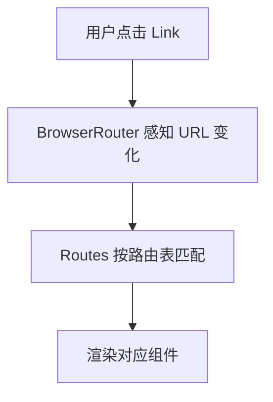
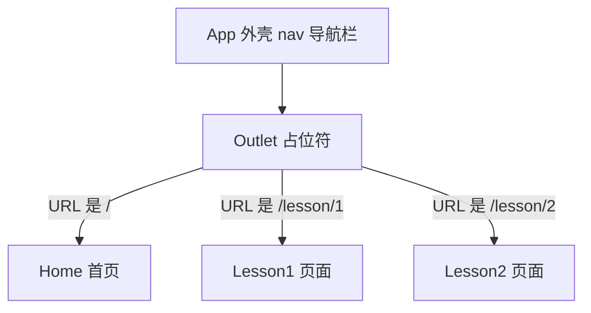

# 第 3 课 · React Router 与多页面 SPA

## 学习目标

完成本课后，你应该能：

1. 说清 SPA（单页应用）和传统多页网站的本质区别，以及"路由"在 SPA 里到底做了什么。
2. 理解 **URL 就是页面状态**：看到 `/lesson/1` 就知道该渲染什么，能复制链接分享，能刷新还原。
3. 掌握 react-router 的三层结构：`BrowserRouter` → `Routes`/`Route` → `Link`/`NavLink`。
4. 会用**布局路由**（无 `path` 的 `<Route>`）+ `<Outlet />` 抽出公共外壳，让导航栏只写一次。
5. 会给项目"加一节新课"，固定三步，一步不漏。

## 核心概念

### SPA 与多页网站：换 HTML 还是换组件树？

> **一句话记住：** 多页网站每次换整个 HTML；SPA 只换组件树，页面从不刷新。

先看两种网站点链接时各发生了什么。传统网站（多页，MPA）：

```
/        → index.html（浏览器下载、解析、渲染一遍）
/about   → about.html（再下载、解析、渲染一遍）
```

每点一个链接，浏览器**丢弃整个页面，重新走一遍加载流程**。结果就是：白屏一下，滚动位置丢失，JS 里的变量全部清零。

SPA（单页应用）是另一条路：服务器只给**一个** `index.html`，React 应用启动后常驻。

点链接时页面不刷新，路由库只是**把 URL 改掉，然后换出一棵新的组件树**。就像第 1 课里的计数器换了个数字，只不过这次换的是"整个页面"。

代价：`<a>` 那套原生行为不能照用了（见下文 Link vs a）；首屏要把路由库一起下载下来。

### URL 即页面状态

> **一句话记住：** URL 是浏览器帮你持久化的页面状态——能分享、能刷新还原。

SPA 里没有"多个 HTML 文件"，那用户怎么区分"哪个页面"？靠 URL。

- `/lesson/1` → 渲染 `Lesson1` 组件
- `/lesson/2` → 渲染 `Lesson2` 组件

URL 成了**全局、可分享、可刷新还原的页面状态**：

- 把 `/lesson/1` 发给同学，他打开就是第 1 课（**深链接直达**，不用从首页一路点进去）。
- 停在第 2 课按 F5 刷新，浏览器重新加载应用后，路由库读当前 URL，照样渲染第 2 课——刷新不会把你"扔回首页"。

对比第 1 课的 `TodoList`：`useState` 里存的状态刷新即丢。URL 是浏览器帮你持久化的状态。

所以能用 URL 表达的"当前在哪个页面"，就该交给路由，不要自己用 state 存 `currentPage`。

### 三层结构

> **一句话记住：** BrowserRouter 管监听、Routes 管映射、Link 管跳转——各司其职。

先有个整体印象：react-router（本项目用的包名就叫 `react-router`，不是 `react-router-dom`——react-router 7 之后合并了，从 `'react-router'` 导入即可）分三层：

```jsx
import { BrowserRouter, Routes, Route, Link } from 'react-router'

// 第一层：BrowserRouter —— 监听 URL，提供路由上下文，整个应用包一次
<BrowserRouter>
  {/* 第二层：Routes/Route —— URL 到组件的映射表 */}
  <Routes>
    <Route path="lesson/1" element={<Lesson1 />} />
  </Routes>
  {/* 第三层：Link —— 改 URL 的入口 */}
  <Link to="/lesson/1">第 1 课</Link>
</BrowserRouter>
```

| 层 | 职责 | 出现次数 |
|---|---|---|
| `BrowserRouter` | 监听 URL 变化，向下提供路由上下文 | 整个应用**一次** |
| `Routes`/`Route` | 声明式映射表：哪个 URL 渲染哪个组件 | 一处集中（本项目在 `main.jsx`） |
| `Link`/`NavLink` | 不刷新地改 URL | 每个需要跳转的地方 |

**图：react-router 三层结构与点击跳转流程**



### 布局路由 + Outlet：公共外壳只写一次

> **一句话记住：** 无 path 的 Route 是公共外壳；子页面渲染到外壳里的 `<Outlet />` 占位符。

为什么要学这个？第 1、2 课页面都要有顶部导航栏。

如果每个页面自己写一遍导航，改一个链接要改 N 处。

解法：**不写 `path` 的 `<Route>`**。它不匹配任何 URL，只作为父级提供公共外壳：

```jsx
<Route element={<App />}>          {/* 布局路由：无 path，只提供外壳 */}
  <Route index element={<Home />} />
  <Route path="lesson/1" element={<Lesson1 />} />
</Route>
```

子路由匹配到的组件渲染在哪里？渲染进布局组件里的 **`<Outlet />` 占位符**：

```jsx
function App() {
  return (
    <>
      <nav className="top-nav">…导航链接…</nav>
      <Outlet />   {/* 当前 URL 对应的子页面在这里出现 */}
    </>
  )
}
```

记住分工：**`Route` 的嵌套决定"谁是谁的孩子"，`Outlet` 决定"孩子画在哪"**。布局路由没有 `path`，所以它对 URL 完全透明——`/lesson/1` 依然就是 `/lesson/1`。

**图：布局路由与 Outlet 嵌套结构**



### index 路由：父路径"正好是它"时显示

> **一句话记住：** `index` 就是"默认子页面"——URL 正好等于父路径时显示它。

```jsx
<Route index element={<Home />} />
```

`index` 表示：URL **正好等于父路由的路径**（这里是 `/`）时渲染 `Home`。

它的作用是把"默认子页面"和普通子页面区分开。没有它，访问 `/` 时 `<Outlet />` 里就什么都没有。

### Link vs `<a>`：整页刷新 vs 换组件树

> **一句话记住：** 站内跳转一律用 `Link`，站外才用 `<a>`——本课最重要的铁律。

先看后果，你就知道为什么是铁律。`<a href="/lesson/1">` 会触发浏览器**原生的导航**：卸载整个页面、重新请求、重新启动 React 应用——SPA 的所有好处（不丢状态、秒切）全部作废。

```jsx
<Link to="/lesson/1">第 1 课</Link>
```

`Link` 拦截点击事件，只做两件事：**改地址栏 URL + 通知路由库换组件树**。没有网络请求，没有页面刷新。

本质上 `Link` 渲染出来的也是 `<a>`，但它接管了点击行为。

结论：**站内跳转一律用 `Link`/`NavLink`；只有跳到外部网站才用 `<a>`**。

### NavLink：active 高亮与 end 属性

> **一句话记住：** NavLink 会在当前 URL 匹配时自动加 `active` 类；首页链接必须加 `end`，否则永远高亮。

导航栏里常需要"当前页高亮"。`NavLink` 就是为此设计的——它是 `Link` 的加强版：当前 URL 匹配它的 `to` 时，自动给 `<a>` 加上 `active` 类，可以借此做高亮：

```jsx
<NavLink to="/lesson/1">第 1 课</NavLink>
<NavLink to="/" end>首页</NavLink>
```

两个坑：

- **`to="/"` 默认会匹配所有路径**（`/lesson/1` 也以 `/` 开头），导致"首页"永远高亮。加 **`end`** 表示"只有 URL 正好是 `/` 才算激活"。
- 高亮样式从哪来？`active` 类名是 react-router 加的，样式由项目 CSS 提供（本项目 `.top-nav` 里有对应规则）。

### 深链接直达

> **一句话记住：** 路由表是声明式的——不管从哪进来，查 URL 就知道渲染什么。

为什么别人直接输入 `/lesson/2` 也能打开你的页面？因为路由表是**声明式**的（URL → 组件，与浏览顺序无关）。

用户直接在地址栏输入 `/lesson/2`、或刷新、或从别的网站链接进来，路由库一查表就知道该渲染什么。

这就是深链接：SPA 也能像多页站一样被"直达"，前提是路由表里登记过这条路径。开发时 Vite 会把任意路径都回退到 `index.html`，所以本地直接输入 URL 也能打开。

## 代码导读

本项目一共三处和路由有关，逐个看：

### `src/main.jsx` —— 路由表（映射关系集中在这里）

```jsx
<StrictMode>
  <BrowserRouter>          {/* 全局只包一次 */}
    <Routes>
      <Route element={<App />}>        {/* 布局路由：无 path，只提供外壳 */}
        <Route index element={<Home />} />       {/* / → 首页目录 */}
        <Route path="lesson/1" element={<Lesson1 />} />
        <Route path="lesson/2" element={<Lesson2 />} />
      </Route>
    </Routes>
  </BrowserRouter>
</StrictMode>
```

- 路由表集中放 `main.jsx` 而不是散在各页面：打开一个文件就能看全"这个应用有哪些页面"。
- 三个子 `Route` 都嵌在 `element={<App />}` 下，所以每页都自带导航栏，页面组件自己不用管。
- 注意导入来源是 `'react-router'`——本项目版本下没有 `react-router-dom` 这一步。

### `src/App.jsx` —— 布局外壳

```jsx
<nav className="top-nav">
  <NavLink to="/" end>首页</NavLink>
  <NavLink to="/lesson/1">第 1 课</NavLink>
  <NavLink to="/lesson/2">第 2 课</NavLink>
</nav>
<Outlet />
```

- `App` 曾经（第 1、2 课时）是整页组件，本课把它改造成了**纯布局**：导航 + `<Outlet />`，内容全部交给子路由。
- `<NavLink to="/" end>` 的 `end` 是必须的，否则"首页"在任何页面都高亮（原因见上文）。
- 复用 `App.css` 里已有的 `.top-nav` 样式，没有为路由新写 CSS。

### `src/pages/Home.jsx` —— 首页目录（Link 的用武之地）

```jsx
const lessons = [ { path: '/lesson/1', title: '…', … }, … ]

{lessons.map((l) => (
  <section className="card" key={l.path}>
    <h2><Link to={l.path}>{l.title}</Link></h2>
    …
  </section>
))}
```

- 目录是 `.map()` 出来的（复用第 1 课列表渲染知识），每条课程数据带自己的 `path`，`Link` 的 `to` 直接引用。
- 这份 `lessons` 数组就是"加新课三步"中第三步的落点（见下）。
- 用的是 `Link` 不是 `NavLink`：目录项不需要"当前高亮"语义，`Link` 更合适。

## 动手试一试

1. **亲手体验 Link vs a**：把 `src/App.jsx` 里某个 `<NavLink>` 临时改成 `<a href="…">`，点它观察区别（页面白屏闪一下、控制台重新加载）。记得改回来。
2. **高亮实验**：去掉首页 `NavLink` 的 `end` 属性，去 `/lesson/1` 看导航栏——"首页"是不是也亮了？想想为什么，再把 `end` 加回去。
3. **布局实验**：在 `App.jsx` 的 `<Outlet />` 下面加一行 `<footer className="hint">公共页脚</footer>`，然后逛遍三个页面，确认页脚处处出现——这就是布局路由的意义。

## 易错点

1. **站内跳转用了 `<a href>`**。现象：点链接整页刷新、白屏、组件里的 state 清零。原因：`<a>` 是浏览器原生导航，会丢掉整个 JS 世界。铁律：站内用 `Link`/`NavLink`，站外才用 `<a>`。
2. **首页 `NavLink` 忘加 `end`**。现象：不管在哪一页，"首页"都高亮。原因：`/` 前缀匹配所有路径；`end` 才表示"正好是 `/`"。
3. **从 `'react-router-dom'` 导入**。现象：报错找不到模块。原因：本项目安装的是合并后的 `react-router` 包，一律 `import { … } from 'react-router'`。
4. **布局路由误写成 `<Route path="*" element={<App />}>` 之类的带 path 写法**，或忘了在布局里放 `<Outlet />`。现象：URL 变了但页面不出现 / 出现空白区域。原因：子路由的渲染位置就是 `<Outlet />`，没有它子页面无处安放。
5. **以为刷新会"回到首页"**。现象（其实是惊喜）：停在 `/lesson/2` 刷新后还在第 2 课。原因：URL 是持久化的页面状态，路由表按当前 URL 查表渲染，与浏览顺序无关——这正是"URL 即状态"的价值。

## 自测题

1. SPA 和传统多页网站在"点击链接"这件事上，分别发生了什么？
2. `BrowserRouter`、`Routes`/`Route`、`Link` 各自负责什么？为什么 `BrowserRouter` 全应用只出现一次？
3. 没有 `path` 的 `<Route>` 是干什么的？子页面的内容最终渲染到哪个元素里？
4. 把本项目的"第 2 课"导航链接换成 `<a href="/lesson/2">`，会有什么后果？至少说出两点。

<details>
<summary>参考答案</summary>

1. 多页网站：浏览器丢弃当前页面，请求新 HTML，重新走完整加载流程（白屏、丢状态）。SPA：页面不刷新，路由库改 URL 并换出一棵新组件树，JS 世界保持存活。
2. `BrowserRouter` 监听 URL 并提供路由上下文，是所有路由能力的前提，上下文只需提供一份所以只包一次；`Routes`/`Route` 是 URL→组件的声明式映射表；`Link`/`NavLink` 在不刷新的前提下修改 URL 触发换页。
3. 布局路由：不匹配 URL，只作为父级提供公共外壳（导航栏等）；子路由匹配的组件渲染进布局里的 `<Outlet />` 占位符。
4. ① 点击触发整页刷新，体验差、状态全丢；② React 应用重新启动，之前组件里的 state（如第 1 课的待办列表）清零；③ 语义上它绕过了路由库，SPA 的"换组件树"机制没有机会工作。

</details>

## 下一课预告

第 4 课：当多个组件需要同一份数据，我们把 state 往上提——"状态提升"与组件间通信。
