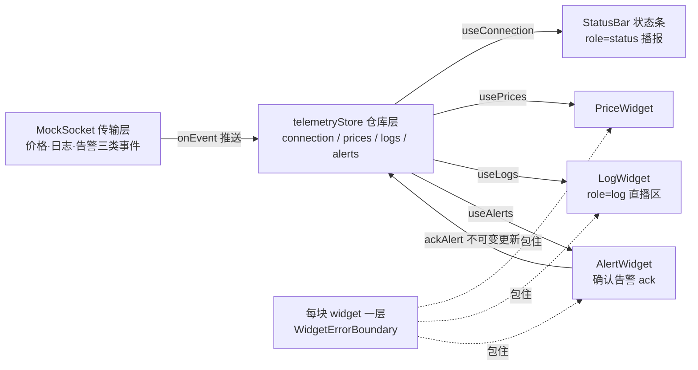
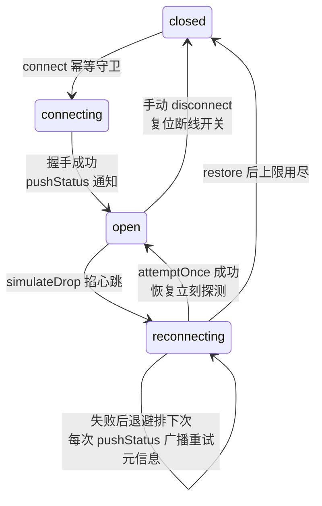
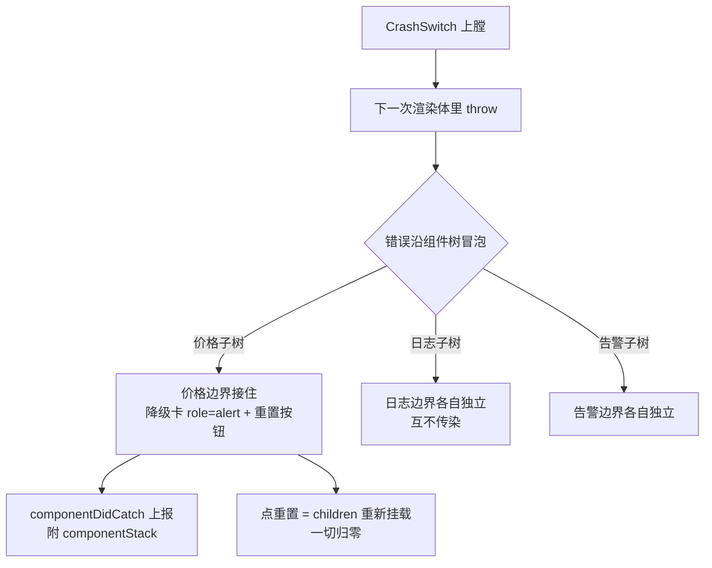

# 第 30 课 · 结业实战：迷你监控台

最后一课没有新 API。这一课交给你一个完整的迷你监控台：

- `MockSocket` 推三类事件（价格心跳 / 日志行 / 告警）；
- 外部 store 做唯一数据源；
- 三块 widget 各自被独立错误边界包裹；
- 顶部状态条播报连接状态。

它把第 26–29 课的工程素养（可访问、安全、实时、可调试）焊在第 1–25 课的地基上。学习方式：打开 http://localhost:5173/lesson/30 ，先正常看它跑，再故意弄坏它（模拟断线、模拟崩溃），最后对着页面底部的「课次回扣表」逐卡复盘。

## 学习目标

完成本课后，你应该能够：

1. 把「数据源 → 外部 store → UI」三层端到端接通：MockSocket 只管推事件，`telemetryStore` 用 `useSyncExternalStore` 暴露给组件，widget 保持纯读者（第 28 课模式的完整落地）；
2. 能解释 getSnapshot 的「稳定引用」铁律：state 顶层不可变替换、没变就回同一引用——并说出"每次返回新对象"会触发无限重渲染的原因；
3. 会用「每个 widget 一个 ErrorBoundary」做故障隔离：单卡崩溃只降级自己、`componentDidCatch` 负责上报、降级卡可一键重置（第 13 + 29 课合练）；
4. 能在实时页面上做 a11y：`role="status"` 播报连接流转、`role="log"` + `aria-relevant="additions"` 做日志流、全部控件原生元素保证键盘可完整操作、live 区不抢焦点（第 26 课回扣）；
5. 能复述「知识点回扣表」：看板上每个功能指回哪节课、哪个概念、哪个文件——把工程素养线变成自己的检查清单。

本课对应的示例代码：

- `src/components/lesson30/mockSocket.js` —— 自含 MockSocket：三类事件推送、断线模拟开关、指数退避重连状态机
- `src/components/lesson30/telemetryStore.js` —— 外部 store + useSyncExternalStore：connection / prices / logs（封顶 50 条）/ alerts
- `src/components/lesson30/widgets/PriceWidget.jsx` —— 价格心跳卡片：随机游走 + 涨跌着色
- `src/components/lesson30/widgets/LogWidget.jsx` —— aria-live 日志流：`role="log"` + polite + additions
- `src/components/lesson30/widgets/AlertWidget.jsx` —— 告警列表 + 确认（ack）操作
- `src/components/lesson30/ErrorBoundary.jsx` —— widget 错误边界 + 内置 CrashSwitch（模拟崩溃开关）
- `src/components/lesson30/Dashboard.jsx` —— 网格编排 + 全局连接状态条 + 键盘可达性说明
- `src/pages/Lesson30.jsx` —— 页面编排：结业致辞 + 看板 + 课次回扣表卡片
- `src/pages/lesson30.css` —— 全部 `l30-` 前缀样式（含 `prefers-reduced-motion` 降级）

## 核心概念

### 三层架构：传输、仓库、窗口

> **一句话记住：** 连接比组件活得久——传输、仓库、窗口三层各是长寿对象，widget 只当纯读者。

监控台是"实时 + 长生命周期"数据的典型场景，正确的分层是把三个职责拆给三种长寿对象：

| 层 | 职责 | 本课的实现 | 为什么不放进组件 |
|---|---|---|---|
| 传输层 | 连接、心跳、重连 | `MockSocket`（类，模块级实例） | 连接比组件活得久；组件卸载连接不该陪葬 |
| 仓库层 | 把事件映射成可渲染的 state | `telemetryStore`（subscribe / getState / actions） | 多个 widget 读同一份数据，各自 useState 就是多份真相 |
| 窗口层 | 渲染 + 局部交互（ack、崩溃开关） | 三个 widget 组件 | 只挑自己那块订阅，数据单向流：源 → store → UI |

这条分层第 28 课已经立过，本课只是把它扩成"一个真正要挂着的页面"。对照第 18 课：zustand 的 `create()` 做的就是仓库层那 30 行手搓代码的封装——手搓过一遍，才知道状态库到底帮你省了什么。

**图：监控台三层架构与数据链路**

### 稳定引用：外部 store 的生死线

> **一句话记住：** getSnapshot 变了才换引用、没变必须同引用——现场打包新对象等于无限重渲染。

`useSyncExternalStore(subscribe, getSnapshot)` 的约定是：React 会随时调 `getSnapshot` 并用 `Object.is` 和上次结果比较。由此推出两条铁律：

- **变了才换引用**：本课 state 只有四个顶层字段（connection / prices / logs / alerts），任何更新都整字段替换（`setState({ logs: [新, ...旧].slice(0, 50) })`）——字段引用变 = 内容真的变了；
- **没变必须同引用**：选择器只准返回"字段引用或原始值"。写成 `() => ({ status, logs })` 这种现场打包，每次都是新对象，React 判定快照永远在变 → 无限重渲染（开发模式直接警告 "The result of getSnapshot should be cached"）。

另外注意粒度的取舍：本课 `prices` 一个 symbol 跳动会换掉整个 prices 字段，理论上"只订阅 GOOG 的卡片"也会被通知——但 `Object.is` 一比发现字段引用变了才重渲染，而监控台每秒都在变，这种粗粒度是**有意的简单**。真要做细粒度选择器，那是 zustand/RTCS 这类库的战场，手搓版先保持能一眼看懂。

### 指数退避：重连的礼貌

> **一句话记住：** 重试间隔按倍数拉长（BASE × 2^n）并封顶，给过载的服务端喘息时间。

为什么需要"退避"？如果固定 1 秒猛试：服务端过载时，所有客户端会同步踩踏，越踩越垮。

重试间隔 = `BASE × 2^已失败次数`，封顶（本课 800ms → 1.6s → 3.2s → 6.4s → 8s 封顶）。指数退避让间隔自动拉长，给服务端恢复时间。生产实现还会加"抖动"（jitter，随机 ±30%）打散重试时机——本课在「动手试一试」里留了这个练习。

状态机全程是：`closed →（connect）→ connecting → open →（断线）→ reconnecting →（退避重试）→ open`。手动 `disconnect` 任何时刻可达 `closed`，并把断线开关一起复位——**状态机不允许出现矛盾组合**（比如"已断开但离线模拟还挂着"）。

**图：MockSocket 状态机与通知点**

### 故障隔离：一个 widget 一个边界

> **一句话记住：** 每块 widget 独立包边界——价格崩了只降级价格卡，爆炸半径由边界位置决定。

错误边界是子树的 try/catch（第 13 课），本课把它用成工程手段——**爆炸半径控制**：

- 三块 widget 各自包一层 `WidgetErrorBoundary`：价格组件崩了，降级卡只出现在价格那张格子里，日志/告警照常跳动；
- `getDerivedStateFromError` 切降级 UI；`componentDidCatch` 是提交期副作用，负责"上报"（生产里发 Sentry，本课打 console 并附上 `info.componentStack`——第 29 课"先于用户看见"的落点）；
- 降级卡带 `role="alert"`（出现即刻播报）和「重置本组件」按钮：重置 = children 重新挂载，子树 state（包括崩溃开关）归零，如同刚打开页面；
- 边界**只能接住渲染期抛的错**。本课的 `CrashSwitch` 专门把 throw 写在渲染体里；要是把 throw 写进 onClick，边界一个字都收不到——事件回调的错误要 try/catch 自己兜。

**图：故障隔离与爆炸半径控制**

### 实时页面的 a11y 三件事

> **一句话记住：** 状态要播报、日志流要节制、焦点不能被抢——实时内容靠 live region 说给人听，不靠抢焦点。

实时页面更新太快，读屏器用户怎么跟上？三件事：

1. **状态变化要播报**：连接状态条 `role="status"`（隐含 `aria-live="polite"`），断线/重连/恢复不需要用户盯着屏幕才发现；
2. **日志流要节制**：`role="log"` + `aria-live="polite"` + `aria-relevant="additions"` + `aria-atomic="false"`——只播报新增条目，不重读整块 50 条；缺了 relevant/atomic 这对搭配，有些读屏器会整段重读，实时流就成了灾难现场；
3. **焦点不能被抢**：实时区域里不放可聚焦元素，内容每秒自更新但焦点纹丝不动；可滚动的日志区加 `tabIndex={0}` 让键盘用户够得着（focusable scroll regions）。控件全用原生 `button` / `checkbox`，Tab 按 DOM 顺序流动，Enter/Space 全部可触发——不需要任何自定义键盘逻辑。

### 安全底线：推送即不可信输入

> **一句话记住：** 远端推送的文本一律当不可信输入，纯文本渲染，永远不碰 dangerouslySetInnerHTML。

MockSocket 推的日志/告警文本和真实远端推送在安全模型里没有区别——都当不可信输入处理：一律 `{log.text}` 纯文本渲染，永远不碰 `dangerouslySetInnerHTML`（第 27 课）。哪怕哪天日志里混进 `<script>`，它也只是屏幕上的一串字符。

## 知识点回扣表

看板上每个功能 ↔ 课次 ↔ 概念 ↔ 文件。这是结业复习的总索引，也是本课真正的"考点"：盖住右边两列，看功能能不能讲出概念。

| 功能 | 课次 | 概念 | 文件 |
|---|---|---|---|
| 实时推送与断线重连状态机 | 28 · 实时数据与 useSyncExternalStore | 外部 store · 观察者订阅 · 传输层与 React 解耦 | `mockSocket.js` |
| 稳定快照与有界缓冲 | 28 · 实时数据与 useSyncExternalStore | getSnapshot 稳定引用 · 顶层不可变替换 · 日志封顶 50 条 | `telemetryStore.js` |
| 重连状态主动播报 | 26 · 可访问性 | `role="status"`（隐含 aria-live polite）· 播报不抢焦点 | `Dashboard.jsx` |
| 读屏友好的日志流 | 26 · 可访问性 | `role="log"` + `aria-relevant="additions"` · 可滚动区加 tabIndex | `widgets/LogWidget.jsx` |
| 全程键盘可操作 | 26 · 可访问性 | 原生 button/checkbox · Tab 按 DOM 顺序 · Enter/Space 触发 | `Dashboard.jsx` |
| 推送文本只当文本渲染 | 27 · 前端安全 | 远端推送是不可信输入 · 永不用 dangerouslySetInnerHTML | `widgets/LogWidget.jsx` |
| 单 widget 崩溃不影响其他 | 13 · 错误边界 | getDerivedStateFromError 切降级 UI · 每个 widget 独立包裹 | `ErrorBoundary.jsx` |
| 崩溃上报与定位 | 29 · 调试方法论与 DevTools | componentDidCatch 副作用上报 · componentStack 定位爆炸面 | `ErrorBoundary.jsx` |
| 挂载即连、卸载即断 | 2 · useEffect 与副作用 | effect 返回清理函数 · 刷新无残留定时器与报错 | `Dashboard.jsx` |
| 告警确认的不可变更新 | 1 · JSX、Props、State | map 造新数组 + 展开造新条目 · 原地修改引用不变等于隐形 | `telemetryStore.js` |
| 页面纯编排 | 22 · 组件设计模式 | 容器/展示：页面零 state，只决定摆什么、按什么顺序 | `pages/Lesson30.jsx` |
| 派生值不进 store | 20 · 综合实战 II | 单一数据源：未确认告警数渲染时现算，不存第二份 | `widgets/AlertWidget.jsx` |
| 状态点闪烁可关 | 23 · 动画与过渡 | `prefers-reduced-motion` 全局降级：信息不靠动画承载 | `pages/lesson30.css` |
| 与状态库的对照 | 18 · Zustand 状态管理 | create() 封装的正是本课手搓的 subscribe/getState/actions | `telemetryStore.js` |

## 代码导读

### `src/components/lesson30/mockSocket.js` —— 会断线重连的假连接

- 类的形状：`status`（closed/connecting/open/reconnecting 四态）+ 两组监听（`onEvent` / `onStatus`，都返回取消订阅函数）+ 三个定时器槽（心跳 / 握手 / 重试）；
- `connect()` 开头是**幂等守卫**（非 closed 直接 return）：StrictMode 下开发环境 effect 会"挂载 → 清理 → 再挂载"跑两遍，第二次 connect 必须安全；
- `emitTick()` 每秒一拍：价格必推（三只 symbol 各走一步随机游走）、日志每 3 拍一条（70% info / 20% warn / 10% error 加权抽取）、告警 10% 概率——真实推送的到达密度从不均匀，教学节奏故意模拟这一点；
- 断线开关 `simulateDrop()`：掐心跳 → 进 reconnecting → `scheduleRetry()`。开关开着时每次 `attemptOnce()` 都失败并按退避排下一次；`restore()` 复位开关后**不等下一个退避窗口、立刻探测**——退避是对网络的礼貌，开关已恢复就没必要再装死；
- `clearTimers()` 一把清三个定时器：断线、手动关闭、重新握手都走它。漏清任何一个都是"僵尸推送"——第 2 课"副作用要清理"在数据源层的最终形态。

### `src/components/lesson30/telemetryStore.js` —— 唯一数据源

- state 四个顶层字段整体替换：`connection`（status + 重试元信息）、`prices`（symbol → { price, prev, dir, ts }）、`logs`（新的在前，slice 封顶 50）、`alerts`（新的在前，带 acked 标记）；
- `socket.onEvent` 的映射是 store 存在的意义：传输层的三种事件翻译成三个字段的不可变替换——`dir` 用 `Math.sign(新价 - 旧价)` 算出 1/-1/0，箭头和颜色留到渲染层再"翻译成人话"；
- `ackAlert(id)`：`map` 造新数组 + 展开造新条目——第 1 课不可变更新在外部 store 上的形态（原地改 `alert.acked` 对 `Object.is` 比较完全隐形）；
- 四个 hook（`useConnection` / `usePrices` / `useLogs` / `useAlerts`）各自订阅一个字段：选择器返回字段引用，满足稳定快照铁律；注释里专门警告了"现场打包新对象"这个死法。

### `src/components/lesson30/ErrorBoundary.jsx` —— 边界 + 崩溃开关

- `WidgetErrorBoundary`：第 13 课双生命周期原样复用（getDerivedStateFromError 切 UI / componentDidCatch 上报），降级卡写死在组件里（带 `role="alert"`、错误信息、重置按钮），并点名 `info.componentStack` 是第 29 课定位爆炸面的抓手；
- `CrashSwitch`：点一下"上膛"（`setArmed(true)`），下一次渲染在函数体里 throw。它必须放在边界**包住的子树里**——错误边界只接子孙的错，接不住自己或祖先；
- "可重置"是免费送的：重置让 children 重新挂载，CrashSwitch 的 `armed` 随组件销毁归零——错误状态和业务状态一起回到初始，不需要任何额外代码。

### `src/components/lesson30/widgets/` —— 三块纯读者

- **PriceWidget**：订阅 `usePrices()`；涨跌色调（`.l30-up/.l30-down`）和箭头是 `dir` 的展示翻译，还配了 `aria-label`（"上涨/下跌"）——箭头符号对读屏器是噪音，语义要写成词；格式化是模块级纯函数，不 useMemo（不昂贵的计算包 memo 是表演式优化）；
- **LogWidget**：订阅 `useLogs()`；外层 div 挂 `role="log"` + `aria-live="polite"` + `aria-relevant="additions"` + `aria-atomic="false"` 四件套，注释逐条解释"少了哪个会怎样"；`tabIndex={0}` 让这块可滚动区键盘可达；日志文本纯字符串渲染并注释了第 27 课的理由；
- **AlertWidget**：订阅 `useAlerts()`；未确认数是渲染时 `filter` 出来的派生值（不进 store）；每条告警一个独立「确认」按钮（目标大、语义直白），确认后整条淡出但记录保留；空态文案回答"是坏了还是真没事"。

### `src/components/lesson30/Dashboard.jsx` —— 编排层

- 挂载 effect 里 `telemetryStore.connect()`，同一个 effect 返回 `disconnect()` 清理——刷新无残留错误的直接原因；注释顺带解释了 StrictMode 双挂载为什么安全；
- `StatusBar`：状态点（纯装饰，`aria-hidden`）+ 文案 + 重连元信息（第几次重试 / 下次间隔，由 `scheduleRetry` 每次排定重试时广播，见下方易错点 6）+ 断线模拟 checkbox（label 包住 input、断开时诚实 disabled）+ 连接/断开 + 清屏；
- 网格里三块 widget 各包一层边界——这是"故障隔离"的结构性表达：隔离不是写出来的，是**摆**出来的；
- 键盘可达性说明卡：把 Tab 顺序、live 区不抢焦点、可滚动区 tabIndex、降级卡 role="alert" 四条写明白——说明本身也是教材的一部分。

### `src/pages/Lesson30.jsx` —— 纯编排页

页面零 state：结业致辞（呼应第 25 课"去构建"的落点）→ `<Dashboard />` → 回扣表卡片。回扣表数据抽成模块常量 `RECAP`（功能/课次/概念/文件四字段），卡片纯 `map` 渲染——增删卡片只动数据不动模板。

## 动手试一试

1. **给重连加抖动（jitter）**：在 `scheduleRetry()` 里把 `delay` 乘上 `0.7 + Math.random() * 0.6`（±30% 随机）。做完想一想：为什么生产系统必须有它而教学演示可以没有？（提示：一个客户端重试没有"同步"问题，一万个才有。）
2. **给日志流加"暂停"**：在 store 加一个 `paused` 布尔字段和 `togglePaused()` action；`handleEvent` 里 `paused` 为真时丢弃 log 事件（价格照常）。再给 LogWidget 加一个「暂停滚动」checkbox。做完检查：暂停的是"入库"还是"渲染"？这两种做法的差别在哪？（提示：暂停入库 = store 层过滤，暂停渲染 = UI 层快照，后者会导致"看起来停了其实没停"。）
3. **写一个只订阅一块的 selector**：加 `usePrice(symbol)`，只返回某一只股票的条目；再做一个"涨幅榜"小组件用 `Object.entries` + `sort` 渲染。观察：一只股票跳动时，涨幅榜重渲染几次？如果你想让它只在"排序结果变化"时才渲染，该在哪一层做什么？（提示：选择器里做排序，返回排序后的数组引用——别忘了稳定引用铁律，缓存上次排序结果再比。）

## 易错点

1. **getSnapshot 现场造对象，页面疯狂重渲染**：现象是控制台警告 "The result of getSnapshot should be cached to avoid an infinite loop"，页面卡死。原因：选择器写成 `() => ({ status: s.status })` 这类每次返回新引用的形状，React 的 `Object.is` 比较永远不等，判定快照一直在变。解法：选择器只返回 state 里已有的字段引用或原始值（本课四个 hook 就是标准形状）。
2. **忘了 cleanup 断开连接，刷新后报错/警告不断**：现象是路由切走后控制台持续出现"卸载后更新状态"类警告，或者重连定时器在后台一直跑。原因：连接活在模块层，比组件活得久，不显式 disconnect 就成了孤儿。解法：挂载 effect 里 connect，同一个 effect 返回 `() => telemetryStore.disconnect()`（Dashboard.jsx 的写法）。
3. **把 throw 写进事件回调，边界没反应**：现象是点了"模拟崩溃"按钮页面直接白屏（或错误原样冒泡到顶），错误边界毫无作为。原因：错误边界只接**渲染期**错误——子组件渲染、生命周期函数里抛的错；事件回调是普通 JS 执行，要 try/catch 自己兜。解法：像 CrashSwitch 那样，用一个 state 触发下一次渲染，在渲染体里 throw。
4. **日志 live 区整段重读**：现象是读屏器每次新日志到来都把 50 条从头念一遍。原因：只写了 `aria-live="polite"`，没配 `aria-relevant="additions"` 和 `aria-atomic="false"`，读屏器把整个区域当一次变更。解法：四件套配齐（role="log" + polite + additions + atomic=false），只播报新增条目。
5. **原地修改 store 里的对象，界面不动**：现象是 `alert.acked = true` 改完，确认按钮没变灰。原因：外部 store 靠引用变化通知订阅者（`Object.is`），原地改属性引用没变，等于什么都没发生。解法：map 造新数组 + 展开造新条目（telemetryStore.ackAlert 的写法）——第 1 课的不可变更新，在这里比在 setState 里更要命。
6. **重连元信息不更新，状态条永远显示旧值**：现象是状态条一直停在"第 1 次重试 · 约 0.8 秒后"（或初始的 0 / 0.0），退避明明在进行、界面却纹丝不动。原因：只在状态本身（connecting/reconnecting/open）变化时广播了 status，而"排定第 N 次重试、间隔多少"只是内部计数器的变化——不推送，订阅方永远不知道。解法：`scheduleRetry()` 里排定完成后也 `pushStatus()` 一次。教训：**外部状态机的"元信息变化"和"状态变化"一样都是通知点**，漏一半就会出现"看起来卡死"的假象。

## 自测题

1. MockSocket 为什么把状态通过 `onStatus` 推出去、而不是让组件轮询 `socket.status`？这两种做法在"断线发生的那一刻"分别会发生什么？
2. `prices` 里一只股票跳动会替换整个 prices 字段，按稳定引用的规则，只显示日志的 LogWidget 会不会重渲染？为什么？
3. 崩溃的价格 widget 被边界接住后，日志和告警 widget 为什么还能继续跳动？如果把三层边界去掉、只留一层包整个网格，行为差在哪？
4. 断线开关打开时，状态条如何让"还没盯着屏幕的用户"知道断线了？重连成功后焦点会被移到状态条吗，为什么？

### 参考答案

1. 推送（观察者）让 store 在状态变化的**那一刻**就知道并更新 state → 订阅它的状态条立刻重渲染；轮询则有延迟，且两次轮询之间的状态变化（比如瞬断瞬连）可能整段丢失。实时系统的状态流转要求"变化即通知"，轮询做不到。
2. 不会重渲染。store 更新时所有订阅者都会被通知，但每个 hook 的 getSnapshot 返回**自己字段的引用**：prices 换了新引用、logs 还是同一个数组引用，`Object.is` 比较 logs 相等 → React 跳过 LogWidget 的重渲染。字段级引用替换 + 字段级订阅，天然实现了"谁关心谁动"。
3. 三块 widget 没有任何共享的渲染路径：各自独立边界包裹，价格子树抛错沿组件树向上找到的"最近边界"只包价格，日志/告警子树根本不在这条冒泡路径上，React 照常渲染它们。只留一层包整个网格：价格一崩，整层 children 都被替换成一张降级卡，日志/告警跟着陪葬——边界包的位置就是爆炸半径。
4. 状态条是 `role="status"`（隐含 aria-live="polite"）：状态文案从"已连接"变成"连接断开，正在重连"时，读屏器在当前内容读完之后自动播报，用户不需要盯着屏幕；重连成功同理播报"已连接"。焦点不会被移动——live 区的规则是"播报，不抢焦点"，用户可能正在别处打字或浏览，移动焦点会打断他；状态条上的控件依然留在原来的 Tab 序里，需要操作时 Tab 过去即可。

## 下一课预告

没有下一课了——这门课到这里正式结业。第 25 课毕业时说"去构建"，第 30 课交出了这份作业：一个接实时数据、崩一块不倒、键盘读屏都能用、出事先自己看见的监控台。

接下来没有课程表，只有你的项目清单：把回扣表当成 checklist，在每一个真实项目里问自己"这里的实时、容错、可访问、安全、调试，我做到了几条"。结业快乐，去构建吧。
