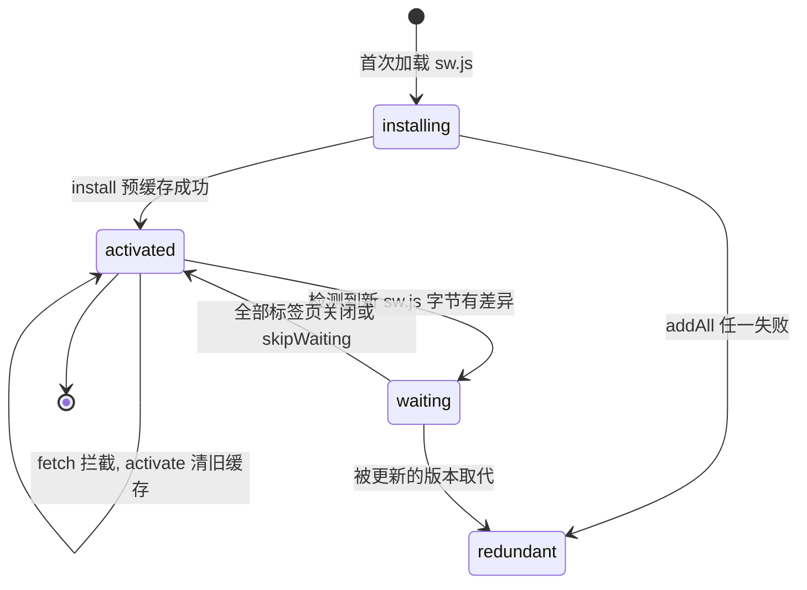
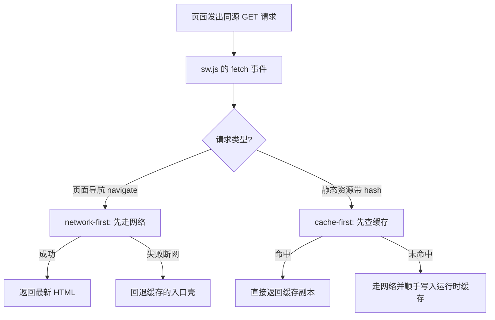
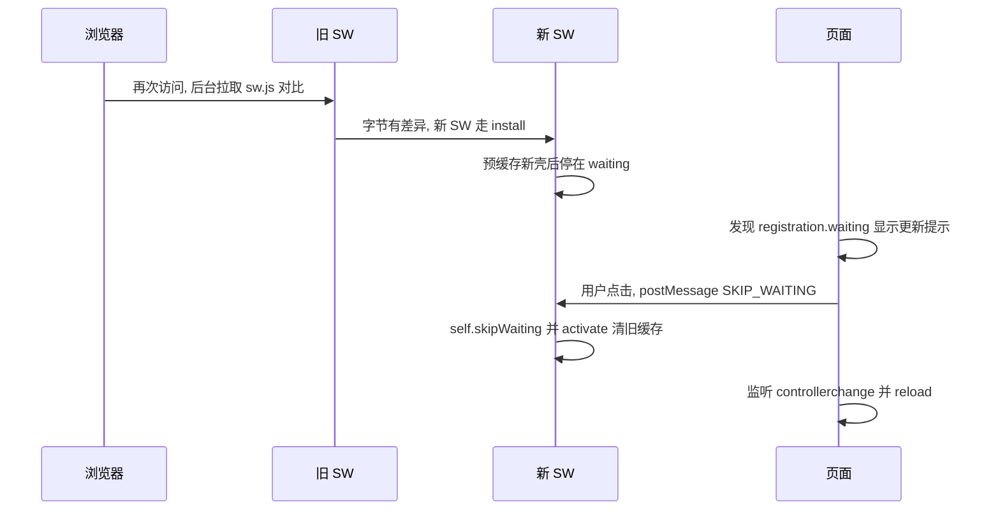

# 第 35 课 · PWA 与离线体验

最后一课（之一）我们把应用"装进"用户的设备：用 `manifest.webmanifest` 声明可安装性，用手写 Service Worker（SW，浏览器后台的代理脚本）拦截网络请求、做缓存策略，让页面在断网时依然能打开。打开 http://localhost:5173/lesson/35 看讲义。真正的离线体验要在生产构建（`npm run build && npm run preview`）里实测——dev 下 SW 被故意禁用（第 24 课说过：dev 与 build 是两个世界）。

## 学习目标

完成本课后，你应该能够：

1. 说清 PWA 三件套：manifest（可安装）、Service Worker（可离线）、HTTPS（安全前提，localhost 豁免）；
2. 复述 SW 生命周期三阶段——install（预缓存）、waiting（更新排队）、activate（清旧缓存 + 接管）——以及 fetch 事件如何按策略拦截请求；
3. 会做缓存策略选型：cache-first / network-first / stale-while-revalidate 各适合哪类资源；
4. 能解释"为什么 dev 下不注册 SW"（搅乱 HMR）和"为什么预缓存不用精确文件列表"（Vite 的 content hash 文件名）；
5. 能完整描述一次更新流程的时序：浏览器检查更新 → 新 SW waiting → 页面提示 → skipWaiting → 刷新。

本课对应的示例代码：

- `public/manifest.webmanifest` —— PWA 清单：name / icons / display standalone / theme_color
- `public/sw.js` —— 手写 SW：版本号常量、install 预缓存入口壳、activate 清旧缓存、fetch 双策略、SKIP_WAITING 消息
- `src/components/lesson35/ServiceWorkerRegister.jsx` —— 仅 PROD 注册、更新提示 UI、在线/离线徽章、Cache API 演示
- `src/pages/Lesson35.jsx` —— 页面编排：manifest / 生命周期 / 策略表 / 实测区 / 离线验证步骤
- `src/pages/lesson35.css` —— `l35-` 前缀样式

## 核心概念

### SW 生命周期与作用域（为什么放 public/ 根）

> **一句话记住：** SW 的权力范围由文件路径决定，放 public 根目录 scope 才是 /，才能接管整站；生命周期是 install → waiting → activate。

先想清楚：一个脚本能拦截全站请求，它的权力边界在哪？

SW 是一个挂在浏览器后台的脚本，作用域（scope，它有权控制的 URL 范围）由**文件路径**决定。

- `public/sw.js` 会被 Vite 原样拷到产物根目录，`register('/sw.js')` 的默认 scope 就是 `/`，能接管整站所有页面。
- 如果放进 `/sub/sw.js`，它只能控制 `/sub` 下的页面。

这是"为什么放根"的唯一原因，与代码写法无关。

生命周期三阶段：

1. **install**：SW 首次加载触发一次。在 `event.waitUntil()` 里预缓存"入口壳"。`cache.addAll` 是原子的——任何 URL 失败整个 install 失败，保证壳完整。
2. **waiting**：浏览器检测到新 `sw.js`（字节级对比）时，新 SW 走完 install **不会**立即接管，而是停在 waiting，等旧 SW 释放控制权（所有标签页关闭，或页面 `postMessage('SKIP_WAITING')` + `self.skipWaiting()`）。
3. **activate**：接管前的最后机会——按缓存版本号删除旧缓存（`CACHE_VERSION` 常量 + `caches.keys()` 过滤），配合 `clients.claim()` 立即控制已打开的页面。

**图：Service Worker 生命周期状态机**



之后是日常工作的 **fetch 事件**：被控制页面发出的每个同源 GET 请求都流经这里，按请求类型套用不同缓存策略。

**图：fetch 请求拦截与双策略分流**



### HTTPS 限制（localhost 豁免）

> **一句话记住：** SW 太敏感，浏览器只许它在安全上下文运行；唯一豁免是 localhost。

为什么浏览器要设安全门槛？SW 能拦截全站请求、伪造响应，是极敏感能力，因此浏览器要求**安全上下文**：必须 HTTPS。唯一的开发豁免是 `localhost`。这与第 24 课"Vite 环境变量只在构建时注入、生产敏感信息不暴露"是同一类思维：**平台能力绑定安全边界**。

### 为什么预缓存不用精确文件列表

> **一句话记住：** 构建产物文件名带 content hash，每次构建都变；预缓存只放稳定文件名，hash 资源交给运行时缓存。

【铁律】Vite 构建的 js/css 文件名带 content hash（如 `assets/index-B3xk9.js`），每次构建都会变。手写列表必然在下次构建后指向 404，导致 `addAll` 失败、install 永远不成功。正确做法是：

- **导航预缓存**：install 时只缓存文件名稳定的 `/`（SPA 的 index.html 壳）；
- **运行时缓存**：hash 资源在用户首次访问时被 fetch 阶段顺手存入缓存。

### 缓存策略选型表

> **一句话记住：** 不可变静态资源用 cache-first，页面和数据用 network-first，"稍旧但秒开"用 stale-while-revalidate。

不同的资源对"新"与"快"的要求不同，所以要先分类型，再选策略：

| 策略 | 做法 | 适合 |
| --- | --- | --- |
| cache-first | 先查缓存，未命中才走网络 | 带 hash 的静态 js/css/图片/字体——文件名即版本，命中即可信 |
| network-first | 先走网络，失败回退缓存 | 页面导航（HTML）、需要尽量新的数据 |
| stale-while-revalidate | 先回缓存，同时后台更新缓存 | 一句话：内容可以稍旧但必须秒开（头像、文章列表） |

### 更新流程完整时序

> **一句话记住：** 浏览器字节对比发现新 SW → waiting 排队 → 页面提示 → skipWaiting → activate 清旧缓存 → 刷新生效。

一次版本更新，从浏览器到用户屏幕，完整时序如下：

```
用户再次访问站点
  → 浏览器后台 GET /sw.js，与当前版本做字节对比
  → 有差异：新 SW 走 install（预缓存新壳）→ 停在 waiting（旧 SW 还在控制页面）
  → 页面在 registration.waiting 上发现"有新版本"→ 显示"点击刷新更新"
  → 用户点击 → postMessage('SKIP_WAITING') → 新 SW 调 self.skipWaiting()
  → 旧 SW 释放控制权，新 SW activate（清旧缓存）
  → 页面监听 controllerchange → window.location.reload() → 新版本生效
```

**图：SW 更新流程时序**



### Lighthouse PWA 评分（呼应第 24 课）

> **一句话记住：** PWA 只能对生产构建打分，dev server 测不出真实表现。

DevTools → Lighthouse → Progressive Web App，主要检查：HTTPS、manifest 完整（name、icons、start_url）、离线返回 200、注册了 SW。与第 24 课同理：**PWA 只能对生产构建打分**，dev server 测不出真实表现。

## 代码导读

- `public/sw.js`：`CACHE_VERSION` 常量 → install 预缓存 `['/', '/manifest.webmanifest', '/favicon.svg']` → activate 清非当前版本缓存 + `clients.claim()` → fetch 里 navigate 用 network-first、静态资源用 cache-first → `message` 监听 `SKIP_WAITING`。注释里讲了不调 `skipWaiting()` 的取舍（宁等用户确认，不冒新旧资源混用的险）。
- `src/components/lesson35/ServiceWorkerRegister.jsx`：`import.meta.env.PROD` 短路注册（dev 下 HMR 不被搅乱）；`registration.waiting` 非空时渲染更新提示条；`navigator.onLine` + `online/offline` 事件驱动徽章；`caches.open('l35-user-data')` 演示页面主线程也能直接读写 Cache API。
- `src/pages/Lesson35.jsx`：六张卡片编排讲义；第五张给出离线实测步骤。

## 动手试一试

1. **实测离线**：`npm run build && npm run preview -- --port 4173`，打开 http://localhost:4173/ 刷新一次让 SW 接管，然后 DevTools → Network 勾 Offline，再刷新——页面应照常渲染，徽章翻红。
2. **观察缓存**：DevTools → Application → Cache Storage，找到 `l35-v1` 与 `l35-user-data` 两个缓存，看看里面各存了什么；点击页面上的"演示：把用户数据写进 Cache API"再回来看。
3. **模拟更新**：改一行 `public/sw.js`（比如把 `CACHE_VERSION` 改成 `l35-v2`），重新 build + preview，第二次访问时应弹出"检测到新版本"提示条。

> 注意：`index.html` 里还需 `<link rel="manifest" href="/manifest.webmanifest" />` 才能通过 Lighthouse 的 manifest 检查；本课程仓库为避免影响其他课未加，你在自己的项目里记得加。

## 易错点

1. **dev 下注册 SW**：SW 缓存模块请求后，Vite HMR 的更新会被旧缓存挡住——"改了代码不生效"。铁律：只在 `import.meta.env.PROD` 注册。
2. **把 hash 文件写进预缓存列表**：下次构建文件名就变了，`addAll` 失败、install 永远挂起。预缓存只放稳定文件名，hash 资源交给运行时缓存。
3. **忘记清旧缓存**：每次更新换 `CACHE_VERSION` 但 activate 不删旧缓存，存储会无限膨胀；反过来，删缓存时不做版本过滤会把新缓存也删掉。
4. **只在挂载时读一次 `navigator.onLine`**：不监听 `online/offline` 事件，徽章永远不翻转。
5. **测试环境搞错**：在 5173（dev）上测离线永远"失败"，因为 SW 根本没注册。PWA 的所有验证都在 build + preview 的产物上进行。

## 自测题

1. 为什么 `sw.js` 要放在 `public/` 根目录？如果把路径改成 `/assets/sw.js` 会有什么后果？
2. `cache-first` 与 `network-first` 各适合什么资源？为什么页面导航不能也用 cache-first？
3. 用户第二次访问站点时，浏览器如何发现 SW 有更新？新 SW 在接管前会停在哪个状态，靠什么机制跳出来？
4. 为什么预缓存列表里不能写 `/assets/index-B3xk9.js` 这样的文件？

<details>
<summary>答案</summary>

1. SW 的作用域由文件路径决定：`/sw.js` 的 scope 是 `/`，能接管整站；`/assets/sw.js` 只能控制 `/assets` 下的页面，站点其余部分不受 SW 保护。
2. cache-first 适合文件名带 hash 的不可变静态资源（命中即可信）；network-first 适合必须尽量新的 HTML 页面与数据。页面导航若也 cache-first，用户会一直看到旧壳、新版本永远刷不出来，所以 HTML 用 network-first、断网才回退缓存。
3. 浏览器后台重新拉取 `/sw.js` 并做字节对比；有差异则新 SW 走 install 后停在 **waiting**，靠旧 SW 释放控制权（关闭所有标签页，或页面 `postMessage('SKIP_WAITING')` → `self.skipWaiting()`）才进入 activate。
4. 这是带 content hash 的文件名，下次构建就会变成新名字，旧 URL 404，`cache.addAll` 原子失败导致 install 不成功。预缓存只放稳定文件名（如 `/`），hash 资源靠运行时缓存策略存。

</details>

## 下一课预告

下一步可以学 Workbox（`vite-plugin-pwa`）——把本课手写的版本管理、策略模板、 precache manifest 自动化；再往前进阶离线数据同步（Background Sync、IndexedDB）。
