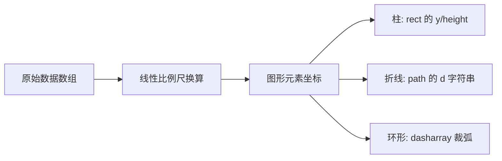
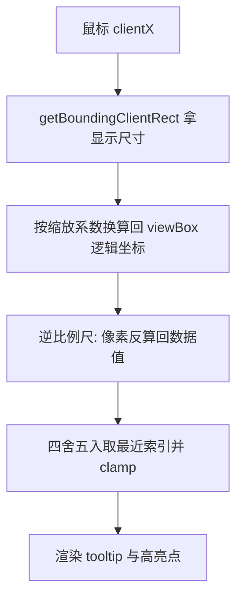
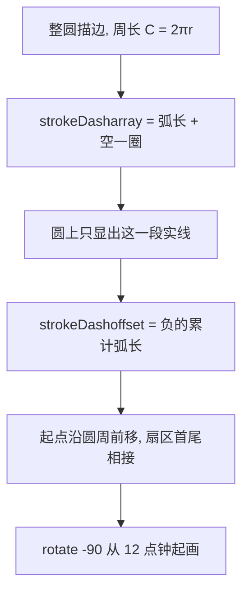

# 第 38 课 · 手写 SVG 数据可视化

这节课不装任何图表库，用"SVG 标准标签 + 初中数学"把柱状图、折线图、环形图各画一张。

三样武器各管一摊：线性比例尺负责"数据 → 像素"的换算，`path` 的 d 字符串拼出折线，`strokeDasharray` 从圆的周长里裁出环形图的弧。

打开 http://localhost:5173/lesson/38 边看边动手：hover 柱子看自绘 tooltip、鼠标沿线滑动看逆函数定位、悬停扇区看中心文字切换。

学完你会知道：什么时候手写更便宜，什么时候该上 ECharts / Recharts。

## 学习目标

完成本课后，你应该能够：

1. 默写线性比例尺公式 f(x) = r₀ + (x − d₀)·k（k = (r₁ − r₀)/(d₁ − d₀)），并用纯函数实现、解释"为什么必须是纯函数"；
2. 说清 SVG viewBox 响应式原理：逻辑坐标系与显示尺寸分离、缩放由浏览器完成，以及它如何呼应第 23 课的渲染流水线与合成层；
3. 会拼 `path` 的 d 字符串画折线，知道"点多于像素宽时先抽稀"，并用比例尺逆函数把鼠标像素反算回数据实现"最近点"hover；
4. 会用周长公式 C = 2πr 与 `strokeDasharray` / `strokeDashoffset` 裁出环形图扇区，配出带百分比的图例；
5. 落地"图表无障碍三件套"：role="img" + 完整结论句 aria-label + 视觉隐藏的数据表。

本课对应的示例代码：

- `src/components/lesson38/scale.js` —— 比例尺纯函数模块：scaleLinear / invertLinear / makeTicks（含两点式推导）
- `src/components/lesson38/BarChart.jsx` —— 线性比例尺的使用侧、坐标轴刻度、自绘 tooltip、CSS 过渡动画
- `src/components/lesson38/LineChart.jsx` —— d 字符串拼接、抽稀函数、逆比例尺 + viewBox 坐标换算的最近点 hover
- `src/components/lesson38/DonutChart.jsx` —— 2πr 周长、dasharray/dashoffset 裁弧、中心文字、图例组件
- `src/components/lesson38/ChartA11y.jsx` —— 图表无障碍外壳：role="img"、结论句、隐藏数据表
- `src/pages/Lesson38.jsx` —— 页面编排 + 选型卡 + 零依赖宣言
- `src/pages/lesson38.css` —— `l38-` 前缀样式（含 sr-only 视觉隐藏方案）

## 核心概念

### 线性比例尺：一张图表的全部数学

> **一句话记住：** 比例尺是一次函数：数据域映射到像素域，一张图表的所有坐标都由它换算。

画图表的第一个问题：**数据值 42 万画在哪个像素上？** 比例尺（scale）就是回答这个问题的换算器。

把数据域 domain = [d₀, d₁] 映射到像素域 range = [r₀, r₁]，就是一条一次函数直线（两点确定一条直线）：

```
f(x) = k·x + b
斜率 k = (r₁ − r₀) / (d₁ − d₀)   ← 1 个数据单位 = 多少像素
截距 b = r₀ − k·d₀
所以 f(x) = r₀ + (x − d₀)·k
```

代入检验：x = d₀ 返回 r₀，x = d₁ 返回 r₁，中间按比例插值。

柱状图的 y/height、轴刻度、tooltip 位置全部由它换算，代码里没有一个魔法数字。

三条铁律：

- **纯函数**：不碰 state、不碰 DOM，同样的入参永远同样的输出——好测试、好复用（D3-scale、ECharts 内部都是这套数学的库化）；
- **SVG 的 y 轴朝下**：柱状图的 yScale 要写 range = [底部y, 顶部y]，让值越大 y 越小，否则柱子倒着长；
- **domain 来自业务语义**：销售额固定 [0, 100] 而不是"本组最大值"——用最大值封顶，最高柱永远顶格，组与组失去可比性；温度没有天然 0 点，domain 则从数据 min/max 推导再留白。

有正必有逆：画图走正向（数据 → 像素），交互走逆向（像素 → 数据）。

逆函数就是把 domain/range 角色对调、斜率取倒数。

**缺逆函数的图表做不了精确交互**——鼠标给你的永远是像素，反算回数据才有意义。

**图：数据到像素的可视化流水线**



### SVG viewBox 响应式原理（呼应第 23 课合成层）

> **一句话记住：** viewBox 定逻辑坐标、width="100%" 定显示尺寸——缩放和重绘浏览器全包，坐标只写一份。

图表要适配各种屏幕宽度，难道每个尺寸都重算一遍坐标？不用。

`viewBox="0 0 480 280"` 定义一个 **480×280 的逻辑坐标系**，`width="100%"` 让显示尺寸跟随容器——浏览器负责"逻辑坐标 × 缩放系数"的等比换算和矢量重绘。

于是：

- 坐标只写死一份，不需要 ResizeObserver、不需要 JS 重算像素，容器多宽图就缩放成多大；
- 重绘发生在**绘制阶段**（第 23 课的 layout → paint → composite 流水线），改 rect 几何属性不触发布局；
- 动画若只用 `transform` / `opacity`，浏览器可以留在**合成层**完成，主线程零参与——本课柱子动画过渡的是 y/height（会重绘，但元素少无感），若要动画大量节点，优先 transform；
- 代价：交互时逻辑坐标 ≠ 屏幕坐标，必须用 `getBoundingClientRect` 拿显示尺寸、把 `clientX` 按比例换算回逻辑坐标（折线图 hover 的第 1 步就是它）。

### 折线：path 的 d 字符串与抽稀

> **一句话记住：** 折线就是一个字符串："M 起点落笔 + L 连线"，点多于像素先抽稀。

折线怎么画？`d` 只是普通字符串：`M x0 y0`（落笔到位）+ 一串 `L x y`（画直线到），模板字符串 join 拼好交给 `<path>`。

两个细节：

- `toFixed(1)` 控制小数位（几千个点时字符串体积差好几倍）；
- `fill: none` 必须显式关掉——path 默认会填充闭合区域，折线会被糊成色块。

**抽稀（decimation）**：像素宽只有几百，点却有几千时，同一个像素里挤多个点纯属浪费——按步长取样把点数压到 ≈ 像素数即可。

要保住峰值/拐点得上 Douglas–Peucker、LTTB 这类"保形状"算法。

本课 48 个点 < 420px 绘图宽，抽稀函数直接放行。

**图：折线图最近点 hover 的坐标换算链**



### 环形：周长公式 + dasharray 裁弧

> **一句话记住：** 环形图是一个粗描边的圆，扇区 = 用 dasharray 从周长里裁出的弧。

环形图不用算角度、不写弧线路径命令——它本质是圆的一段弧长，而圆的弧长可以用"描边裁剪"直接裁出来。

环形图 = 一个粗描边的圆（`strokeWidth` ≈ 半径的 1/3），扇区是圆的一段弧长。

半径 r = (画布 − 描边宽) / 2（描边正好贴住画布边），周长 **C = 2πr**：

- `strokeDasharray = "${弧长} ${C}"`：先画"弧长"的实线段，再空一整圈 → 圆上只看得见这一段；
- `strokeDashoffset = −前面累计弧长`：负号把图案起点沿圆周前移，扇区首尾相接；写成正号会互相叠错位；
- `rotate(-90)`：SVG 角度从 3 点钟方向起算，转 −90° 让第一名从 12 点钟开始。

**图：dasharray 与 dashoffset 裁出扇区**



百分比 = value / total × 100。

注意 toFixed 四舍五入后各项合计可能 ≠ 100%（三等分 33.3×3 = 99.9），图表库用"最大余数法"分摊差额——先知道这个坑即可。

图例给颜色配上名字，是可读性的第二层保障。

### 图表无障碍三件套（图表库常常做错的事）

> **一句话记住：** role="img" + 结论句 aria-label + 外置隐藏数据表，缺一不可。

图表是几十个 rect/text，屏读用户逐个听会疯掉——所以要给图"配解说"。三件套：

1. **role="img"**：把整块图表当"一张图片"播报，内部几十个 rect/text 不再逐个念；
2. **aria-label 写完整结论句**："6 月最高 89 万元，2 月最低 31 万元"——替用户把图看完，不是"柱状图"三个字；结论应该从数据实时统计，不是写死的文案；
3. **视觉隐藏的 `<table>` 数据回退**：屏读用户逐格听数、爬虫/SEO 索引结构化数据。隐藏用 clip 方案，绝不能 `display:none`（连无障碍树和搜索索引一起消失）。

【必讲易错】数据表必须放在 role="img" 元素的**外面**（兄弟节点）——role="img" 会把所有后代从无障碍树剪掉，藏在里面等于没写。

很多图表库只输出空 `<canvas>` 或裸 `<svg>`，什么语义都不留，这就是它们常做错的事。

### 为什么不用 div 拼柱状图（L12 的 HeavyChart 就是一个）

> **一句话记住：** div 只有矩形、节点翻倍、改高触发重排——SVG 一样图形全包、缩放免费。

L12 的 `HeavyChart` 是一个手写 SVG 图表的现成例子——它"假装"是 500KB 的图表库，实际是零依赖内联 SVG。

为什么不用 div + height% 拼柱子？

1. **div 只能是矩形**：折线的斜线、环形的弧、面积填充拼不出来（skew/rotate 是 Hack，角度计算比比例尺还绕）；SVG 一条 path 画完 48 个点；
2. **DOM 数量**：div 方案每根柱至少 3 个节点，SVG 一根柱一个 rect，折线更是 1 个元素；
3. **布局 vs 绘制**：div 改 height 触发 layout + paint（第 23 课流水线）；SVG 图形是绘制结果，改几何属性只走重绘，transform/opacity 动画还能进合成层；
4. **缩放免费**：viewBox 让"逻辑坐标写死一份、显示尺寸跟容器走"；div 柱高用 % 也能缩，但文字、间距、轴要另行布局——SVG 里它们和图形共用同一套坐标系。

### 手写还是上库（选型卡）

> **一句话记住：** 几种基础图、贴设计稿就手写；缩放刷选、大数据、几十种图就上库。

| 维度 | 手写 SVG（本课） | ECharts / Recharts |
| --- | --- | --- |
| 图表种类 | 三五种基础图绰绰有余 | 几十种开箱即用，含地图/关系图/3D |
| 视觉定制 | 完全自由 | 主题配置项内定制，深挖要读源码 |
| 交互 | hover/简单 tooltip 手写可做；缩放刷选联动成本高 | dataZoom、图例联动开箱即用 |
| 数据量 | SVG 节点数 = 元素数，上千点要抽稀 | ECharts 可切 Canvas，扛大数据量 |
| 包体积 | **0 KB，零依赖** | Recharts ≈100KB+ / ECharts ≈300KB+ |

经验法则：只要柱/折/环几种基础图、视觉要完全贴合设计稿 → 手写；要缩放刷选、实时大数据、几十种图 → 直接上库，别硬造。

## 代码导读

- `src/components/lesson38/scale.js`：先读文件头的数学注释——两点式解一次函数的完整推导（正向 k、b，逆向取倒数）；纯函数、无 React，柱/折两图共用一份实现，也满足 Fast Refresh 的"组件文件只导出组件"约束。
- `src/components/lesson38/BarChart.jsx`：y 比例尺 range 写成 `[底, 顶]`（y 轴朝下）；`makeTicks` 生成刻度；hover 只存"第几根柱"，tooltip 位置做了 clamp 防出画布；柱子的 y/height 靠 CSS transition 平滑过渡（SVG2 几何属性）。
- `src/components/lesson38/LineChart.jsx`：`onMove` 三步走——getBoundingClientRect 换算 viewBox 坐标 → 逆比例尺 → 四舍五入取最近索引并 clamp；`thin` 是步长抽稀（本诂数据量小不触发，改 2000 个点看 console）；d 字符串用 `M`/`L` 拼接 + `toFixed(1)`；数据由页面 props 传入，图和表同源。
- `src/components/lesson38/DonutChart.jsx`：`CIRCUMFERENCE = 2πr`；每个扇区 `dasharray = "弧长 C"`、`dashoffset = −累计弧长`（负号！）；`rotate(-90)` 从 12 点起画；中心文字默认总量、悬停切占比；`DonutLegend` 命名导出，必须放在 role="img" 外面。
- `src/components/lesson38/ChartA11y.jsx`：`figure` 容器 = role="img" 的图 + 可选图例 + `.l38-visually-hidden` 数据表；label 要求"完整结论句"；注释里写了 table 为什么不能塞进 role="img"。
- `src/pages/Lesson38.jsx`：选型卡 + 三张图各套 ChartA11y；"换一组数据"按钮演示"数据变、比例尺不动"，且 aria-label 的结论句随数据实时重算；卡片六回答"为什么不用 div 拼柱状图"。

## 动手试一试

1. **观察比例尺的意义**：点"换一组数据"看柱子平滑生长；再把 `BarChart.jsx` 里 `Y_DOMAIN` 改成 `[0, 200]`——同样数据柱子全部变矮一半。这就是 domain 语义：轴的范围决定图的"嗓门"。
2. **让抽稀真的干活**：把 `Lesson38.jsx` 里 `LINE_SAMPLES` 的长度改成 2000（`Array.from({ length: 2000 }, ...)`），刷新页面看 console 的抽稀日志，折线形状基本不变——这就是"点多于像素宽先抽稀"。
3. **亲手验证无障碍**：DevTools → Elements → Accessibility 面板，检查图表区域是 img 角色 + 完整结论句；在 Elements 里搜 `l38-visually-hidden` 找到数据表；再点"换一组数据"，看 aria-label 的结论句跟着变。

## 易错点

1. **y 轴朝下**：yScale 的 range 写成 `[顶, 底]`，柱子会从顶上"垂"下来。铁律：SVG y 向下为正，柱状图 range = [底边, 顶边]。
2. **domain 用数据最大值封顶**：最高柱永远顶格，组与组失去可比性；domain 应来自业务上限或"数据 min/max + 留白"。
3. **hover 没换算 viewBox 缩放**：直接拿 `clientX` 当逻辑坐标，窗口一缩放 hover 就偏。必须先 `getBoundingClientRect` 换算（折线图 onMove 第 1 步）。
4. **数据表塞进 role="img" 里面**：role="img" 把后代从无障碍树剪掉，等于没写；或者用 `display:none` 隐藏表格——SEO 和屏读一起消失。正确姿势：clip 视觉隐藏 + 放在 role="img" 外面。
5. **dashoffset 符号写反**：负号是"起点沿圆周前移"实现首尾相接；写成正号扇区会叠错位。另外 π 用 `Math.PI`，手写 3.14 的精度损失会在最后一段扇区露出缝隙。

## 自测题

1. 默写线性比例尺公式（含斜率），并说明为什么比例尺必须是纯函数？
2. viewBox 响应式为什么不需要 ResizeObserver？它给交互（hover）带来的代价是什么？
3. 用周长公式和 dasharray/dashoffset 描述：如何从圆环上"裁"出 25% 的扇区？
4. role="img" 之后，图表内部的 `<text>` 屏幕阅读器还能读到吗？无障碍三件套分别服务于谁？

<details>
<summary>答案</summary>

1. f(x) = r₀ + (x − d₀)·k，其中 k = (r₁ − r₀)/(d₁ − d₀)。纯函数：不碰 state/DOM、同输入同输出——可单测、可复用、可在服务端安全执行；图表里所有数据→像素换算集中在这一处，出问题只查一个函数。
2. viewBox 定义逻辑坐标系、width="100%" 只定显示尺寸，等比换算和矢量重绘由浏览器完成，坐标写死一份即可，无需监听容器尺寸重算像素。代价：逻辑坐标 ≠ 屏幕坐标，交互必须用 getBoundingClientRect 把 clientX/clientY 按缩放系数换算回逻辑坐标，再走逆比例尺。
3. C = 2πr 是整圈长度；25% 扇区的弧长 = 0.25C。设 `strokeDasharray = "${0.25 * C} ${C}"`（画一段、空一圈）；`strokeDashoffset = −(它前面扇区的累计弧长)`（负号把起点前移、首尾相接）；整组包在 `rotate(-90)` 里从 12 点钟起画。
4. 读不到：role="img" 把所有后代从无障碍树剪掉，播报的只有 aria-label。三件套的分工：role="img" 服务于"把图当一张图播报"；完整结论句 aria-label 服务于屏读用户"听图"；视觉隐藏的数据表同时服务于屏读用户（逐格听数）与搜索引擎（索引结构化数据）。

</details>

## 下一课预告

第 39 课 · Web Vitals 性能指标：图能画了，性能也不能糊——LCP / INP / CLS 三大核心指标分别量什么、`web-vitals` 库怎么用、哪些代码（比如今天这种几百个 SVG 节点）会拖慢哪项指标。
