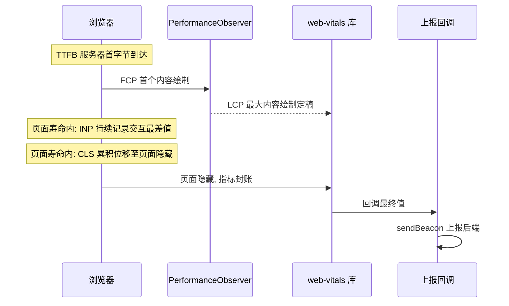
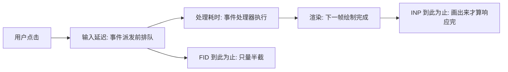
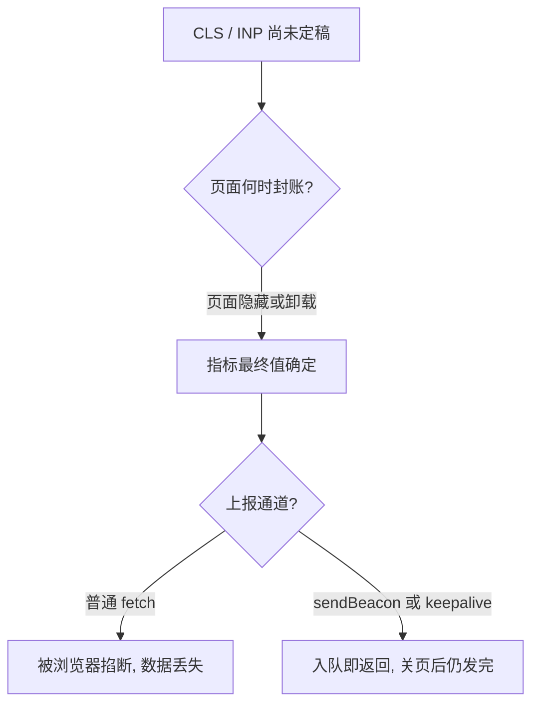

# 第 39 课 · Web Vitals 真实测量

第 24 课我们学了怎么把应用"变快"，这一课解决"怎么知道真的变快了"。

具体做三件事：

- 接入 Google 官方的 `web-vitals` 库（v6），在页面里展示本次加载的真实 LCP / CLS / INP / FCP / TTFB；
- 亲手制造一次长任务，看它被 PerformanceObserver 捕获；
- 理清"实验室数据 vs 现场数据（RUM）"两种尺子的分工。

打开 http://localhost:5173/lesson/39 看实测面板。

## 学习目标

完成本课后，你应该能够：

1. 背出 Core Web Vitals 三指标的定义与官方好坏阈值（LCP ≤2500ms / CLS ≤0.1 / INP ≤200ms，poor 阈值 4000 / 0.25 / 500）；
2. 说清 INP 为什么在 2024 年 3 月取代 FID——从"测第一次输入延迟"升级为"测整页寿命所有交互到下一次绘制"；
3. 区分实验室数据（Lighthouse：受控、可复现、单次跑分）与现场数据（RUM：真实用户、75 百分位、官方口径）各自能回答的问题；
4. 会用 `web-vitals` 的 `onLCP/onCLS/onINP/onFCP/onTTFB` 接自定义回调，并说明为什么卸载时上报要用 `sendBeacon`；
5. 能列出本地 dev 测量的三条局限，知道性能结论必须来自生产现场数据。

本课对应的示例代码：

- `src/components/lesson39/vitalsReport.js` —— web-vitals 接入：官方阈值表硬编码、`rateMetric` 分级函数、dev 彩色日志、`sendBeacon` 上报示例
- `src/components/lesson39/VitalsPanel.jsx` —— 五指标实时卡片、longtask 观察器 + 200ms 阻塞按钮、Resource Timing 表、Navigation Timing 时间线
- `src/pages/Lesson39.jsx` —— 页面编排：阈值表 / RUM vs 实验室 / 实测区 / 优化清单
- `src/pages/lesson39.css` —— `l39-` 前缀样式（分级色块：绿 good / 橙 needs-improvement / 红 poor / 灰 无数据）

## 核心概念

### 三指标定义表（官方阈值，值得背下来）

> **一句话记住：** LCP 管主内容多快出齐，CLS 管页面跳不跳，INP 管交互跟不跟得上。

优化性能之前得先有尺子——不知道"多快算快"，一切优化都是凭感觉。Core Web Vitals（核心网页指标）就是 Google 给的三把官方尺子。

每档阈值都不是拍脑袋：Google 按真实用户数据划在"绝大多数站点能达到"的水平线上。

| 指标 | 全称 | 测什么 | 良好 | 需改进 | 差 |
| --- | --- | --- | --- | --- | --- |
| LCP | Largest Contentful Paint 最大内容绘制 | 视口内最大元素渲染完成的时刻——"主内容出齐" | ≤ 2500ms | 2500–4000ms | > 4000ms |
| CLS | Cumulative Layout Shift 累积布局偏移 | 页面寿命内所有意外位移分数之和——"内容跳不跳" | ≤ 0.1 | 0.1–0.25 | > 0.25 |
| INP | Interaction to Next Paint 交互到下一次绘制 | 整页寿命内交互响应的最差值（约取最差 2% 的交互） | ≤ 200ms | 200–500ms | > 500ms |

辅助诊断指标：

- FCP（First Contentful Paint，≤1800ms 良好）回答"白屏多久"；
- TTFB（Time To First Byte，≤800ms 良好）回答"网络/服务器慢不慢"。

排查链路：LCP 大 → 先看 TTFB，再查首屏资源体积；INP 差 → 查长任务。

**图：页面加载与指标采集时间线**

### INP 为什么取代 FID

> **一句话记住：** FID 只量第一次交互的半截；INP 量整页所有交互、画出来才算响应完。

2024 年 3 月起，Google 把 INP 换下了服役多年的 FID——因为 FID 有两个先天缺陷。

FID（First Input Delay）的两个先天缺陷：

- 只测**第一次**交互，后面卡不卡不管；
- 只量到事件处理**开始执行**为止，不含处理耗时和渲染——用户感知不到这个"半截"数据。

INP 全面升级：

- 量到**下一次绘制**（画出来才算响应完）；
- 覆盖**整页寿命的所有交互**（约取最差 2%）；
- 长任务、重的事件处理器、大范围重渲染都会被如实计入。

一句话：**FID 测"点得进吗"，INP 测"跟得上吗"**。

**图：一次点击从输入到绘制的计时口径**

### RUM vs 实验室数据

> **一句话记住：** Lighthouse 回答"改完有没有变快"，RUM 回答"用户实际快不快"——两把尺子缺一不可。

"我优化了，用户真的变快了吗？"——这个问题实验室数据回答不了，因为它测的不是真实用户。两种尺子各有分工：

| | 实验室（Lighthouse） | 现场（RUM，web-vitals） |
| --- | --- | --- |
| 环境 | 受控：模拟中端手机 + 4G，单次跑分 | 真实用户：真实设备/网络/交互 |
| 能回答 | "这次改动有没有变快"（可复现、可对比） | "用户实际体验如何"（唯一的事实） |
| 不能回答 | 用户间差异；CLS/INP 几乎测不到（无交互） | 具体哪次改动导致变慢 |

Core Web Vitals 的官方口径是**现场数据的 75 百分位**（75% 用户达到"良好"）。

数据源如 Google 的 CrUX 数据集——PageSpeed Insights、搜索控制台报的就是它。

**Lighthouse 分数再高也不能替代现场数据**。

### 上报策略：sendBeacon 页面卸载安全

> **一句话记住：** CLS/INP 要等页面隐藏才定稿——卸载时上报必须用 sendBeacon，fetch 会被掐断。

测好了指标，怎么送到后端？关键问题是**时机**——很多指标（CLS 最终值、INP）恰恰要到页面**隐藏/卸载**时才定稿，而普通 `fetch` 在页面卸载时会被浏览器直接掐断。

`navigator.sendBeacon()` 是浏览器专门为此设计的 API：把数据放入队即返回，浏览器保证页面关闭后仍把数据发完。

注意三点：

- 只能发 POST、拿不到响应、适合"发了就忘"的埋点；
- 不支持时的兜底是 `fetch(..., { keepalive: true })`（同样有 64KB 体积上限）；
- payload 里带上 `metric.id`（同一次加载同名指标共享），后端据此去重合并。

**图：指标定稿与上报时机**

### 本地 dev 测量的局限（生产测量才准）

> **一句话记住：** dev 无优化、localhost 无网络、样本只有你自己——性能结论必须来自生产现场。

为什么本课面板上的数字不能直接当结论？本地 dev 测量有三条硬伤：

1. **dev 模式没有优化**：Vite dev 不做代码分割、压缩、tree-shaking，每个源码模块都是独立请求——dev 下的资源数量、耗时与生产完全不可比；
2. **localhost 没有网络延迟**：DNS、TCP/TLS、服务器处理全部 ≈ 0，本课面板的 Navigation Timing 时间线在 localhost 恒为 `<1ms`，不是"网站快"，是"没有网络可测"；
3. **样本是开发者自己**：一台快电脑、没有冷缓存、没有老款安卓手机。RUM 的意义就在于样本是全体真实用户。

【铁律】**dev/localhost 的数值只能证明"测量接口能用"；性能结论必须来自生产现场数据**（或至少 `npm run build && npm run preview` + DevTools 网络限速）。

## 代码导读

- `src/components/lesson39/vitalsReport.js`：`THRESHOLDS` 官方阈值表硬编码（带每条的含义注释）→ `rateMetric(name, value)` 按 `≤good 为 good、>poor 为 poor` 分级（与库内部同口径）→ `initVitalsReport(onReport)` 注册五个 `onXxx`，LCP/CLS/INP 开 `reportAllChanges`（默认要等页面隐藏才回调，面板要实时；INP 初始值 -1 不算有效值，没交互依旧"尚无交互"）并用模块级标志位防 StrictMode 双挂载重复注册 → `devLog` 用 `console.log` 的 `%c` 占位符给名称/数值/分级分别上色 → `sendToAnalytics` 是 `sendBeacon` 生产上报示例（本课未实际调用，避免往不存在的接口发请求）。
- `src/components/lesson39/VitalsPanel.jsx`：回调同时写**模块级快照**与组件 state（路由切走再回来不丢数据）；`PerformanceObserver` 观察 `longtask`（`buffered: true` 回放历史，`try/catch` 兜底 Safari 不支持）；"制造 200ms 阻塞"按钮用 `while` 忙等占住主线程——这次点击本身也会成为一个慢交互，所以点完 INP 卡片从"尚无交互"变成真实值；`performance.getEntriesByType('resource')` 取前 8 个资源展示传输/解压后大小与耗时；navigation 条目拆出 DNS / 建立连接 / 请求→首字节 / 响应下载四段。
- `src/pages/Lesson39.jsx`：四张卡编排讲义——三指标阈值表、RUM vs 实验室对比、实测区（`VitalsPanel`）、优化清单（呼应第 24 课的代码分割/压缩/图片优化）。

## 动手试一试

1. **制造长任务**：打开 /lesson/39，点击"制造 200ms 阻塞"按钮——页面明显卡一下，长任务列表立刻出现一条"持续 ≈200ms"；同时观察 INP 卡片从"尚无交互"变成被这次点击打出来的真实值（大概率"需改进"甚至"差"——如实！）。
2. **对照 dev 日志**：打开 DevTools 控制台，刷新页面——`LCP`、`FCP`、`TTFB`、`CLS` 会以彩色标签打印（绿/橙/红对应良好/需改进/差）；面板卡片左色条应与控制台分级一致。
3. **观察资源与时间线**：点"刷新资源列表"，对比几个资源的 transferSize 与 decodedBodySize（差值 ≈ 压缩省下的）；再看 Navigation Timing 时间线——四段全 `<1ms`，然后 DevTools → Network 面板切"Slow 4G"限速重测（HMR 不受影响但指标不会变，因为指标是页面加载时测的，需要真刷新），感受"真实网络才有意义"。

## 易错点

1. **给 INP 编数据**：没交互就是没值，"尚无交互"才是诚实展示。CLS 同理：值可能是 0（页面真的没跳），0 是真实测量结果，不是"没数据"。
2. **StrictMode 下重复注册**：dev 里 effect 跑两遍，`onXxx()` 没有配对的注销函数，直接注册会收到双份回调。用模块级标志位防重（见 `initVitalsReport`），并把回调写到模块级快照而不是依赖某个组件实例。
3. **用 fetch 在页面卸载时上报**：卸载时 fetch 被掐断，CLS/INP 的最终值大概率丢失。卸载时机必须用 `sendBeacon`（或 `fetch` + `keepalive`）。
4. **把 dev 数值当性能结论**：dev 无优化、localhost 无网络延迟，"localhost 上 LCP 300ms"什么都证明不了；结论要在生产现场数据（RUM）上看 75 百分位。
5. **只盯着实验室分**：Lighthouse 是单次模拟跑分，测不到 CLS/INP（没有交互）；两种尺子分工不同，优化用实验室对比，验收用现场数据。

## 自测题

1. Core Web Vitals 三指标的好/差阈值各是多少？LCP 偏大时应该顺着哪条链路排查？
2. INP 与 FID 的测量口径有什么三点不同？为什么说 FID 是"半截"数据？
3. 为什么 CLS、INP 的最终值往往要到页面隐藏/卸载时才定稿？这时上报该用什么 API，普通 `fetch` 差在哪？
4. 本课面板里 Navigation Timing 四段在 localhost 全是 `<1ms`，能说明应用很快吗？为什么？

答案

1. LCP ≤2500ms 良好、>4000ms 差；CLS ≤0.1 良好、>0.25 差；INP ≤200ms 良好、>500ms 差。LCP 偏大先看 TTFB（网络/服务器慢不慢），再查首屏资源体积与加载时机（代码分割、图片压缩、preload、CDN——第 24 课的手段）。
2. 三点：FID 只测第一次交互，INP 覆盖整页寿命所有交互（约取最差 2%）；FID 只量到事件处理开始执行，INP 量到下一次绘制（画出来才算响应完）；因此长任务卡顿、重的事件处理器只有 INP 能反映。FID 测"点得进吗"，INP 测"跟得上吗"。
3. CLS 要等页面隐藏才能封账（之后可能有新位移），INP 要等足够多的交互样本定稿——两者都选在页面隐藏/卸载时上报最终值。此时普通 fetch 会被浏览器掐断、数据丢失；`sendBeacon` 把数据入队即返回，浏览器保证页面关闭后仍发完（兜底：`fetch` + `keepalive: true`）。
4. 不能。`<1ms` 只说明"没有网络可测"：localhost 没有 DNS/TCP/TLS/服务器往返，且 dev 模式没有压缩、代码分割等生产优化。性能结论必须来自生产环境的现场数据（RUM）按 75 百分位看，或至少 build + preview 加网络限速模拟。

## 下一课预告

最后一课（第 40 课）将给本课程收官：把前面学到的东西串成一次完整的"从测量到优化"闭环——用本课的现场指标定位问题、用第 24 课的构建手段解决它、再用实验室数据对比验证。

带上你的面板数据来。
