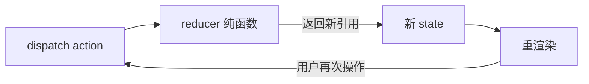
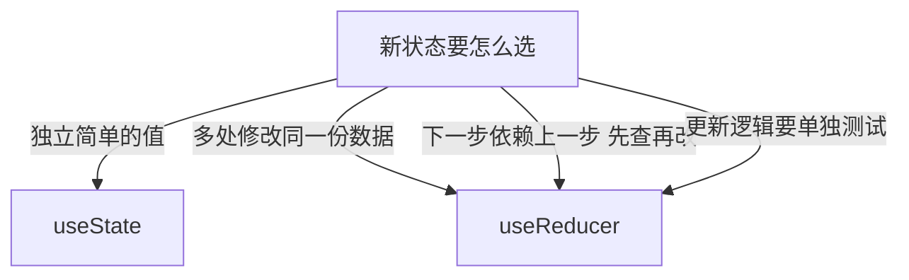

# 第 7 课 · useReducer 与复杂状态

## 学习目标

完成本课后，你应该能够：

1. 说清楚 useReducer 解决的是什么问题：多条更新逻辑纠缠同一份状态时，useState 的 setter 散落各处容易写出不一致的中间态；
2. 会写标准的三件套：`reducer(state, action)` 纯函数、`initialState`、`useReducer(reducer, initialState)`；
3. 掌握不可变更新的固定手法：改一条 → `map`，加一条 → 展开数组 `[...old, item]`，删一条 → `filter`，并在心里知道"为什么引用必须变"；
4. 能用自己的话给出 useReducer vs useState 的选择标准；
5. 理解 dispatch 只是"发通知"——组件描述发生了什么（action），怎么改状态由 reducer 全权决定。

本课对应的示例代码：

- `src/components/lesson7/cartReducer.js` —— 购物车 reducer 纯函数（add / inc / dec / remove / clear）
- `src/components/lesson7/ShoppingCart.jsx` —— 用 useReducer 驱动的购物车组件
- `src/pages/Lesson7.jsx` / `src/pages/lesson7.css` —— 页面入口与样式

## 核心概念

### 从 useState 到 useReducer：问题出在哪

> **一句话记住：** 多处代码各改一份状态，容易出不一致的中间态；useReducer 把"怎么改"全收进一个纯函数。

第 1 课以来我们一直用 `useState` 管状态，它的模式是"setter 分布在各个事件处理函数里"。状态简单时这很清爽，但想象一个购物车：

- 点"加入"要先查购物车里有没有同款，有就合并数量，没有就新增条目；
- 点"−"要把数量减一，减到 0 还得把整行删掉；
- "删除"整行、"清空"重来……

这些逻辑如果全写在组件里，每个 onClick 都是十几行数组操作，而且**同一份 `items` 被七八处代码分别修改**——任何一处忘了不可变更新，界面就不刷新；任何两处的规则不一致，就会出现"数量停在 0 的空行"这种诡异状态。

useReducer 的解法是**把"怎么改"全部收拢到一个纯函数里**：

```jsx
function reducer(state, action) {
  switch (action.type) {
    case 'add':   /* 返回新 state */
    case 'remove' /* 返回新 state */
    default:      return state
  }
}

const [state, dispatch] = useReducer(reducer, initialState)
```

组件里从此只剩 `dispatch({ type: 'add', payload: product })`——它只是"发出一条通知"：**发生了什么事（type）+ 相关数据（payload）**。至于通知之后状态变成什么样，组件不关心、也不许关心，全在 reducer 里。

**图：dispatch → reducer → 新 state → 重渲染**



### reducer 是纯函数：两条铁律

> **一句话记住：** 同样的输入永远同样的输出，且永远返回新对象——引用没变 React 就不重渲染。

为什么必须是纯函数？因为 React 全靠"引用变没变"来决定重渲染。具体是两条铁律：

`reducer(state, action) → newState` 必须是纯函数：

1. **同样的输入永远得到同样的输出**：不发请求、不 `Date.now()`、不改 state 之外的任何变量；
2. **不修改传入的 state**：永远返回新对象/新数组。

为什么铁律 2 不能破？React 用 `Object.is` 比较**新旧 state 的引用**来决定要不要重渲染。

你写 `state.items.push(item)`，内容变了但引用没变。React 认为"没变化"，界面纹丝不动——这是本课最经典的 bug 来源。

固定手法对照（在 `cartReducer.js` 里都有对应注释）：

| 要做什么 | 不可变写法 | 千万别写 |
|---|---|---|
| 改数组里某一条 | `items.map(it => it.id === id ? {...it, qty: it.qty + 1} : it)` | 找到对象后 `it.qty++` |
| 数组追加一条 | `[...items, newItem]` | `items.push(newItem)` |
| 删掉某一条 | `items.filter(it => it.id !== id)` | `items.splice(idx, 1)` |
| 清空 | 返回 `initialState` | `items.length = 0` |

记忆口诀：**map 管"改"，展开管"加"，filter 管"删"**——而且三者都返回新数组，原数组毫发无损。

### action 与 payload：让通知自带数据

> **一句话记住：** 通知 = 发生了什么（type）+ 相关数据（payload）；怎么改状态是 reducer 的事。

action 是一个普通对象，约定 `{ type, payload }`：

```jsx
dispatch({ type: 'add', payload: { id: 'p1', name: '键盘', price: 399 } })
dispatch({ type: 'inc', payload: { id: 'p1' } })
dispatch({ type: 'clear' }) // 不需要数据就不带 payload
```

`type` 用字符串描述"发生了什么"，`payload` 携带改动所需的数据。reducer 里对 `type` 做 `switch`，每个 case 返回新 state。**default 分支必须 `return state`**：保证 reducer 对任何输入（包括将来手滑打错的 type）都安全，购物车不会被一个未知 action 清成 `undefined`。

### 状态转移一步到位

> **一句话记住：** 一个 case 直接算出最终形态，没有两步 setState 之间的中间态。

为什么这条值得单独讲？先看 `dec` 这个最好的例子：数量大于 1 就减一，等于 1 就整行删除。

用 useState 你得写"先 `setQty(q => q - 1)`，再判断要不要 `setItems(filter)`"——两次 setState 之间就存在中间态。

reducer 里这只是**一个 case 返回一个结果**：算出最终形态，一次到位，不存在中间态。

### useReducer vs useState 怎么选

> **一句话记住：** 独立简单值用 useState；多处操作联动同一份数据，就升级 useReducer。

| 场景 | 选谁 | 理由 |
|---|---|---|
| 独立、简单的值（输入框草稿、开关、一个数字） | `useState` | setter 一行写完，写 reducer 纯属仪式感 |
| 多个操作联动同一份数据（增/删/改/清都对 items 动手） | `useReducer` | 更新规则集中一处，不会各写各的 |
| 下一步状态依赖上一步、还要先查再改（add 要先找同款） | `useReducer` | 纯函数里查 + 算一步完成 |
| 更新逻辑想抽成独立文件、单独测试 | `useReducer` | reducer 不依赖 React，普通函数测试即可 |

经验法则：**`setXxx` 的回调逻辑开始在不同地方复制粘贴时，就是升级 useReducer 的信号**。两者不互斥——真实项目里一个页面常常是"复杂对象用 reducer，零散简单值用 useState"。

**图：useState 还是 useReducer——选择流程**



### 派生数据依然直接算

> **一句话记住：** 总价、件数渲染时现算，绝不存进 state——reducer 正是为了消灭手动同步。

总计、件数都是从 `items` 能直接算出来的派生数据（第 2 课讲过的原则在这里同样适用）：渲染时 `reduce` 现算，**绝不**再 `useState` 存一份总价——否则每次 dispatch 之后你还得记得同步它，而 reducer 恰恰是为了消灭这种"手动同步"才存在的。

## 代码导读

### `src/components/lesson7/cartReducer.js` —— 纯函数本体

- 顶部块注释交代 reducer 的职责和两条铁律；**每个 action 的注释都标明了它用的不可变手法**（map / 展开数组 / filter / 返回初始值）。
- `initialCart` 独立导出：`useReducer(reducer, initialCart)` 用它做初始值，`clear` 的目标也是它，空购物车只在代码里出现一次。
- `add`：先用 `find` 查同款——查到就 `map` 把那条换成"数量 +1 的新对象"（其余条目原样保留，引用各自不变）；没查到就 `[...items, 新条目]` 追加。这就是"同商品合并数量"的全部实现。
- `dec`：先 `find` 防御（商品不在购物车里就原样返回）；`qty > 1` 走 `map` 减一，`qty === 1` 走 `filter` 删行——注释里解释了为什么 reducer 没有"两步 setState"的中间态问题。
- `remove` / `clear` / `default`：filter 删行、返回 `initialCart`、未知 action 原样返回。

### `src/components/lesson7/ShoppingCart.jsx` —— 只发通知的组件

- `useReducer(cartReducer, initialCart)` 得到 `[cart, dispatch]`；组件里**没有任何一行修改状态的逻辑**，全部是 `dispatch({ type, payload })`。
- `PRODUCTS` 是常量数组，不是 state——从不变化的数据放 state 纯属浪费渲染（5 个商品按钮就是 `.map` 它）。
- 五个入口各自 dispatch：商品按钮 `add` + 整个商品对象做 payload；表格行 `inc` / `dec` / `remove` + `{ id }` 做 payload；清空按钮 `clear` 不带 payload。
- `total` 和 `count` 用 `reduce` 在渲染时现算——派生数据不进 state。
- 顶部块注释是本课的核心判断标准：useReducer vs useState 的选择清单，建议对照读一遍。

### `src/pages/Lesson7.jsx` —— 页面组织

页面只有标题、一句导语和 `<ShoppingCart />`，外加 `import './lesson7.css'`。注意页面组件自己没有 reducer——**useReducer 是工具不是目的**，状态转移不复杂的组件继续用 useState 完全正确。

## 动手试一试

1. **给商品加"数量上限 9"**：点 `inc` 时如果数量已经是 9 就保持不变（或让按钮禁用）。提示：上限规则属于"怎么改"，应该加在 reducer 的哪个 case 里？按钮禁用需要组件知道当前数量——组件能不能直接读 reducer 里的逻辑，还是只能读 state？
2. **加一个优惠码 action**：`{ type: 'applyCoupon', payload: { code } }`——`SAVE10` 打九折、`SAVE20` 打八折，无效码就原样返回 state（顺便想想：折扣信息存在哪？只存 `discount: 0.9` 一个字段，总计时用它乘，还是直接存算好的总价？提示：回忆第 2 课"派生数据不要存"）。
3. **给 reducer 写单元测试**：reducer 是不依赖 React 的纯函数，新建 `cartReducer.test.js`，对每个 action 断言"输入这个 state + 这个 action → 输出那个 state"。重点测：add 已有商品要合并、dec 到 0 要删行、未知 action 原样返回。

## 易错点

1. **原地修改导致界面不更新**：现象是点了"加入"，数据明明变了（console.log 能看到）界面却不动。原因：`items.push(...)` 或 `it.qty++` 改的是原对象，state 引用没变，React 用 `Object.is` 比较后跳过了重渲染。必须返回新数组/新对象。
2. **忘记 default 分支**：现象是某个手滑写错的 `type` 让整个 state 变成 `undefined`，页面白屏。原因：switch 没命中任何 case 又没写 `return state`，函数返回 undefined。default 永远 `return state`。
3. **在 reducer 里干副作用的事**：现象是购物车数量奇怪地翻倍（StrictMode 下 reducer 可能被调用两次）。原因：在 reducer 里发请求、写 console 之外的日志、`Date.now()` 生成 id——reducer 必须是纯函数，副作用请留在事件处理函数或 useEffect 里。
4. **把派生的总价存进 state**：现象是改了数量总价却差一拍，或者需要写 useEffect 去同步。原因：总价是从 items 能算出来的，存两份数据必然不同步。渲染时 `reduce` 现算。
5. **为一个小小的布尔值也写 reducer**：现象是代码变啰嗦，一个开关绕了三个文件。原因：把"useReducer 更高级"误当成了"一律用它"。独立简单值用 useState，复杂联动状态才用 reducer——选择标准看组件顶部注释。

## 自测题

1. React 为什么要求 reducer 不可变更新？写 `state.items.push(x)` 会发生什么？
2. `dispatch({ type: 'add', payload: p })` 执行后，reducer 是"立刻"执行的吗？如果同一个事件里连发两次 dispatch 会怎样？
3. 同一款商品点两次"加入"，`cartReducer` 是怎么让两条记录合并成一条的？用了哪种不可变手法？
4. `dec` 在数量为 1 时要把整行删除。用 useState 分别写会涉及哪几次 setState？reducer 为什么没有中间态问题？
5. 页面里要新加一个"搜索商品"输入框，它的草稿值该用 useReducer 还是 useState？为什么？

### 参考答案

1. React 用 `Object.is` 比较新旧 state 引用来判断是否重渲染。原地 push 不改变引用，React 认为 state 没变、跳过重渲染，界面不更新；必须返回新数组。
2. 不是立刻。dispatch 只是把 action 排进队列，React 在本次事件处理结束后统一处理；连发两次 dispatch，reducer 会依次执行两次（每次都拿到上一次的结果）——因为 reducer 收到的永远是最新 state，不存在过期闭包问题。
3. `add` 先 `find` 查同款 id：查到就 `map`，把命中那条换成 `{ ...it, qty: it.qty + 1 }` 的新对象，其余条目引用不变；只有购物车里没有该商品时才 `[...items, 新条目]` 追加。
4. useState 要先 `setQty(q => q - 1)` 再根据"减完是不是 0"决定要不要 `setItems(items.filter(...))`，两次更新之间存在"数量为 0 的空行"这种中间态；reducer 里一个 case 直接算出最终结果（map 减一或 filter 删行）一次性返回，没有中间态。
5. 用 useState。搜索草稿是一个独立、简单的值，新值不依赖任何判断，setter 一行写完；为它写 action/reducer 只有仪式感。这正是选择标准：独立简单值 → useState，状态转移复杂/多处联动 → useReducer。

## 下一课预告

第 8 课：自定义 Hook——把本课的"state + 更新逻辑"打包成 `useCart()`，让购物车在多个组件间即插即用。
